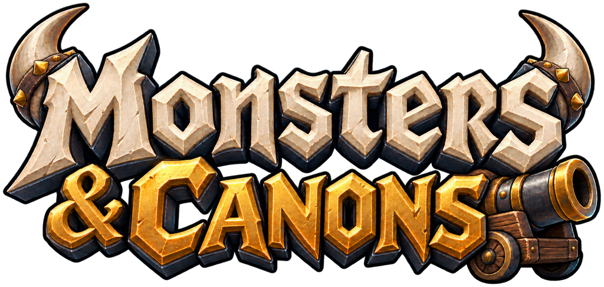
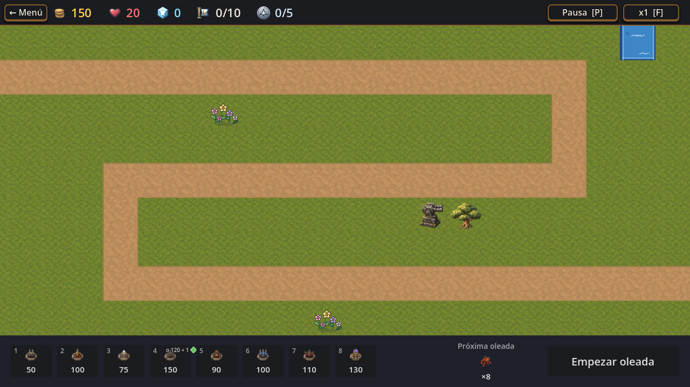
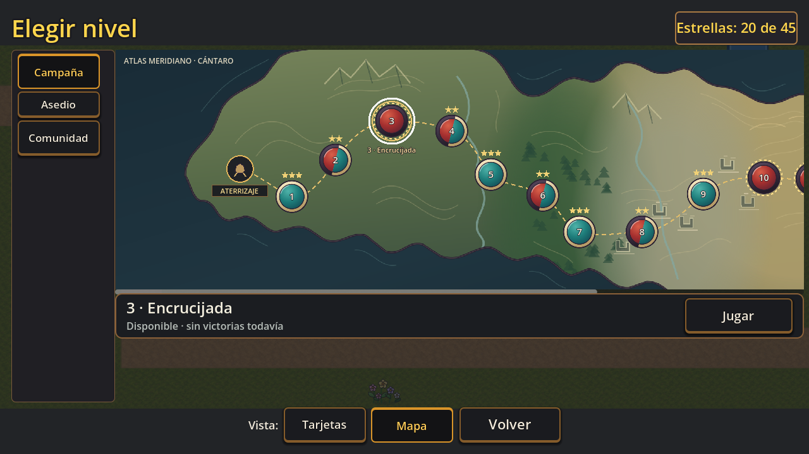
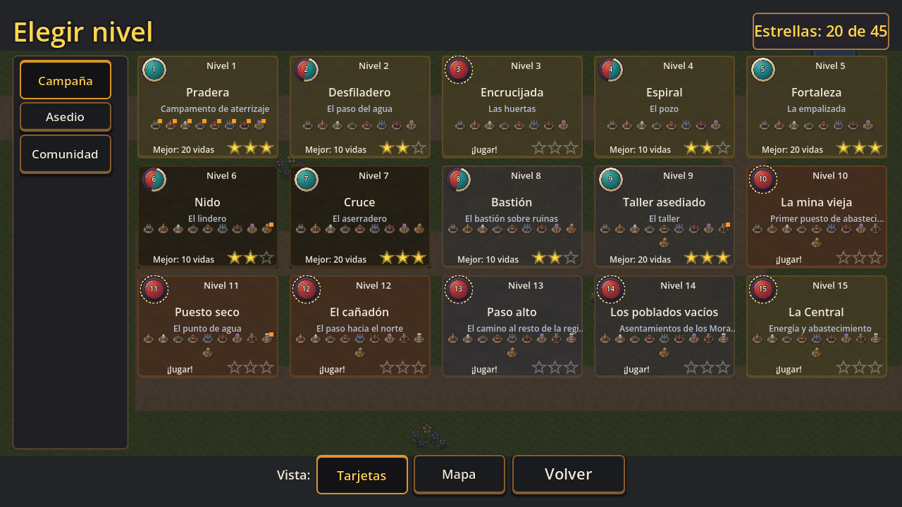
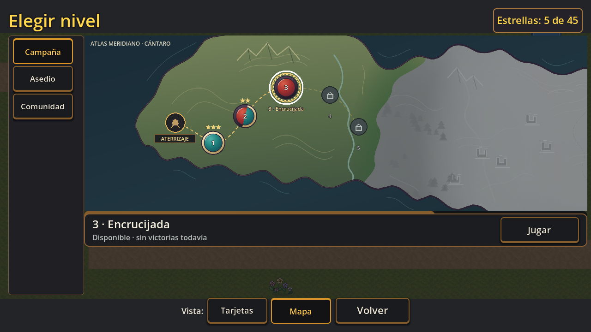

<p align="center">
  
</p>

<p align="center"><strong>Defendé Cántaro. Elegí tus torres. Aguantá cada oleada.</strong></p>

**Monsters & Canons** es un tower defense 2D de fantasía y tecnología. La colonia de Cántaro necesita resistir a criaturas que avanzan por caminos fijos: vos decidís dónde construir, qué mejorar y cómo combinar las defensas antes de que llegue la próxima oleada.

[](https://github.com/pasaporteN25/TDv1/actions/workflows/tests.yml)

El juego está en desarrollo y la V1 todavía tiene pruebas y decisiones pendientes. Lo que ves acá describe el contenido integrado hoy; no significa que haya una versión publicada o certificada para todos los dispositivos.

## Una campaña para defender Cántaro

Recorré **15 niveles** entre praderas, desiertos, nieve, volcanes, bosques, pantanos y ruinas. Cada mapa presenta caminos, oleadas y combinaciones de enemigos propias; avanzar también revela qué pasó con la colonia y sus habitantes.

En cada partida vas a poder:

- **Armar una defensa a tu manera:** elegir entre torres con alcances, ritmos de disparo y efectos distintos, y decidir cuándo mejorarlas.
- **Leer el terreno:** ubicar las torres para cubrir curvas, cruces y tramos largos sin bloquear el camino.
- **Prepararte para nuevas amenazas:** aprender qué resiste cada criatura y combinar ralentización, daño en área, electricidad y apoyo.
- **Volver por una mejor partida:** los niveles registran progreso, estrellas y récords.
- **Descubrir el mundo:** la Wiki reúne bestiario, torres, guía y relatos que se abren a medida que avanzás.

La campaña es el recorrido principal. También podés volver a jugar sus mapas en **Asedio**, con enemigos más duros, o abrir **Comunidad** para jugar mapas creados con el editor y compartidos como archivos. En PC, el editor permite diseñar mapas, preparar oleadas y probarlos; los modos propios sirven para agrupar tus mapas.

## Así se ve

### Prepará la defensa



### Elegí un destino en la campaña

| Mapa de campaña · PC | Tarjetas de nivel · PC |
|---|---|
|  |  |

### También en formato apaisado para celular



Las capturas de celular se tomaron en un escritorio con el modo móvil simulado; no son pruebas en un teléfono físico.

## Para empezar

El proyecto todavía no ofrece una descarga pública. Si querés jugar o colaborar con una copia local, consultá la [guía de instalación y uso](ONBOARDING.md). Para conocer los enemigos, torres, niveles y formatos de mapas, está la guía de [contenido](CONTENIDO.md).

## Información técnica

- **Motor:** Godot 4.7.2, con GDScript.
- **Plataformas en desarrollo:** escritorio y una interfaz adaptable a celular. La experiencia en teléfono real todavía requiere validaciones.
- **Código, datos y arte propio:** licencia GNU GPL v3 o posterior; ver [`LICENSE`](LICENSE).
- **Tests:** el proyecto usa GUT. Para correr toda la suite desde la raíz:

  ```bash
  godot --headless --import
  godot --headless -s addons/gut/gut_cmdln.gd -gdir=res://tests -gexit
  ```

  Un resultado con `SCRIPT ERROR` cuenta como fallo aunque el resumen de tests diga que pasó.

Las especificaciones, decisiones y estado detallado del desarrollo están en [`specs/`](specs/). Son documentación de trabajo, no requisitos para jugar. Para instalar herramientas, ejecutar el proyecto, exportar o contribuir, seguí [`ONBOARDING.md`](ONBOARDING.md).
