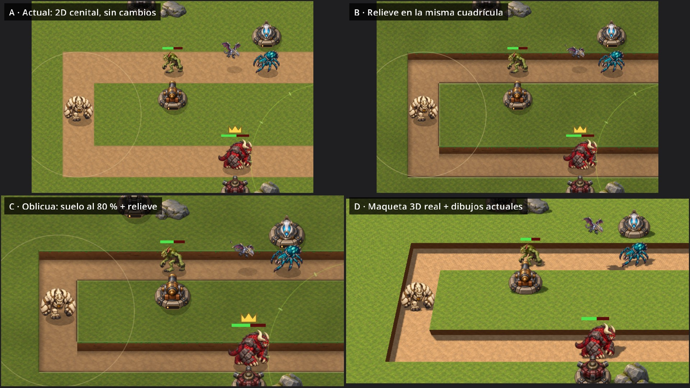
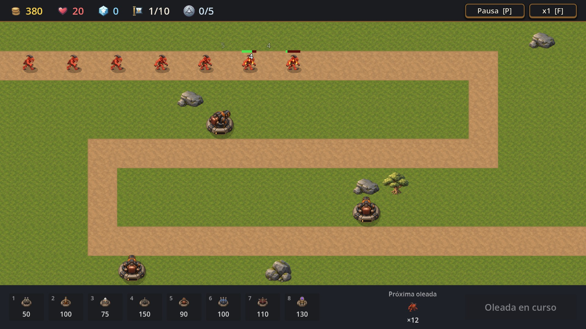
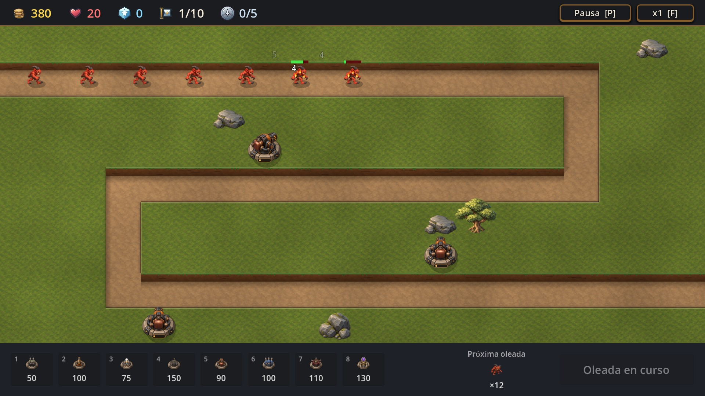
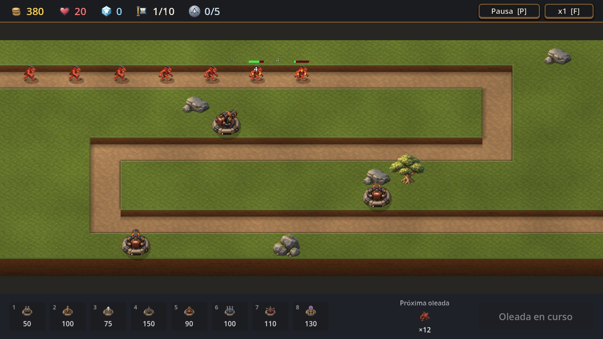
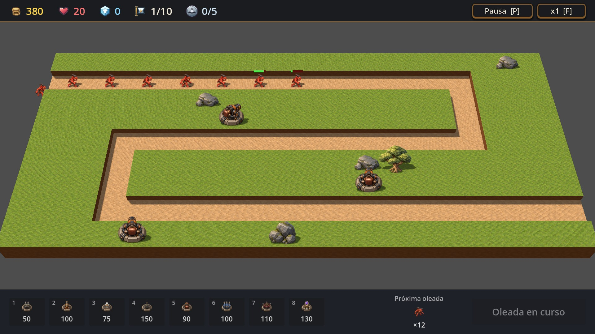

# B-21 v2 · ¿Una vista con más sensación de 3D? Nuevo análisis y pruebas

**2026-10-06 · Tarea T193 · RF-382 · D-074.** Es una investigación: **no cambia nada del juego**, ni mapas, ni guardados. Elegir una opción te toca a vos (Lucas).

> **Decisión posterior (Lucas, 2026-10-07, D-075):** el 3D no se integra en la V1; pasa a una segunda entrega, *Monsters & Canons 3D*. El concepto, una prueba de cámara libre y el plan están en [`specs/06-monsters-canons-3d.md`](../../specs/06-monsters-canons-3d.md).

## Resumen

- **Recomendación:** **no cambiar la proyección del juego**. Si querés más profundidad, la mejor relación entre lo que se gana y lo que cuesta es la **opción B (relieve en la misma cuadrícula)**, hecha por etapas que se pueden cortar en cualquier momento.
- **C (vista oblicua)** es la que más "se siente 3D" sin salir del 2D y queda como alternativa si te gusta más. Cuesta el doble que B y es un *breaking change*: cambia la cámara y obliga a corregir todo lo que está de pie.
- **D (maqueta 3D real)** es la más vistosa, pero para este juego **no conviene**. Implica rehacer cómo se dibuja todo (semanas de trabajo), achica las casillas del fondo un 40 % y su rendimiento en celular es una incógnita.
- **Dejarlo como está (A)** también es una opción válida. El juego ya se lee muy bien, y ese tiempo puede ir al contenido (B-22, niveles 10 a 15).


## Por qué rehacer el análisis

El estudio de M36 ([`B21-profundidad.md`](../redesign-m36/B21-profundidad.md)) fue rápido y sus muestras no alcanzaban para decidir:

- No tenían monstruos, interfaz ni vista previa de construcción: solo el suelo y tres íconos de torre.
- El "relieve" era una franja oscura de 8 px debajo del tablero.
- La "oblicua" deformaba el mapa en un paralelogramo (una inclinación lateral). Eso no es una vista oblicua de cámara.
- La "3D" era una foto del suelo pegada en un plano y girada en diagonal, sin relieve ni luz.
- Los costos se estimaron sin medir: ni rendimiento, ni clics, ni tamaño de las casillas.

## Cómo se probó

Todo sale de un laboratorio nuevo, [`vista_lab.tscn`](vista_lab.gd), que usa **la partida real** (la misma escena `game.tscn`, el mismo HUD y las mismas reglas) y le cambia solo la presentación:

- **Escena de referencia, igual en las cuatro vistas:** nivel 1 (Pradera), 7 torres (algunas al sur del camino, para que los monstruos pasen *detrás*, y otras al norte, para que pasen *delante*), 14 monstruos de todos los tamaños (con el Soberano y un volador), varios heridos (se ven las barras de vida) y la **vista previa de construcción** de la Incendiaria con su alcance.
- **Capturas:** las cuatro vistas completas y un recorte ampliado de la misma zona (Cañón, fila 4 y vuelta de la fila 7).
- **Medidas:** tamaño de una casilla en pantalla (fila de arriba y de abajo), qué parte del área de mapa ocupa el tablero y una prueba de clics de ida y vuelta (casilla → pantalla → casilla) en el centro y cerca de los cuatro bordes de las 123 casillas construibles: 615 clics por vista.
- **Rendimiento:** la carga de la constitución (P7) igual que `tools/perf_test.gd`: 200 monstruos, 60 torres disparando, números de daño y 15 muertes por segundo. Tres rondas por configuración, más una corrida de calentamiento descartada.
- **Jugar:** cada vista se puede jugar entera (nivel 1). Una autoprueba elige una torre con el teclado, construye tres (en D, con clics simulados que pasan por la cámara 3D), sale con Escape, lanza la oleada 1 y saca una foto en pleno combate.

## Las cuatro opciones

| | Qué cambia | Qué **no** cambia |
|---|---|---|
| **A · Actual** | Nada: suelo visto desde arriba, dibujos en perspectiva elevada. | — |
| **B · Relieve en la misma cuadrícula** | El camino queda **hundido**: se ve el talud de tierra en su borde norte, el pasto proyecta sombra hacia el sureste (la luz viene de arriba a la izquierda, como en torres y monstruos) y el borde sur tiene un labio iluminado. Manchas suaves de luz rompen la repetición del pasto. Torres, monstruos y decoración se **ordenan por profundidad** (el que está más abajo tapa al de atrás). Los árboles son un poco más altos. | Las casillas, los clics, los caminos, los alcances, la cámara, los mapas y los guardados. |
| **C · Oblicua (suelo al 80 %)** | Lo de B, y además la cámara "se inclina": el suelo se ve al 80 % de su alto, como mirado desde unos 53°, y aparece el canto delantero del tablero, como una maqueta. Todo lo que está de pie (torres, monstruos, árboles) se estira al revés para no verse aplastado. | La lógica y los datos. Los clics funcionan sin tocar el código de construcción: Godot deshace solo la transformación de la cámara. |
| **D · Maqueta 3D real** | Terreno con geometría de verdad (camino hundido, pasto elevado, canto del tablero), sol con **sombras reales** y cámara en perspectiva. Torres, monstruos, decoración y proyectiles son los dibujos actuales, en planos que miran a la cámara. | La lógica: la partida 2D sigue corriendo, oculta, y la maqueta copia posiciones y animaciones en cada cuadro. Los clics pasan por un rayo de la cámara. |

### De cerca (misma zona en las cuatro vistas)



En **B** y **C** el Soberano (fila 7) queda **detrás** de la torre de Ráfaga que está al sur: el orden por profundidad funciona. En **A** los monstruos siempre se dibujan encima de las torres, estén delante o detrás. En **D** pasa lo mismo que en B y C, pero con la profundidad real de la placa de video.

### En pleno combate (autoprueba, oleada 1)

| A | B |
|---|---|
|  |  |
| **C** | **D** |
|  |  |

En **D** no se ven los números de daño ni las llamas: los efectos no están portados, porque en 2D no coincidirían con la perspectiva. También se ve a los monstruos entrar flotando por el borde del tablero. Una versión real necesitaría una rampa o un túnel de entrada.

Vistas completas: [A](vista_a.jpg) · [B](vista_b.jpg) · [C](vista_c.jpg) · [D](vista_d.jpg).

## Resultados medidos

### Casillas, superficie y clics ([`medidas.json`](medidas.json))

| | Casilla arriba (px) | Casilla abajo (px) | Tablero / área de mapa | Clics en la casilla correcta |
|---|---|---|---|---|
| A | 64 × 64 | 64 × 64 | 100 % | 615 / 615 |
| B | 64 × 64 | 64 × 64 | 100 % | 615 / 615 |
| C | 64 × 51 | 64 × 51 | 80 % | 615 / 615 |
| D | **53 × 38** | 64 × 56 | **66 %** | 615 / 615 (con código nuevo de rayo) |

Píxeles lógicos (pantalla de 1280 × 720). En un celular de 6,1" apaisado, 64 px son unos 5,8 mm de dedo, 51 px unos 4,6 mm y 38 px unos 3,4 mm. Es una cuenta aproximada, no se midió en un teléfono. Las guías de Android piden unos 7 a 9 mm, así que ya hoy estamos por debajo, y C y D empeoran ese número.

### Rendimiento ([`rendimiento.txt`](rendimiento.txt))

AMD Radeon RX 6900 XT, ventana de 1920 × 1080, renderizador GL Compatibility (el mismo del juego), vsync apagado. Promedio de 3 rondas:

| Configuración | FPS | ms por cuadro | p95 (ms) | Cuadros > 16,6 ms |
|---|---|---|---|---|
| A · actual | 92 | 10,8 | 17,1 | ~6 % |
| B · relieve dibujado en cada cuadro | 73 | 13,7 | 18,5 | ~15 % |
| **B · relieve horneado** (como sería en producción) | **92** | **11,0** | 17,3 | ~7 % |
| B · horneado, sin orden por profundidad | 92 | 10,9 | 17,2 | ~6 % |
| **C · horneado** | **95** | **10,5** | 16,7 | ~5 % |
| D · maqueta 3D (versión final) | 203 | 4,9 | 7,8 | ~0 % |
| *Control: A sin dibujar torres ni monstruos* | *520* | *1,9* | *4,2* | *0 %* |
| *`tools/perf_test.gd` oficial, mismas condiciones* | *91–93* | — | — | *~2 %* |

Cómo leer la tabla:

- **El relieve no cuesta nada si se "hornea".** Dibujado en cada cuadro suma unos 3 ms, porque son miles de polígonos y líneas. Como el suelo no cambia durante la partida, en producción se dibuja una sola vez en una textura, y así B rinde igual que A. Las fotos con y sin horneado se ven iguales.
- **Ordenar por profundidad no cuesta nada medible** (B horneado con y sin orden: 11,0 contra 10,9 ms).
- **El número de D engaña.** El control lo explica: hoy unos **9 de los ~11 ms** de cada cuadro se van en *dibujar* torres y monstruos en 2D (cada uno se redibuja entero, con sombra, barra, auras e íconos). La maqueta 3D omite casi todos esos detalles (coronas, auras, escarcha, llamas, placas de nivel, parpadeo de golpe), por eso tarda menos. Lo que sí demuestra es que **el 3D no es un problema en esta PC**: terreno, sombras y 260 dibujos cuestan unos 3 ms. No dice nada del celular.

### Autoprueba jugando

Las cuatro vistas: la tecla 5 elige la Incendiaria, se construyen **3 de 3** torres (en D, por clic simulado sobre la pantalla), Escape cierra el modo construcción, la oleada 1 corre con 8 monstruos en pantalla y no aparece ningún `SCRIPT ERROR`.

## Evaluación por criterio (lo que pedía B-21)

| Criterio | B · relieve | C · oblicua | D · 3D real |
|---|---|---|---|
| **Orden de dibujo y oclusiones** | Mejora: delante/detrás correcto. Las barras de vida, coronas e íconos tienen que ir en una capa superior, si no un monstruo grande detrás de una torre puede quedar tapado. | Igual que B. | Correcto por profundidad real. Las barras se dibujan en 2D sobre la proyección (ya está probado acá). |
| **Alineación de bases y caminos** | Exacta: nada se mueve de su casilla. | Exacta en la cuadrícula; lo de pie se estira 1,25 en vertical. | Bien. Las bases quedan apoyadas en el pasto elevado y los monstruos en el camino hundido. |
| **Selección y construcción** | Sin cambios. | Sin cambios de código (615/615). Hay que enderezar la torre fantasma, que hoy sale aplastada. | Código nuevo: rayo de la cámara al plano del pasto (615/615 en la prueba). La vista previa (casilla, fantasma y alcance) ya está hecha en el prototipo. |
| **Cámara y tamaño de mapas** | Sin cambios. | Hay que adaptar el zoom de mapas grandes (RF-251) al 80 %. Sobra alto de pantalla en los mapas de 20 × 9, que habría que llenar con un fondo por tema. | Perspectiva: las casillas del fondo miden 53 × 38 px y el tablero usa el 66 % del área. Cada tamaño de mapa necesita su encuadre. |
| **Interfaz (HUD, panel, Wiki)** | Sin cambios. | Sin cambios; el mapa ocupa menos alto. | El HUD sigue igual. Barras, coronas, números y avisos se reescriben como capa 2D proyectada. |
| **Proyectiles y efectos** | Sin cambios. | Hay que estirarlos al revés uno por uno; los que giran (flechas, rayos) no quedan exactos solo con eso. Es un cálculo, no lo revisé en imagen. | Todos se rehacen en 3D: arcos del Mortero, rayos, anillos, disolución, fragmentos, números. Hoy solo están los proyectiles. |
| **Rendimiento en escritorio** | Igual que A si se hornea. | Igual que A si se hornea. | Bien en esta PC. |
| **Celular** | Igual que A. El horneado ocupa unos 4 MB de memoria a 1× y unos 16 MB a 2× (con mipmaps); conviene hornearlo a la resolución de la pantalla. | Casillas un 20 % más bajas. | Casillas del fondo un 40 % más bajas. Las sombras en tiempo real con GL Compatibility en Android son el mayor riesgo, y no se midieron. |
| **Mapas y guardados** | Compatibles, sin cambios. | Compatibles. | Compatibles: la lógica sigue en casillas. |
| **Editor de mapas** | Puede seguir viéndose desde arriba o mostrar el relieve horneado. | Puede seguir desde arriba (es más fácil editar así). | Tiene que seguir desde arriba. |
| **Arte** | Taludes y suelos de la leyenda (agua, hielo, lava, barro) por tema: 7 paletas. La decoración ya trae su sombra suave. | Lo de B más el canto y el fondo del tablero por tema. | Los dibujos traen la luz pintada y el sol 3D agrega otra. En la decoración se duplica la sombra (la pintada más la real). |
| **¿Breaking change?** | No. | Sí: cambia la cámara (PR separado, como pide B-21). | Sí, total: es otra forma de dibujar el juego. |

## Costo estimado

Días de trabajo de una sesión, con pruebas, capturas para tu revisión y documentos:

| Opción | Costo | Qué incluye |
|---|---|---|
| A | 0 | — |
| **B** | **4 a 6 días** | Relieve horneado de verdad (no este prototipo), paletas de taludes para los 7 temas y los suelos de la leyenda, decoración como objetos, orden por profundidad con capa superior para barras, coronas e íconos, tests (el relieve no cambia qué se construye ni los caminos), revisión visual y rendimiento. |
| C | B + 5 a 8 días | Cámara y zoom para todos los tamaños de mapa; enderezar torres, monstruos, decoración, proyectiles, efectos, números y torre fantasma; canto y fondo del tablero por tema; tests de clics con zoom; PR marcado como *breaking change*. |
| D | 4 a 8 semanas | Una capa de presentación nueva: terreno por tema, torres (base, torreta, placa, brillo de mejora, aturdimiento), monstruos (parpadeo, frío, fuego, auras, disolución), proyectiles y los 10 efectos en 3D, sombreadores portados, selección por rayo también para monstruos, encuadre por mapa, editor y prueba en celular. |

Para comparar, el estudio de M36 estimaba relieve 3–6 días, oblicua 8–15 y 2.5D 15–30. Estos números ya se apoyan en prototipos que funcionan.

## ¿Conviene aplicarlo en este juego? (incluida la opción de no hacerlo)

**El arte ya está pensado en 3/4.** Las torres y los monstruos están pintados desde una cámara elevada; lo único que se ve "desde arriba" es el suelo. Por eso C se ve tan coherente: inclina el suelo hasta el ángulo de los dibujos. B consigue parte de eso sin mover nada, con el mismo truco que usan muchos juegos 2D (taludes y sombras pintados).

**En un tower defense manda la lectura.** Primero tenés que ver el camino, el alcance y qué monstruo es cuál. A es lo más claro. B conserva todo eso. C y D pagan la profundidad con superficie de mapa y tamaño de toque, justo lo que más importa en celular.

**El costo de D no se justifica acá.** Sería reescribir cómo se dibuja todo el juego para ganar belleza. Pierde legibilidad, el celular es incierto y todo lo que sumemos después (Excavador, Ballesta, Alquimista, niveles 10 a 15) costaría más, porque cada efecto habría que hacerlo en 3D. Tendría sentido en un juego nuevo pensado en 3D desde el principio.

**Propuesta concreta, si querés avanzar: B por etapas**, con tu revisión entre cada una:

1. **Orden por profundidad y decoración como objetos**, con una capa superior para barras, coronas e íconos. Arregla que los monstruos se dibujen encima de torres que tienen delante. Es chico y no cambia el aspecto general.
2. **Relieve horneado del camino en la Pradera**: taludes, sombra y luz suave. Lo mirás jugando antes de seguir.
3. **Extenderlo a los otros 6 temas** y a los suelos de la leyenda.

Si después de verlas te quedás con **C**, B es su base: se hace B y después C en un PR aparte, marcado como *breaking change* y sin mergear hasta que lo apruebes (como dice B-21). Si preferís **dejarlo así (A)**, se cierra B-21 como "estudiado, no se adopta" y no se pierde nada.

## Lo que no se probó (límites honestos)

- **Ningún celular.** No hay medidas de rendimiento, memoria ni toque en Android o iOS. Los milímetros de arriba son una cuenta aproximada.
- **Un solo tema (Pradera) y un solo mapa de 20 × 9.** No hay taludes para los otros temas ni para los suelos de la leyenda, y no se probó un mapa grande con zoom.
- **El relieve, el fondo y la maqueta son arte de prototipo**, generado por código; no es arte final ni pasó por la guía de arte.
- **C:** la torre fantasma sale aplastada y los efectos no están corregidos. **D:** faltan efectos, coronas, auras, escarcha, llamas, placas de nivel, brillo de mejora, aturdimiento y disolución. Los monstruos entran flotando por el borde, no se pueden seleccionar monstruos y la decoración tiene sombra doble.
- **Todo se midió en una sola PC muy potente.** Los números absolutos no se trasladan a otras máquinas; sirven para comparar entre vistas.
- Al cerrar el laboratorio, Godot avisa de 2 objetos sin liberar. Es del prototipo, no del juego.

## Cómo reproducirlo

Desde la carpeta del proyecto. Conviene apuntar `APPDATA` a una carpeta temporal para no mezclar registros; los guardados ya van aparte, a `user://test_b21_vista.json`. Para jugar cada vista (cambiá la letra):

```bash
godot --path . res://art/b21-vista/vista_lab.tscn -- jugar variante=C
```

Fotos, medidas y rendimiento:

```bash
godot --path . res://art/b21-vista/vista_lab.tscn -- capturas
```

```bash
godot --path . res://art/b21-vista/vista_lab.tscn -- medidas
```

```bash
godot --path . res://art/b21-vista/vista_lab.tscn -- rendimiento variante=B horneado
```

Otras opciones: `solo=B` (una sola foto), `sin_orden` (sin orden por profundidad), `ocultar_actores` (el control de rendimiento) y `autoprueba` (junto con `jugar`). El modo `camara` (agregado en T194) orbita la maqueta 3D y saca seis vistas.

## Hallazgo aparte (no implementado)

Medir D dejó ver que **dibujar torres y monstruos en 2D se lleva unos 9 de los ~11 ms de cada cuadro** con la carga de P7. Hoy sobra margen en PC (92 FPS), pero en celular podría ser lo primero que conviene aligerar. Quedó anotado en "Sugerencias de Claude" (spec §13) para consultarte; no se tocó nada.

## Archivos

| Archivo | Qué es |
|---|---|
| [`vista_lab.gd`](vista_lab.gd) / `vista_lab.tscn` | El laboratorio: capturas, medidas, rendimiento y jugar. |
| [`relief_layer.gd`](relief_layer.gd) | Relieve en la misma cuadrícula (B y C). |
| [`diorama_3d.gd`](diorama_3d.gd) | Maqueta 3D (D): terreno, luz, dibujos, barras, vista previa y clics por rayo. |
| [`d_input.gd`](d_input.gd) | En D, pasa la entrada del mapa al laboratorio antes que la partida. |
| `comparacion_vistas.jpg`, `comparacion_detalle.jpg` | Las cuatro vistas y el recorte de detalle. |
| `vista_a.jpg` … `vista_d.jpg` | Cada vista completa, a 1920 × 1080. |
| `jugar_a.jpg` … `jugar_d.jpg` | Fotos en pleno combate de la autoprueba. |
| `medidas.json`, `rendimiento.txt` | Medidas de interacción y mediciones crudas. |
| `camara_pruebas.jpg`, `camara_1.jpg` … `camara_6.jpg` | Prueba de cámara libre (T194). |
