# T475 · Paquete de propuesta de postes de campaña

**APROBADO EN BLOQUE por Lucas el 2026-10-25** («Atlas + los 20 postes tal cual», respuesta en sesión tras revisar el HTML con los 15 planos; incluye las casillas de borde o sobre señal existente de los niveles 2, 4, 8 y 9). No hay aprobaciones por mapa separadas: la aprobación es una sola, en bloque. Paquete generado el 2026-10-25 por `tools/t475_planos_postes.py` sobre `origin/main` 9ce9e18.

**Estado de la integración (2026-10-28, tercer paso de T475): los 20 postes están integrados (15 niveles).** En los niveles 8 y 9 la casilla aprobada `(0, 4)` es el símbolo de ruina canónico y el poste lo tapaba por completo (`Capturas/T475-nivel08-poste-tapaba-senal-ampliado.png`); **decisión de Lucas del 2026-10-28:** el poste va en la candidata C1, la casilla `(18, 1)`, en ambos niveles (análisis en `art/t475-casillas-8-y-9/index.md`), y esa casilla pasa de `.` a `X` (**no construible**) en `data/levels/level_08.json` y `level_09.json`: es lo único que cambia en esos dos JSON respecto de «antes» (hashes nuevos abajo). Ver `specs/tareas/informes/T475-integracion-postes.md`.

## Cómo leerlo

- Coordenadas `(x, y)` desde 0, origen arriba a la izquierda.
- Cada nivel tiene `nivel_NN_plano.png` (grilla completa con coordenadas, camino, entradas/salida, construibles, removibles, extracciones, decoración y señales) y `nivel_NN_contexto.png` (9×7 casillas ampliadas alrededor de cada candidato).
- Son **planos de la grilla leída de los JSON**, no capturas del motor. El sprite del poste enemigo existente se pega solo como referencia de tamaño; la integración real puede verse distinta.
- Clasificación (replica `MapGrid`/`LevelFile`): `bloqueada` = `X`; `decoración`/`señal` = letra de leyenda con `dibujo` y sin `construible`/`removible`/`extraccion` (MapGrid la trata como bloqueada); `señal` = `roca_marcada`, `simbolo_ruina`, `campamento_vacio`, `sendero`, `herramienta`.
- «Margen» = casillas hasta el borde más cercano del mapa (0 = casilla de borde). `LevelDecor` dibuja los objetos dentro de su casilla (`level_decor.gd`, líneas 75-77), así que un poste de tamaño de casilla no se corta en el borde; igual hace falta confirmarlo en una captura del motor.
- Los candidatos descartados quedan anotados (no se borra historial); su reemplazo está verificado con las mismas comprobaciones.

## Resumen

- 20 candidatos vigentes (1 por nivel en 1–10, 2 en 11–15). Los 20 de la ficha existen y son permanentemente no construibles; ninguno cae en agua, hielo, removible, extracción, camino, entrada, salida o casilla libre.
- **3 candidatos cambiaron** por margen de borde 0 con reemplazo verificado: nivel 12 `(5,0)` → `(5,2)`; nivel 13 `(24,0)` → `(23,2)` y `(24,11)` → `(24,9)`.
- **4 candidatos sin reemplazo posible dentro de los datos**: niveles 4, 8 y 9 (margen de borde 0) y nivel 2 (ocuparía la columna existente). Se mantienen marcados como riesgo y requieren decisión de Lucas; cambiar la grilla exigiría su OK explícito y queda fuera de esta tarea.

## Por nivel

### Nivel 1 · Pradera (20×9)

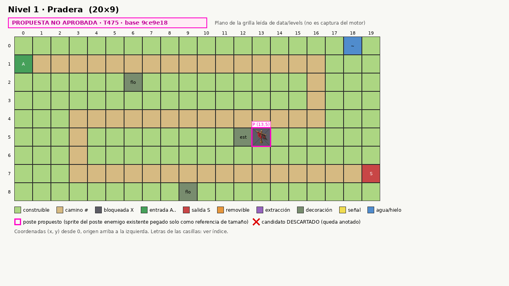  
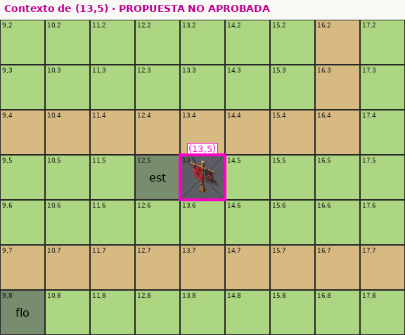

| Candidato | Estado | Origen | Tipo de casilla | Vecinas (N/E/S/O) | Margen | Cercano (≤2) | Riesgo | Recomendación | OK de Lucas |
|---|---|---|---|---|---|---|---|---|---|
| `(13, 5)` | propuesta | Ficha | `X` bloqueada | N: camino, E: construible, S: construible, O: decoracion:estatua | 3 | — | Bajo. Pegada a la estatua (12,5), que no se pisa, y bajo el camino (13,4). | Aprobar tras ver captura del motor. | Aprobado 2026-10-25, en bloque, tras revisar el plano de cada nivel en el HTML de revisión |

### Nivel 2 · Desfiladero (20×9)

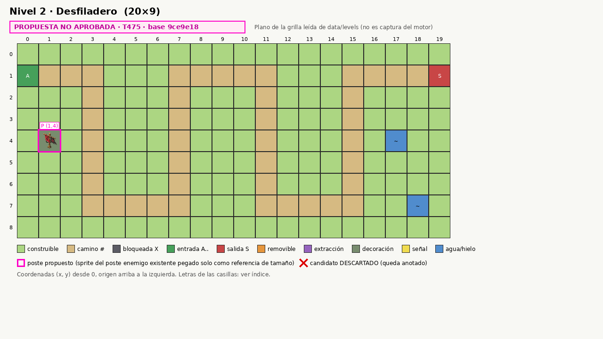  
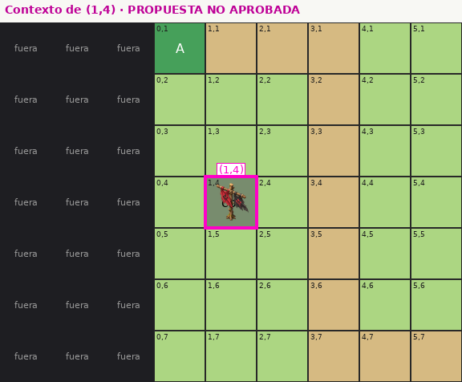

| Candidato | Estado | Origen | Tipo de casilla | Vecinas (N/E/S/O) | Margen | Cercano (≤2) | Riesgo | Recomendación | OK de Lucas |
|---|---|---|---|---|---|---|---|---|---|
| `(1, 4)` | propuesta | Ficha | `s` decoracion (columna) | N: construible, E: construible, S: construible, O: construible | 1 | — | Alto. La casilla ES la columna `s`: el poste se superpondría a un dibujo existente. Margen 1. Es la única casilla no agua y no construible del mapa; no hay reemplazo sin tocar `data/`. | Lucas decide: superponer a la columna o aprobar aparte un ajuste de datos. No avanzar sin OK. | Aprobado 2026-10-25, en bloque, tras revisar el plano de cada nivel en el HTML de revisión |

### Nivel 3 · Encrucijada (20×9)

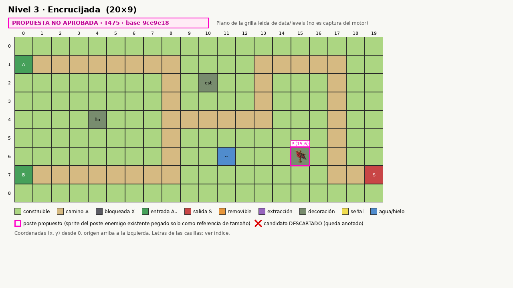  
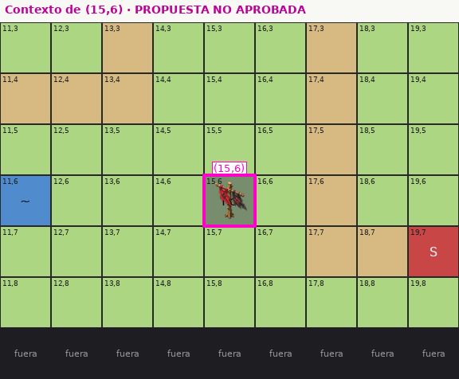

| Candidato | Estado | Origen | Tipo de casilla | Vecinas (N/E/S/O) | Margen | Cercano (≤2) | Riesgo | Recomendación | OK de Lucas |
|---|---|---|---|---|---|---|---|---|---|
| `(15, 6)` | propuesta | Ficha | `,` decoracion (flores) | N: construible, E: construible, S: construible, O: construible | 2 | — | Bajo-medio. Cubre las flores (decoración); al este está el camino (17,6) a dos casillas. | Aprobar tras captura (revisar que las flores no asomen). | Aprobado 2026-10-25, en bloque, tras revisar el plano de cada nivel en el HTML de revisión |

### Nivel 4 · Espiral (20×9)

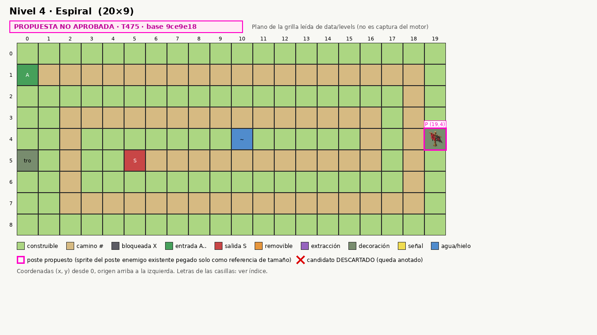  
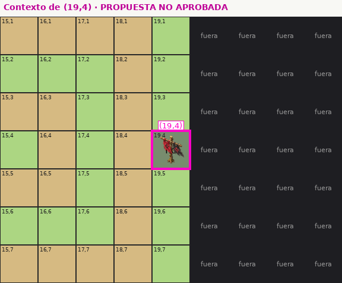

| Candidato | Estado | Origen | Tipo de casilla | Vecinas (N/E/S/O) | Margen | Cercano (≤2) | Riesgo | Recomendación | OK de Lucas |
|---|---|---|---|---|---|---|---|---|---|
| `(19, 4)` | propuesta | Ficha | `,` decoracion (flores) | N: construible, E: fuera del mapa, S: construible, O: camino | 0 | — | Medio. Margen de borde 0 (última columna), camino pegado al oeste (18,4) y sin alternativa en datos: las únicas otras bloqueadas son el tronco (0,5), también en el borde, y el agua. LevelDecor dibuja los objetos dentro de su casilla, así que en principio no se corta, pero falta verlo en el motor. | Lucas decide con captura del motor; si se corta, ajuste de datos aparte. | Aprobado 2026-10-25, en bloque, tras revisar el plano de cada nivel en el HTML de revisión |

### Nivel 5 · Fortaleza (20×9)

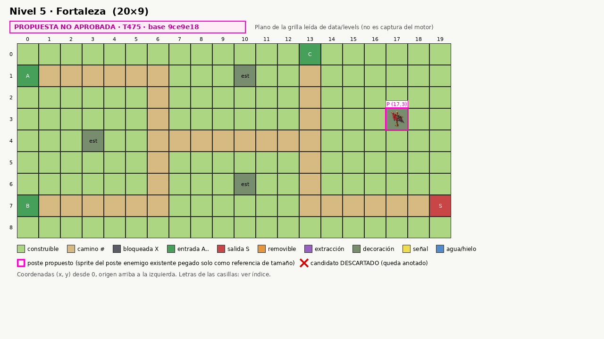  
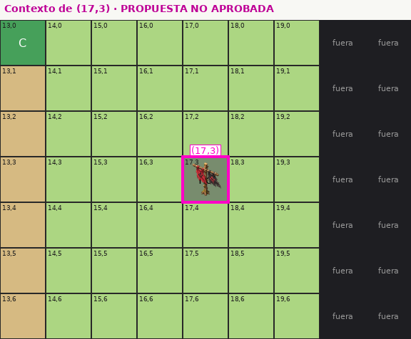

| Candidato | Estado | Origen | Tipo de casilla | Vecinas (N/E/S/O) | Margen | Cercano (≤2) | Riesgo | Recomendación | OK de Lucas |
|---|---|---|---|---|---|---|---|---|---|
| `(17, 3)` | propuesta | Ficha | `,` decoracion (flores) | N: construible, E: construible, S: construible, O: construible | 2 | — | Bajo. Flores aisladas al este, a 4 casillas del camino (13,3). | Aprobar tras captura. | Aprobado 2026-10-25, en bloque, tras revisar el plano de cada nivel en el HTML de revisión |

### Nivel 6 · Nido (20×9)

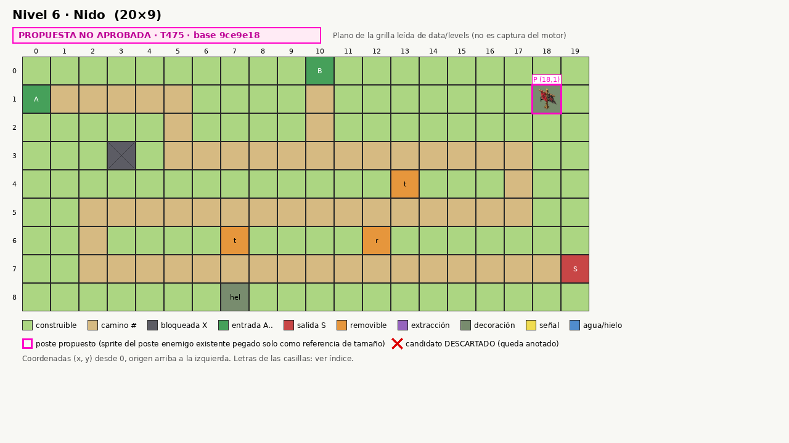  
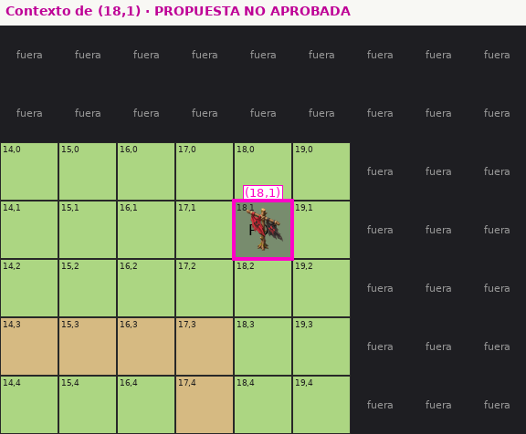

| Candidato | Estado | Origen | Tipo de casilla | Vecinas (N/E/S/O) | Margen | Cercano (≤2) | Riesgo | Recomendación | OK de Lucas |
|---|---|---|---|---|---|---|---|---|---|
| `(18, 1)` | propuesta | Ficha | `p` decoracion (poste_cintas) | N: construible, E: construible, S: construible, O: construible | 1 | — | Bajo. Ya es el poste `p` (`poste_cintas`); solo cambia la regla de estrellas (RF-696), no la posición. | Conservar la posición; aprobar. | Aprobado 2026-10-25, en bloque, tras revisar el plano de cada nivel en el HTML de revisión |

### Nivel 7 · Cruce (20×9)

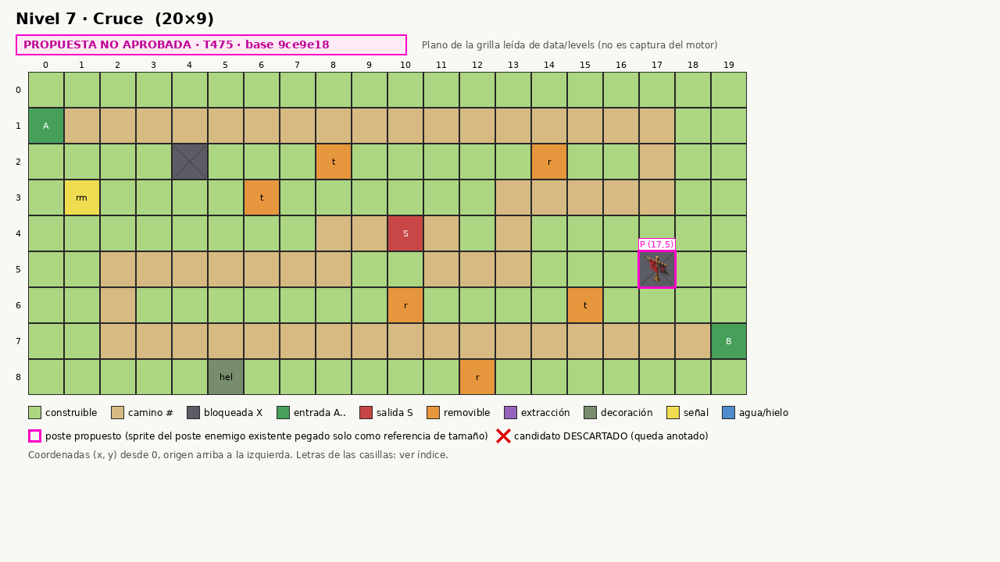  
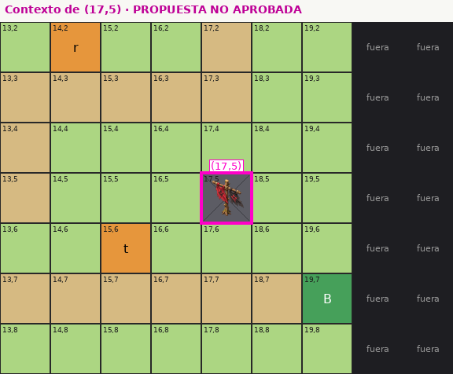

| Candidato | Estado | Origen | Tipo de casilla | Vecinas (N/E/S/O) | Margen | Cercano (≤2) | Riesgo | Recomendación | OK de Lucas |
|---|---|---|---|---|---|---|---|---|---|
| `(17, 5)` | propuesta | Ficha | `X` bloqueada | N: construible, E: construible, S: construible, O: construible | 2 | removible:arbol (15,6); entrada (19,7) | Bajo-medio. Bloqueada `X` del este; el árbol removible (15,6) y la entrada B (19,7) quedan a 2 casillas, ninguno pisado. | Aprobar tras captura. | Aprobado 2026-10-25, en bloque, tras revisar el plano de cada nivel en el HTML de revisión |

### Nivel 8 · Bastión (20×9)

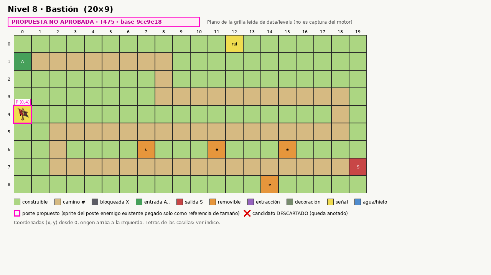  
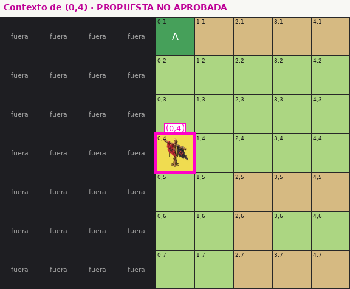

| Candidato | Estado | Origen | Tipo de casilla | Vecinas (N/E/S/O) | Margen | Cercano (≤2) | Riesgo | Recomendación | OK de Lucas |
|---|---|---|---|---|---|---|---|---|---|
| `(0, 4)` | propuesta | Ficha | `s` senal (simbolo_ruina) | N: construible, E: construible, S: construible, O: fuera del mapa | 0 | — | Medio-alto. Es el símbolo de ruina `s` (señal canónica) y está en el borde (margen 0). Las únicas casillas bloqueadas permanentes del mapa son las dos señales `s`, ambas en el borde: no hay reemplazo sin tocar `data/`. | Lucas decide si el poste puede ir sobre la señal; si no, ajuste de datos aparte. | Aprobado 2026-10-25 en bloque, **reemplazada el 2026-10-28**: el poste tapaba la señal; descartada |
| `(18, 1)` | **elegida** | Candidata C1 (`art/t475-casillas-8-y-9/`) | `X` bloqueada (antes `.` libre; Lucas la volvió `X` el 2026-10-28) | N: construible, E: construible, S: construible, O: construible | 1 | camino a 2 casillas (fila 3); sin señales ni removibles cerca | Bajo: no construible, así que ninguna torre tapa el poste. Cambia el JSON del nivel (una casilla). | Integrada. | Lucas, 2026-10-28, decisión en sesión: poste en C1 `(18, 1)` en el nivel 8 (casilla libre; el mismo día Lucas decidió hacerla `X`, no construible, para que una torre no tape el poste). |

### Nivel 9 · Taller asediado (20×9)

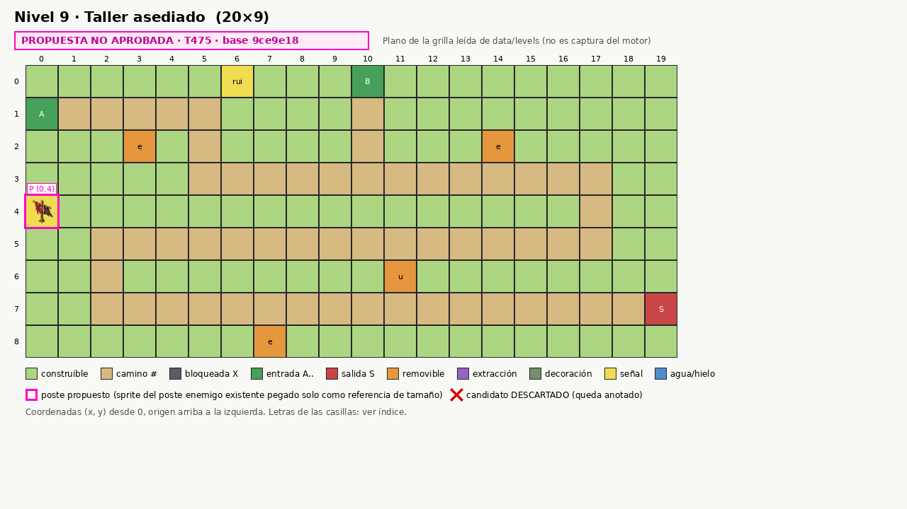  
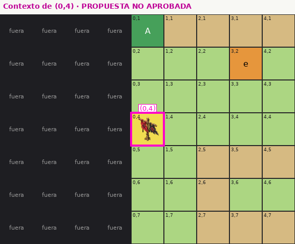

| Candidato | Estado | Origen | Tipo de casilla | Vecinas (N/E/S/O) | Margen | Cercano (≤2) | Riesgo | Recomendación | OK de Lucas |
|---|---|---|---|---|---|---|---|---|---|
| `(0, 4)` | propuesta | Ficha | `s` senal (simbolo_ruina) | N: construible, E: construible, S: construible, O: fuera del mapa | 0 | — | Medio-alto. Igual que el nivel 8: señal `s` en el borde (margen 0); la otra `s` (6,0) también es borde. Sin reemplazo posible sin tocar `data/`. | Lucas decide; igual que nivel 8. | Aprobado 2026-10-25 en bloque, **reemplazada el 2026-10-28**: el poste tapaba la señal; descartada |
| `(18, 1)` | **elegida** | Candidata C1 (`art/t475-casillas-8-y-9/`) | `X` bloqueada (antes `.` libre; Lucas la volvió `X` el 2026-10-28) | N: construible, E: construible, S: construible, O: construible | 1 | camino a 2 casillas (fila 3); sin señales ni removibles cerca | Bajo: no construible, así que ninguna torre tapa el poste. Cambia el JSON del nivel (una casilla). | Integrada. | Lucas, 2026-10-28, decisión en sesión: poste en C1 `(18, 1)` en el nivel 9 (casilla libre; el mismo día Lucas decidió hacerla `X`, no construible, para que una torre no tape el poste). |

### Nivel 10 · La mina vieja (24×11)

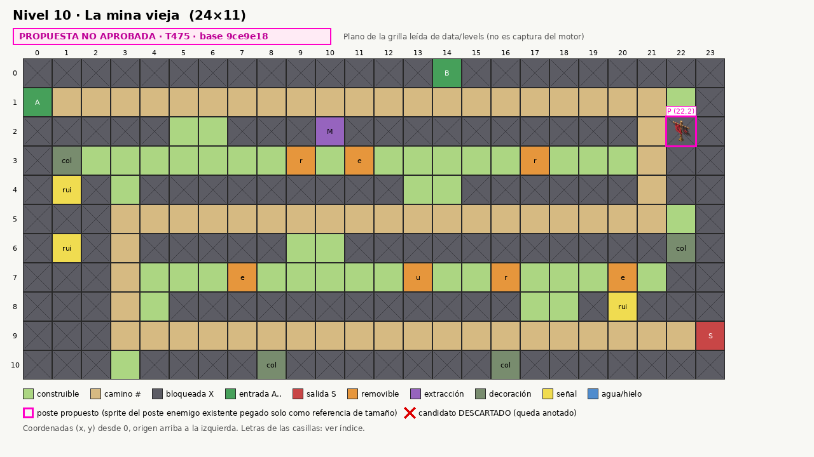  
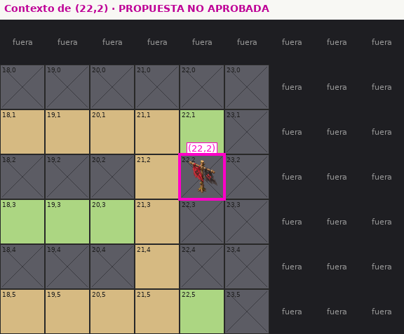

| Candidato | Estado | Origen | Tipo de casilla | Vecinas (N/E/S/O) | Margen | Cercano (≤2) | Riesgo | Recomendación | OK de Lucas |
|---|---|---|---|---|---|---|---|---|---|
| `(22, 2)` | propuesta | Ficha | `X` bloqueada | N: construible, E: bloqueada, S: bloqueada, O: camino | 1 | — | Bajo. Bloqueada `X` junto al camino (21,2); la mina (10,2) y las ruinas quedan lejos. | Aprobar tras captura. | Aprobado 2026-10-25, en bloque, tras revisar el plano de cada nivel en el HTML de revisión |

### Nivel 11 · Puesto seco (24×11)

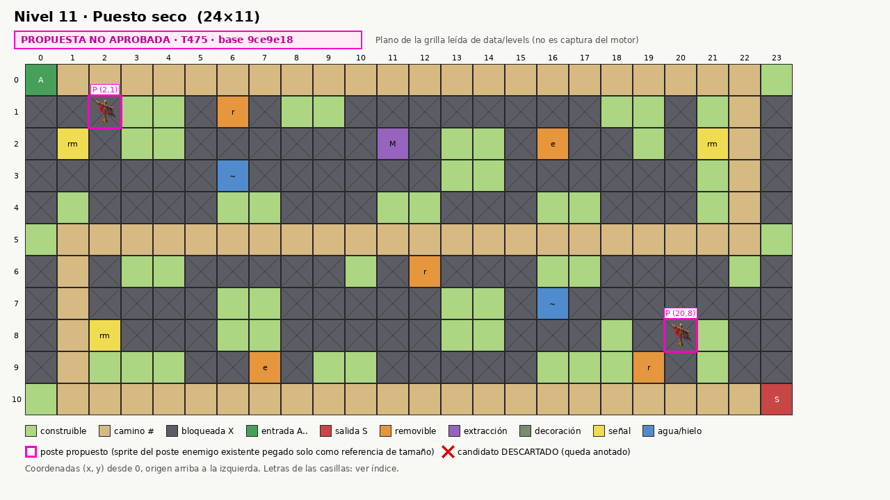  
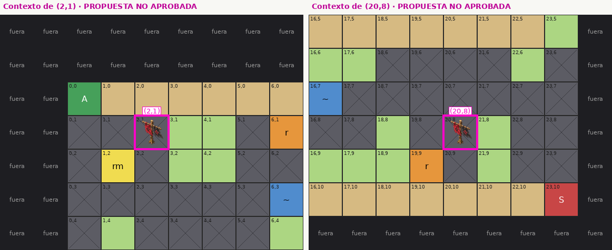

| Candidato | Estado | Origen | Tipo de casilla | Vecinas (N/E/S/O) | Margen | Cercano (≤2) | Riesgo | Recomendación | OK de Lucas |
|---|---|---|---|---|---|---|---|---|---|
| `(2, 1)` | propuesta | Ficha | `X` bloqueada | N: camino, E: construible, S: bloqueada, O: bloqueada | 1 | entrada (0,0); senal:roca_marcada (1,2) | Bajo. `X` bajo el camino (2,0); la entrada A (0,0) queda a 2 casillas y la roca marcada (1,2) en diagonal, sin pisarla. | Aprobar tras captura. | Aprobado 2026-10-25, en bloque, tras revisar el plano de cada nivel en el HTML de revisión |
| `(20, 8)` | propuesta | Ficha | `X` bloqueada | N: bloqueada, E: construible, S: bloqueada, O: bloqueada | 2 | removible:roca (19,9) | Bajo-medio. `X` rodeada de `X` y pasto; la roca removible (19,9) está en diagonal contigua, sin pisarla. | Aprobar tras captura. | Aprobado 2026-10-25, en bloque, tras revisar el plano de cada nivel en el HTML de revisión |

### Nivel 12 · El cañadón (26×11)

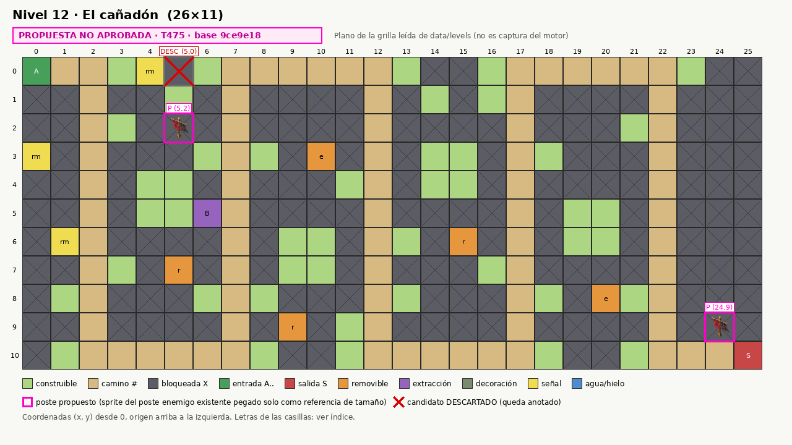  
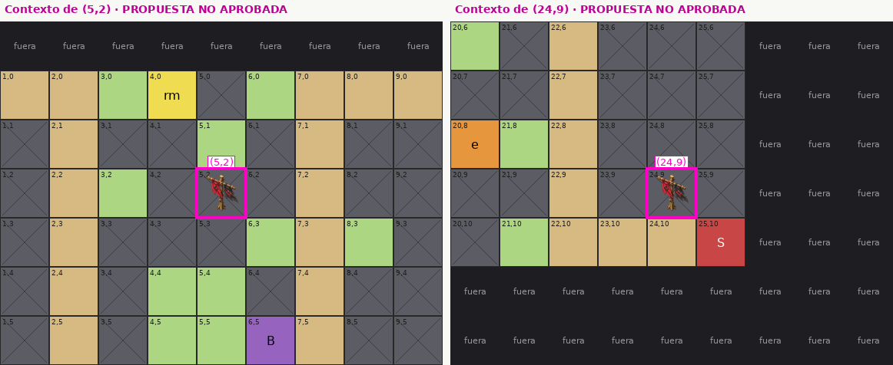

| Candidato | Estado | Origen | Tipo de casilla | Vecinas (N/E/S/O) | Margen | Cercano (≤2) | Riesgo | Recomendación | OK de Lucas |
|---|---|---|---|---|---|---|---|---|---|
| `(5, 0)` | descartado | Ficha | `X` bloqueada | N: fuera del mapa, E: construible, S: construible, O: senal:roca_marcada | 0 | senal:roca_marcada (4,0) | Margen de borde 0 (fila superior) y roca marcada `h` en (4,0) pegada: el poste competiría con la señal y podría cortarse arriba. | Descartado: reemplazado por (5,2). | No aplica (descartado) |
| `(5, 2)` | propuesta | Reemplazo de (5,0) | `X` bloqueada | N: construible, E: bloqueada, S: bloqueada, O: bloqueada | 2 | senal:roca_marcada (4,0) | Bajo. `X` verificada, margen 2, sin señales ni removibles en las 8 vecinas; la roca marcada (4,0) queda a 2 casillas. | Aprobar tras captura. | Aprobado 2026-10-25, en bloque, tras revisar el plano de cada nivel en el HTML de revisión |
| `(24, 9)` | propuesta | Ficha | `X` bloqueada | N: bloqueada, E: bloqueada, S: camino, O: bloqueada | 1 | salida (25,10) | Bajo-medio. `X` sobre el camino (24,10); la salida (25,10) queda en diagonal; margen 1 por el este y por abajo. | Aprobar tras captura (revisar cercanía a la salida). | Aprobado 2026-10-25, en bloque, tras revisar el plano de cada nivel en el HTML de revisión |

### Nivel 13 · Paso alto (26×12)

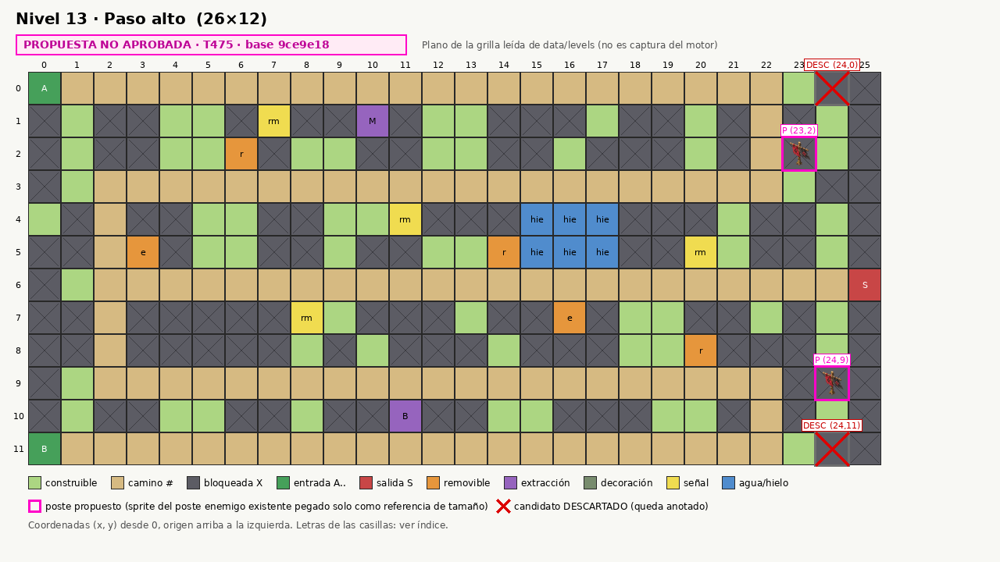  
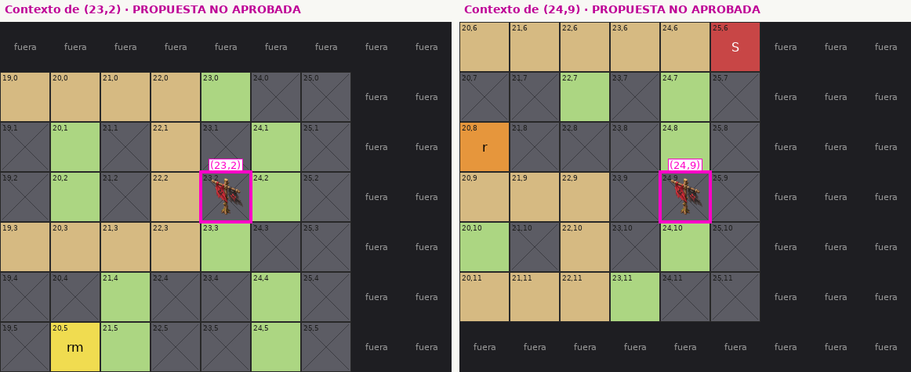

| Candidato | Estado | Origen | Tipo de casilla | Vecinas (N/E/S/O) | Margen | Cercano (≤2) | Riesgo | Recomendación | OK de Lucas |
|---|---|---|---|---|---|---|---|---|---|
| `(24, 0)` | descartado | Ficha | `X` bloqueada | N: fuera del mapa, E: bloqueada, S: construible, O: construible | 0 | — | Margen de borde 0 (fila superior): el dibujo podría cortarse. | Descartado: reemplazado por (23, 2). | No aplica (descartado) |
| `(23, 2)` | propuesta | Reemplazo de (24,0) | `X` bloqueada | N: bloqueada, E: construible, S: construible, O: camino | 2 | — | Bajo. `X` verificada, margen 2, solo `X`, pasto y camino alrededor; sin señales ni removibles cerca. | Aprobar tras captura. | Aprobado 2026-10-25, en bloque, tras revisar el plano de cada nivel en el HTML de revisión |
| `(24, 11)` | descartado | Ficha | `X` bloqueada | N: construible, E: bloqueada, S: fuera del mapa, O: construible | 0 | — | Margen de borde 0 (fila inferior): el dibujo podría cortarse. | Descartado: reemplazado por (24, 9). | No aplica (descartado) |
| `(24, 9)` | propuesta | Reemplazo de (24,11) | `X` bloqueada | N: construible, E: bloqueada, S: construible, O: bloqueada | 1 | — | Bajo. `X` verificada, margen 1 por el este y 2 por abajo, vecinas solo `X` y pasto. | Aprobar tras captura. | Aprobado 2026-10-25, en bloque, tras revisar el plano de cada nivel en el HTML de revisión |

### Nivel 14 · Los poblados vacíos (26×12)

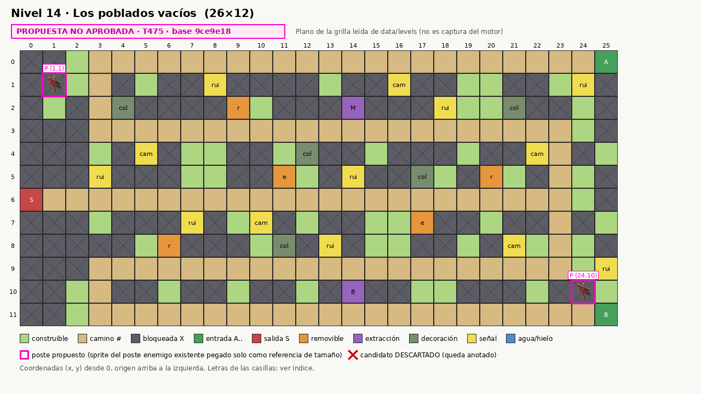  
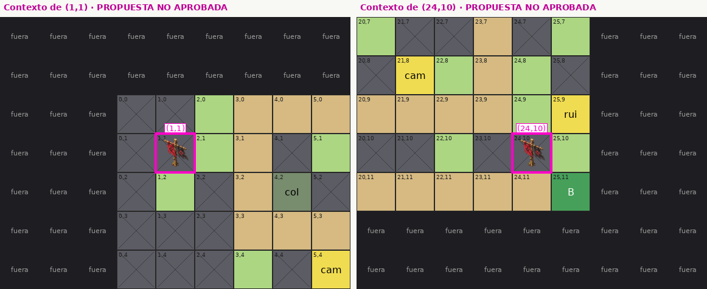

| Candidato | Estado | Origen | Tipo de casilla | Vecinas (N/E/S/O) | Margen | Cercano (≤2) | Riesgo | Recomendación | OK de Lucas |
|---|---|---|---|---|---|---|---|---|---|
| `(1, 1)` | propuesta | Ficha | `X` bloqueada | N: bloqueada, E: construible, S: construible, O: bloqueada | 1 | — | Bajo. `X` en el noroeste; el símbolo `s` (8,1) y los campamentos quedan lejos. | Aprobar tras captura. | Aprobado 2026-10-25, en bloque, tras revisar el plano de cada nivel en el HTML de revisión |
| `(24, 10)` | propuesta | Ficha | `X` bloqueada | N: construible, E: construible, S: camino, O: bloqueada | 1 | senal:simbolo_ruina (25,9); entrada (25,11) | Medio. `X` con margen 1; el camino queda al sur (24,11), el símbolo de ruina `s` (25,9) en diagonal contigua y la entrada B (25,11) en diagonal: podría competir con la señal y la entrada. | Aprobar tras captura (revisar encuadre sudeste). | Aprobado 2026-10-25, en bloque, tras revisar el plano de cada nivel en el HTML de revisión |

### Nivel 15 · La Central (26×12)

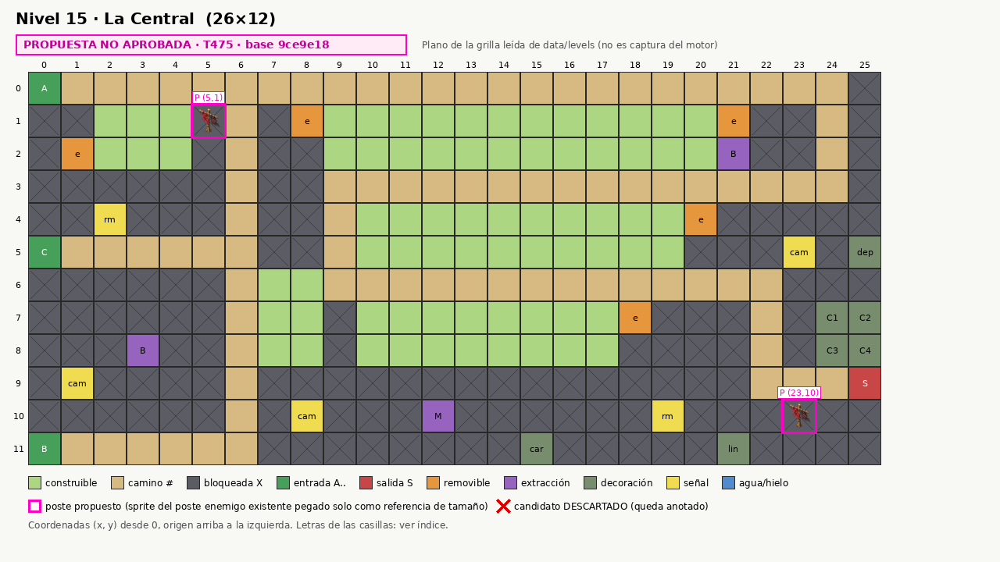  
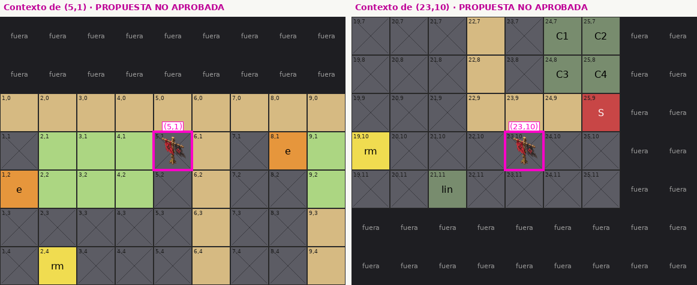

| Candidato | Estado | Origen | Tipo de casilla | Vecinas (N/E/S/O) | Margen | Cercano (≤2) | Riesgo | Recomendación | OK de Lucas |
|---|---|---|---|---|---|---|---|---|---|
| `(5, 1)` | propuesta | Ficha | `X` bloqueada | N: camino, E: camino, S: bloqueada, O: construible | 1 | — | Bajo. `X` del noroeste entre dos tramos de camino (5,0) y (6,1); central y abastecimiento lejos. | Aprobar tras captura. | Aprobado 2026-10-25, en bloque, tras revisar el plano de cada nivel en el HTML de revisión |
| `(23, 10)` | propuesta | Ficha | `X` bloqueada | N: camino, E: bloqueada, S: bloqueada, O: bloqueada | 1 | salida (25,9) | Bajo. `X` del sudeste bajo el camino (23,9); la salida (25,9) y el poste de abastecimiento (21,11) quedan a 2 casillas y la señal `s` (19,10) a 4. | Aprobar tras captura (revisar cercanía al poste de abastecimiento). | Aprobado 2026-10-25, en bloque, tras revisar el plano de cada nivel en el HTML de revisión |

## Comparación estructural «antes»

Hash SHA-256 de cada `data/levels/level_NN.json` en `origin/main` 9ce9e18. «Grilla» es el hash de `mapa` + `leyenda` (JSON canónico, claves ordenadas). Para probar después que el mapa jugable no cambió: `python3 tools/t475_planos_postes.py --verify` (desde 2026-10-28 dice «CAMBIÓ» en el 8 y el 9 a propósito, por la `X` en (18, 1); en el 15 ya decía «CAMBIÓ» antes de este cambio porque el índice quedó viejo respecto de un cambio posterior del nivel 15).

| Nivel | JSON completo (SHA-256) | Grilla + leyenda (SHA-256) |
|---|---|---|
| 01 | `a69feaf78d87b41f020177f1292482f8b03d6ff2decbd2b7928102de71d52d64` | `36455cc2d0f301283ed626efedbcd45601ba21c5f1c8ed9662b8c2bb7cdb1252` |
| 02 | `989d596338c37c3d62482ba7aadd863b72a2bf79a5bd6449838d31683acd01b8` | `8bb3fcb28bf170dae6c2ec640428a2b0163d8d7c11f310e3ed46ceb5e58fc0cb` |
| 03 | `c4fff3a35e2a1278bcc5792330cd887c7e5b6da5a36bf7e9fe7a0cba09b9d6a8` | `987f367b379c75d1fc4b04545c904ea3b3149a216798a50c846776192a4d09eb` |
| 04 | `a2a1f6e6f65c10ec3ba87264c17dccecdab15a0e2a9ad0340c6948e65a892d56` | `6748181e2245573784da7068164c4f239a92f70944aa05e95c1a6329ec87ea5c` |
| 05 | `abef553788fe90aea726f370047e6bb7743e14cf55b1bed93b80e6c027d26cef` | `0e448d6575118a5f4849a949298c2a3006b8d6ce8ff372e735da0e2f1427adc4` |
| 06 | `091dc4aa81958fd7ccee54b24857d8a75885da1a49f73171d106635f8f6c0a01` | `4baa260407f648f0080c2314b0afe71c935c969a5151e937bffebff5ab73d4a4` |
| 07 | `d250d69eba3a1b47638892f291aa70c76a5332219c17f770f56fda01e763699a` | `f122de9fd58754be44969358ed6f4795f4fbc291e198b285f5af6cd9412354aa` |
| 08 | `e0f1c38361a8af20325025bd6cc0fb63915e96ff93acdacecf27a9c56d358b05` (con la `X` en (18, 1): `3b11c91ede82521c7521af539b5e6f23d44e4f79260ae37ab0497180d707713b`) | `e148de2fca0155f2dc799a714fbaa13e0c202162537c44223f82ff450c9c37dd` |
| 09 | `38019324f39caa34db22048031d06100c0505df16cd074b89c151a3741c1ad9a` (con la `X` en (18, 1): `cafb60f81576d636ed76f0c7afaeb6a5aeb3c5f552fc5a64433907377053c360`) | `490d7dcafa836a709e442e04ed0af88def8bbf38cece2fd7e5cb58bf05fa4281` |
| 10 | `21af960b29532957099e39c7b97c7c7ed101e3e5ef2646c003bfc091607e7fdf` | `bd9fbdad2d1bf22058e4b567b66af964e83d90f862104965156a084cd5de0580` |
| 11 | `cbec8c23f8998a67d321d95be9d2d65bf82e1664cd99f148aee715f9fda870e6` | `5cffcbf5bc77696215c927536d84eb4a650c8ee148f0778b3ba51c3e5c6164e8` |
| 12 | `0a884be2b4cbfdfec6bc8daa40b7ab96e0ace79205d076baa384c3ebbba08a67` | `266982fda29354c7df227869fa8d1bb6228f8dcadd4d160a2051746f526be588` |
| 13 | `0577701868f5455858abd257393a3eb33cb740ce9754455510170986926cf3a1` | `b2d7fb1946527dc68d4a648189c2ea36758a071883f658040bf865425ec7e592` |
| 14 | `150929389daa85941b826cbca70aaa9f25b73f97b95ea38149afa2e057112a20` | `341c00645a48fad0944a0f43207fe0da613c883bfecdec63cc4cb8b811124d69` |
| 15 | `0e67f0becbaa63a93af17edf3fab828216fd51a6979f7fa34d9f7e089a1baaa3` | `70e7f2b47342d8fdfc6d59239499bdd43072d44effacc5eb8963ec37b295a5ca` |

## Referencia vigente (T560, 2026-10-29)

Después de T475 (niveles 8 y 9) y de T558 (textos de los niveles 3, 4, 11, 12, 13, 14 y 15) los hashes de arriba quedaron viejos para esos niveles. Cambios **esperados y revisados**: en 8 y 9 solo la casilla `(18, 1)` pasó de `.` a `X` (no construible; la grilla cambia, la leyenda no); en 3, 4, 11, 12, 13, 14 y 15 cambiaron únicamente textos (`entrada`, `victoria`, `nombre`; en el 15, el abastecimiento) y la **grilla y la leyenda siguen idénticas** a «antes». `--verify` acepta estos hashes además de los de arriba; si un mapa vuelve a cambiar, tiene que agregarse acá con su motivo.

| Nivel | JSON completo vigente (SHA-256) | Grilla + leyenda vigente (SHA-256) |
|---|---|---|
| 03 | `95d8e53ae13c4224803cea8f87af93a18c13adb74529f0ebb7b66181981c506c` | `987f367b379c75d1fc4b04545c904ea3b3149a216798a50c846776192a4d09eb` |
| 04 | `d9215c2d7091cc8c77f7fb6dd479139f00ad32e094be5142852223a1d2393643` | `6748181e2245573784da7068164c4f239a92f70944aa05e95c1a6329ec87ea5c` |
| 08 | `3b11c91ede82521c7521af539b5e6f23d44e4f79260ae37ab0497180d707713b` | `392a1b8082afdc2d681d500c8f864f7a56a011383014c8a8c075d78ba5fb4962` |
| 09 | `cafb60f81576d636ed76f0c7afaeb6a5aeb3c5f552fc5a64433907377053c360` | `3d3adf12f0256d6bf2c8122de6d4a0b311b5943dccd876ca45d9bca1f1fe5325` |
| 11 | `c6b7ff220c08a61ce502afeddcbcfd6d63175012877afc93387a7c2d6688fed0` | `5cffcbf5bc77696215c927536d84eb4a650c8ee148f0778b3ba51c3e5c6164e8` |
| 12 | `f13288247f7d0b333baa6ea52a4e4a4d7bf7fb0da3698e15ba571b8680a4f6a1` | `266982fda29354c7df227869fa8d1bb6228f8dcadd4d160a2051746f526be588` |
| 13 | `7786e8111b0e06eb2a15e010a8afefa6b340eeb95d068d9604b286d62bc6c65a` | `b2d7fb1946527dc68d4a648189c2ea36758a071883f658040bf865425ec7e592` |
| 14 | `aa1dfb186cc5b8040625fa492d2088138017c9db2c6b6550938f24a233cc4a41` | `341c00645a48fad0944a0f43207fe0da613c883bfecdec63cc4cb8b811124d69` |
| 15 | `32f78a4cb309777821bd06b864bfa354acbb6ad418ea623b347d4b158ed0e09d` | `70e7f2b47342d8fdfc6d59239499bdd43072d44effacc5eb8963ec37b295a5ca` |

## Límites

- Los planos salen de los JSON, no del motor. Las capturas del motor real de la integración están en `Capturas/T475-*.png` (1280×720, ventana, partida de campaña).
- No se verificó rendimiento, teléfono ni balance.

