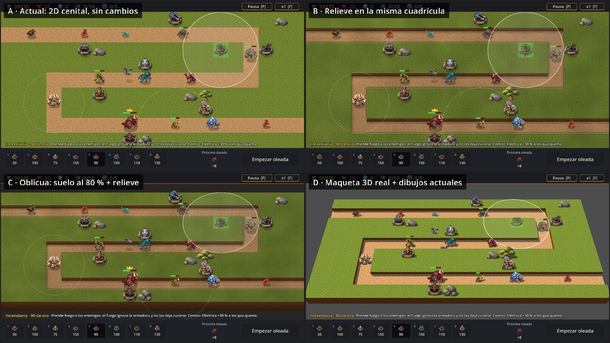
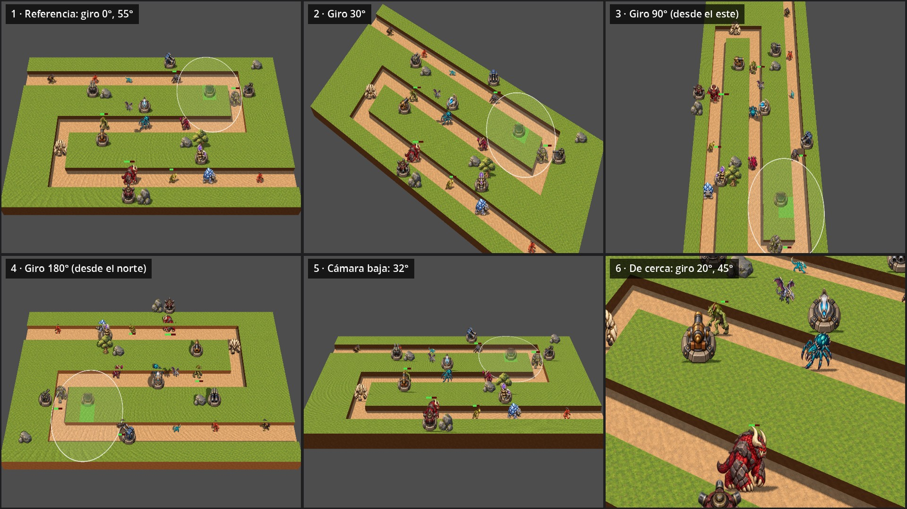

# 06 — Monsters & Canons 3D

> **Qué es este documento:** el concepto y el plan de la **segunda entrega** del juego, en 3D. Junta todo lo que investigamos para B-21 (cuatro vistas, maqueta 3D, mediciones y una prueba de cámara libre) con lo que ya tiene la V1 y lo que todavía le falta.
>
> **Qué no es:** todavía no es una spec. Cuando arranque el proyecto, este documento se convierte en su constitución, su spec y sus primeras decisiones, igual que hicimos con la V1.
>
> **Estado:** 2026-10-07. Las decisiones de Lucas están marcadas **(Lucas)**; lo demás son propuestas de Claude, para discutir.
>
> **Antes de empezar M&C 3D se termina lo pendiente de la V1** (sección 10).

---

## 0. Resumen

- **La familia:** *Monsters & Canons* (V1, 2D, este repositorio) → **Monsters & Canons 3D** (segunda entrega, campo de pruebas para aprender 3D) → *Monsters & Canons 2* (una eventual tercera entrega, que por ahora no se planifica).
- **M&C 3D conserva lo de la V1** (monstruos, torres, habilidades, economía, Wiki, modo de pruebas y forma de trabajar) y lo lleva a un mundo 3D **donde la altura cambia las decisiones del jugador**, no solo el aspecto.
- **Plataformas (Lucas):** PC como desarrollo principal y celular como segundo desarrollo cuidado. La propuesta es **un solo proyecto con dos productos**, no dos proyectos separados (sección 7).
- **Cámara (Lucas):** no fija. La prueba de esta semana muestra que con los dibujos actuales aguanta **giros chicos (±30°), inclinarla y acercarla**; el giro libre de 360° pide modelos 3D (sección 5).
- **Arte:** por etapas. Primero terreno y decoración en 3D real; después las **torres como modelos**, que son lo más fácil porque son rígidas; los **monstruos al final**, que son lo más caro por la animación. Mientras tanto, los dibujos actuales funcionan como planos (sección 6).
- **Lore (Lucas):** si se trabaja bien, habilita una V2. El lore y el plan de cierre de V1 ya están registrados en [07-lore-y-cierre-v1.md](07-lore-y-cierre-v1.md) (B-03 sigue abierto: diseño detallado e implementación pendientes); conviene escribirlo **en la V1**, porque va a ser la base de toda la saga (sección 9).

---

## 1. La familia de juegos

| Entrega | Qué es | Estado |
|---|---|---|
| **Monsters & Canons** (V1) | El tower defense 2D actual: 9 niveles, 10 torres, 15 monstruos, Wiki, editor, modo de pruebas, Windows, Linux y Android. | En curso. Se cierra lo pendiente antes de seguir. |
| **Monsters & Canons 3D** | Segunda entrega: el mismo universo y gran parte de los sistemas, en 3D, para PC y celular. **Es campo de pruebas**: se aprende 3D sin planificar todo desde cero. | Este documento. Arranca después de cerrar la V1. |
| *Monsters & Canons 2* | Eventual tercera entrega, pensada en 3D desde el principio con lo aprendido. | Sin planificar: "volar demasiado en el futuro" (Lucas). |

**Sobre el nombre:** la marca aprobada es **Monsters & Canons**, con una sola N (el logo se corrigió a propósito en M24, `art/redesign-m24/`). Ya existe un logo en volumen (`art/prototypes/branding/monsters_canons_logo_3d.png`) que puede servir de punto de partida para M&C 3D.

*Sugerencia de Claude, para consultar:* "Canons" con una N se presta a un doble sentido, cañones y **cánones** (las leyes de un mundo), que el lore podría aprovechar.

---

## 2. Decisiones de Lucas que dan origen a este documento

1. **El 3D no se integra en la V1** (2026-10-06/07). La maqueta 3D "es la mejor de todas", pero exige adaptar o rehacer los dibujos y repensar el espacio. Por eso va a un juego aparte, y B-21 queda resuelto en la V1 con este destino (D-075).
2. **M&C 3D es la segunda entrega y conserva cosas de la primera**, llevándolas al 3D. Sirve de campo de pruebas; no tiene que ser perfecta.
3. **Dos desarrollos: PC y celular.** PC es la preferida ("más completo") y el celular importa porque Lucas es desarrollador mobile y quiere algo bueno ahí también.
4. **Cámara no fija:** empezar con pruebas para ver cómo manejarla.
5. **Primero se termina todo lo pendiente de la V1**, aunque algunas cosas sean mucho trabajo: la V1 también es campo de pruebas para la siguiente.
6. **El lore importa:** si queda bien, habilita una V2.

---

## 3. Lo que ya aprendimos (evidencia)

Todo sale de prototipos que corren sobre la partida real de la V1, en `art/b21-vista/`. El informe completo está en [`B21-vista-v2.md`](../art/b21-vista/B21-vista-v2.md).

### 3.1 La maqueta 3D (B-21 v2, T193)



| Qué probamos | Qué pasó | Qué significa para M&C 3D |
|---|---|---|
| Correr la **lógica de la V1 sin cambios** debajo de una vista 3D | Funciona. La partida 2D sigue oculta y la maqueta copia posiciones y animaciones en cada cuadro. | Se puede arrancar M&C 3D **con el núcleo de la V1** y cambiar solo la presentación. |
| Dibujos actuales como **planos** inclinados hacia la cámara, apoyados en el pie | Se ven bien con cámara fija y el orden por profundidad es real. | El arte de la V1 sirve para empezar a jugar en 3D desde el primer día. |
| **Sol con sombras reales** en GL Compatibility (escritorio) | Funciona, con el sesgo de sombra ajustado a la escala (una casilla = una unidad). | Las sombras le dan casi todo el "volumen" a la escena; en celular no se midieron. |
| **Clics por rayo** de la cámara al plano del pasto | 615/615 clics en la casilla correcta. | Construir y seleccionar en 3D es un problema resuelto. |
| **Barras de vida en 2D** proyectadas sobre la escena 3D | Funciona con `unproject_position`. | Barras, números y avisos pueden seguir siendo 2D, encima del 3D. |
| **Perspectiva** con el mapa entero en pantalla | La fila del fondo baja a 53 × 38 px y el tablero usa el 66 % del área. | En 3D **no conviene ver siempre el mapa entero**: hace falta acercar y desplazar la cámara. |
| **Rendimiento** (RX 6900 XT, 200 monstruos y 60 torres) | Terreno, sombras y 260 dibujos cuestan unos 3 ms por cuadro. | El 3D no es el problema en PC. Falta medir en celular. |

### 3.2 Hallazgo de rendimiento que vale para el 3D

En la V1, dibujar torres y monstruos en 2D se lleva unos **9 de los ~11 ms** de cada cuadro con la carga de P7, porque cada uno se redibuja entero en cada cuadro. **Lección para M&C 3D:** separar desde el día uno la **simulación** (que calcula) de la **vista** (que dibuja), y dibujar muchos monstruos iguales con instancias (por ejemplo `MultiMesh`), sin regenerar nada por cuadro.

### 3.3 Prueba de cámara libre (2026-10-07, T194)

La misma maqueta, ahora orbitando: los dibujos siempre miran a la cámara y eligen su cuadro (8 vistas en torres, 4 en monstruos) según el giro. El sol queda fijo en el mundo.



| Vista | Qué se ve |
|---|---|
| 1 · Referencia (giro 0°, 55°) | Igual que la maqueta D. |
| 2 · Giro 30° | **Aguanta bien.** Los dibujos siguen creíbles y el tablero gana dinamismo. |
| 3 · Giro 90° (desde el este) | El mapa se vuelve una franja larga. Los monstruos eligen su fila de dirección según el giro, pero todos muestran el mismo ángulo de arriba pintado. |
| 4 · Giro 180° (desde el norte) | **Se rompe.** La luz pintada (arriba a la izquierda) no coincide con el sol, torres y bases muestran siempre su frente pintado, los puntos de apoyo pensados para verse desde el sur quedan corridos y las paredes tapan a los monstruos que pasan pegados a ellas. |
| 5 · Cámara baja (32°) | Se lee y da más sensación de altura, pero las filas del fondo se achican mucho. |
| 6 · De cerca (giro 20°, 45°) | **Sorprendentemente bien**: es la que más se parece a un juego 3D. Se nota la textura repetida del pasto y que las paredes son una banda lisa. |

**Conclusión de la prueba:**

- Con el arte actual, una cámara de estratega (desplazar, acercar, inclinar y **girar hasta unos ±30°**) es viable de inmediato.
- Girar 360° exige modelos 3D, o dibujos con 4 vistas pintadas por cada giro de 90° (cuatro veces el arte).
- Con cámara libre aparecen problemas nuevos que hay que diseñar: monstruos tapados por paredes o torres (siluetas a través de lo que tapa) y un botón para volver a la vista general.

Fotos individuales: [`camara_1.jpg`](../art/b21-vista/camara_1.jpg) a [`camara_6.jpg`](../art/b21-vista/camara_6.jpg).

### 3.4 Recetas técnicas que conviene conservar

- **Apoyo de un dibujo en 3D:** el punto de apoyo (pie o borde delantero de la base) va en el origen del nodo, con `offset = fila_de_apoyo − alto/2`. Con cámara giratoria conviene apoyar en el centro de la base, que no depende del ángulo.
- **Planos hacia la cámara:** inclinarlos (o usar *billboard*) evita que se hundan en el suelo.
- **Sombras:** en una escena de ~20 unidades, el sesgo por defecto se come las sombras chicas. Con `shadow_bias` 0,01 y `shadow_normal_bias` 0,2 se ven bien.
- **Encuadre:** buscar la distancia mínima a la que el mapa entra entre las barras del HUD, probando y midiendo con `unproject_position`.
- **Entrada:** en 3D, el nodo que recibe los clics del mapa tiene que estar donde estaba el `BuildController`, para que Escape y las teclas lleguen en el mismo orden (`d_input.gd`).
- **Suelo que no cambia:** "hornearlo" una vez en una textura cuesta lo mismo que no tener relieve.

---

## 4. Qué cambia en el juego al pasar a 3D (diseño)

### 4.1 El principio

**El 3D tiene que cambiar decisiones, no solo el aspecto.** Si una partida de M&C 3D se juega exactamente igual que la V1, el 3D es maquillaje caro. Lucas lo planteó así: un mapa en forma de laberinto plano no tiene sentido en 3D.

### 4.2 El espacio: de corredores a paisajes

- **Los caminos siguen siendo fijos.** Es lo que hace legible un tower defense, y muchos del género en 3D lo mantienen. Lo que cambia es que el camino **recorre un terreno**: valles, pasos de montaña, puentes, vados, rampas. Deja de ser un zigzag dibujado sobre una tabla.
- **La cuadrícula se queda debajo**, cada casilla con su **altura**. Así se conservan el editor, los mapas de texto, el bot de balance y los tests. *Propuesta para el formato:* una capa `"alturas"` en el JSON del nivel, con una cifra de 0 a 9 por casilla, al lado de la capa `"mapa"` que ya existe. Los mapas viejos valen como altura 0.
- **Decisión a probar en el primer prototipo:** ¿se construye en **cualquier casilla** (como en la V1) o en **lugares marcados** del mapa? Los lugares marcados simplifican cámara, arte y toque en el celular, pero quitan libertad. Se puede probar con el mismo mapa.

### 4.3 Mecánicas que el 3D hace posibles

| Mecánica | Qué hace | De dónde viene | Costo |
|---|---|---|---|
| **Altura = alcance** | Una torre en una meseta llega más lejos; el terreno bajo es más barato o queda más cerca del camino. | B-08 ("colina") | Chico |
| **Línea de visión** | Un acantilado tapa los disparos directos; el Mortero tira por arriba. Le da identidad a cada torre. | Nuevo | Mediano |
| **Caminos en dos niveles** | Puentes y túneles: un camino pasa por encima o por debajo de otro. | B-09 (puentes y cruces) | Mediano |
| **Voladores con altura real** | Ignoran el relieve y se ven por arriba de todo; las torres antiaéreas tienen sentido visual. | RF-05 | Chico |
| **Excavador** | Se entierra y sale: en 3D se entiende solo, con tierra que se mueve. | B-07/B-22 (candidato) | Mediano |
| **Embestidor en bajada** | Carga más rápido cuesta abajo; las rectas en pendiente son peligrosas. | M40 | Chico |
| **Terrenos con efecto** | Pantano lento, vado, terreno rico. | B-08 | Mediano |

*Propuesta:* probar **altura = alcance** y **puentes** primero **en la V1, en 2D** (son B-08 y B-09, que ya están pendientes). Así llegamos a M&C 3D sabiendo si son divertidas, y con su lógica y sus tests hechos.

### 4.4 Lo que se conserva de la V1

Las 10 torres (incluido el Mortero 2×2 y el Estandarte mecánico), los 15 monstruos con sus habilidades (auras, aturdir, rebote, robo, carga, desgaste y reparación), los combos por estado, los avances coleccionables, la economía, las oleadas, las estrellas y los récords, la Wiki generada desde los datos, el modo de pruebas, el editor y los mapas de la comunidad, el audio, el estilo hierro/bronce de la interfaz y los temas de paisaje.

### 4.5 Lo que no pasa tal cual

- **Los mapas de 20 × 9:** pasan como punto de partida, pero conviene rediseñarlos con alturas.
- **La interfaz:** la cámara necesita lugar y gestos; el HUD tiene que dejar libre más pantalla.
- **Los efectos visuales:** se rehacen en 3D (partículas, disolución y anillos en el suelo).
- **Las 8 vistas pintadas de las torres:** con modelos dejan de hacer falta.

### 4.6 Lo que la V1 excluye a propósito (§11)

Multijugador, héroes, habilidades activas del jugador, modo infinito, meta-progresión, historia con diálogos, logros y construir laberintos. **M&C 3D las hereda como excluidas**, salvo que Lucas decida otra cosa: cada una agranda mucho el alcance. Para un campo de pruebas, lo sensato es cambiar **una sola cosa grande**: el 3D.

---

## 5. Cámara

### 5.1 Propuesta por etapas

| Etapa | Cámara | Arte necesario |
|---|---|---|
| **1 · Estratega** (primer prototipo) | Desplazar, acercar y alejar, inclinar entre ~35° y ~65°, **girar hasta ±30°** y volver a la vista general con una tecla o un botón. | El actual (probado: vistas 1, 2, 5 y 6). |
| **2 · Giro de a 90°** (opcional) | Cuatro ángulos fijos, como en muchos juegos de estrategia por turnos. | Cuatro vistas pintadas por dibujo, o modelos. |
| **3 · Giro libre** | Órbita completa. | Modelos 3D (por lo menos para torres y decoración). |

**Reglas de lectura para cualquier etapa:**

- **Siluetas a través de lo que tapa:** un monstruo detrás de una pared o una torre se ve con su contorno.
- Barras de vida y avisos siempre encima, en 2D.
- **Alcance dibujado sobre el terreno**, que sigue la forma del relieve.
- **Límites:** la cámara no puede perder el mapa ni meterse adentro del terreno.
- Si el mapa queda más grande que la pantalla, un **minimapa** o un indicador de por dónde vienen los monstruos.

### 5.2 Controles en PC

- **Desplazar:** WASD o flechas, mouse al borde de la pantalla, o arrastrar con el botón del medio.
- **Zoom:** rueda.
- **Girar:** Q/E, o Alt + arrastrar.
- **Vista general:** Inicio/F.
- **Teclas remapeables desde el principio:** ya tenemos la receta (skill `godot-remappable-controls`).

### 5.3 Controles en el celular

- **Un dedo que toca:** selecciona, o construye en el modo construcción.
- **Un dedo que arrastra:** desplaza la cámara.
- **Pellizco:** acerca o aleja.
- **Dos dedos girando:** giro limitado.
- **Doble toque:** vista general.

**Ojo con un conflicto clásico:** arrastrar para mover la cámara contra tocar para construir. *Propuesta:* construir en dos pasos. Tocar la casilla muestra la torre fantasma y un botón "Construir"; sin ese segundo toque no se construye nada. Así un desplazamiento nunca construye por error.

---

## 6. Arte en 3D

### 6.1 De dónde partimos

El arte de la V1 son **imágenes renderizadas desde un ángulo fijo** (cámara elevada a unos 35°, luz arriba a la izquierda), en PNG con 8 vistas en torres y 4 direcciones × 4 pasos en monstruos. Las fuentes y los *prompts* aprobados están guardados (`art/redesign-m23/` a `art/redesign-m43/`). Esas imágenes son una **hoja de referencia** muy buena para modelar: ya fijan siluetas, colores y materiales.

### 6.2 Tres caminos

| Camino | Cómo es | A favor | En contra |
|---|---|---|---|
| **A · Dibujos actuales como planos** | Lo que hizo la maqueta D. | Gratis. Conserva el estilo aprobado. Sirve para jugar desde el primer día. | Cámara limitada (±30°). Luz pintada contra luz real. |
| **B · Modelos 3D sencillos (low-poly) a medida** | Modelar en Blender (gratis) y exportar a Godot en glTF. | Control total, estilo propio, cámara libre. | Lleva tiempo de modelado y, en monstruos, **esqueleto y animaciones**. |
| **C · Modelos generados con IA desde los conceptos** | Herramientas de imagen-a-3D a partir de las imágenes aprobadas, y después limpieza. | Formas rápidas, fieles a los diseños. | Mallas sucias, consistencia entre modelos, licencias de cada herramienta. La animación sigue siendo manual. |

### 6.3 Propuesta: híbrido escalonado

1. **Terreno, caminos, paredes y decoración en 3D real desde el principio.** Es lo más barato (geometría simple con texturas que ya tenemos) y es lo que más "3D" se ve.
2. **Torres como modelos.** Son **rígidas**: base fija y torreta que gira, sin esqueleto. En 3D son **más fáciles que en 2D**, porque no hacen falta 8 vistas pintadas. Además cubren las tres familias de materiales (hierro/bronce, industrial, arcano). Piloto: el Cañón.
3. **Monstruos al final.** Son lo más caro (esqueleto, caminar, morir, volar). Mientras tanto siguen como planos con sus dibujos actuales (camino A). Piloto: el Normal (diablillo) y después uno de cuatro patas.
4. **Efectos en 3D** (partículas, anillos, disolución) cuando cada pieza los necesite.

### 6.4 Una guía de arte 3D

Igual que `05-guia-de-arte.md` para la V1, M&C 3D necesita la suya antes de producir:

- **Identidad que se conserva:** un color por especie, silueta reconocible, hierro y bronce, luz arriba a la izquierda como referencia.
- **Presupuesto por plataforma:** polígonos y resolución de texturas en PC y en celular, y niveles de detalle (LOD).
- **Proceso de aprobación:** hoja de contacto en el juego, a la distancia normal de la cámara y de cerca.

---

## 7. PC y celular: dos desarrollos, una base

### 7.1 Propuesta: un proyecto, dos productos

Lucas planteó dos desarrollos. Propongo **un solo proyecto de Godot** con el núcleo compartido (simulación, datos, Wiki, guardado, tests) y **capas por plataforma**: controles, interfaz, calidad gráfica y renderizador. La V1 ya hace algo parecido con sus variantes normal y de pruebas (presets de exportación y *feature tags*).

**Por qué no dos proyectos:** cada arreglo, cada monstruo y cada nivel habría que hacerlo dos veces, y las versiones se separan rápido.

Si con el tiempo la interfaz del celular resulta muy distinta, se pueden tener **escenas de interfaz separadas** dentro del mismo proyecto.

### 7.2 Qué cambia según la plataforma

| | PC (principal) | Celular |
|---|---|---|
| **Renderizador** | Forward+ (mejor calidad: sombras suaves, oclusión ambiental). | Mobile (Vulkan). Para teléfonos sin Vulkan, Compatibility como respaldo (verificar cómo lo resuelve la versión de Godot que usemos). |
| **Calidad** | Alta, con opciones. | Perfiles bajo, medio y alto: sombras, distancia de dibujo, densidad de decoración, resolución de render, 30 o 60 FPS. |
| **Controles** | Teclado y mouse (sección 5.2); mando como opción futura. | Gestos (sección 5.3). |
| **Interfaz** | Paneles completos, ayudas al pasar el mouse. | Botones de 7 a 9 mm como mínimo, paneles plegables, nada importante en los bordes. |
| **Sesiones** | Largas. | Cortas: guardar al salir de la app y pausar al perder el foco. Cuidar batería y temperatura. |
| **Paquete** | Windows y Linux (Steam o itch.io si se publica). | AAB/APK con texturas ASTC/ETC2 y tamaño controlado. iOS necesita una Mac (como en la V1). |

### 7.3 Cómo trabajar las dos a la vez

- **PC primero, pero el celular en cada hito:** ningún hito se da por cerrado sin correr en un **teléfono de referencia** de gama media (a definir).
- **Presupuesto de rendimiento desde el día uno**, como el P7 de la V1, con dos números: PC (por ejemplo 60 FPS con 200 monstruos y 60 torres a 1080p) y celular (por ejemplo 30 FPS estables con la misma carga, o la carga que se defina). Se mide, no se supone.
- **Aprovechar que Lucas es desarrollador mobile:** perfilado en Android real, pruebas en dispositivos, publicación en tiendas.

---

## 8. Qué se reutiliza de la V1 (técnico)

| Pieza de la V1 | En M&C 3D | Qué cambia |
|---|---|---|
| `Rules`, fórmulas y tests de lógica (GUT) | Se reusa | Agregar altura y línea de visión como datos y funciones puras (P10). |
| Datos `.tres` de torres, monstruos y balance | Se reusa | Campos nuevos (bonus por altura, modelo 3D) apagados por defecto. |
| Oleadas, `WaveSpawner`, `LevelSession`, economía | Se reusa | Casi nada. |
| `SaveManager` y guardado versionado | Se reusa | Guardado propio de M&C 3D. |
| Wiki generada desde los datos | Se reusa | Imágenes de los modelos (renders) en lugar de PNG. |
| Modo de pruebas (`DevMode`, panel) | Se reusa | Controles de cámara y vista de alturas. |
| Bot de balance (`balance_sim.gd`) | Se reusa | Aprender altura y línea de visión. |
| Formato de nivel JSON y editor | Se extiende | Capa de alturas; el editor sigue desde arriba y pinta alturas. |
| `Level`, `MapGrid`, recorridos | Se extiende | Casillas con altura; el camino en 3D sigue el terreno. |
| `Tower` y `Enemy` (simulan y se dibujan) | **Se separan** | Simulación pura por un lado y vista 3D por otro (sección 3.2). |
| Efectos, *shaders* y dibujo 2D | Se rehacen | Partículas y *shaders* espaciales. |
| HUD y menús hierro/bronce | Se reusa el estilo | Disposición nueva por plataforma. |
| Audio | Se reusa | Sonido posicional en 3D como opción. |
| Proceso SDD, `.claude/rules/`, skills | Se reusa | Constitución nueva, adaptada (sección 11, H0). |

**Un atajo probado:** el primer prototipo jugable de M&C 3D puede correr **la simulación 2D de la V1 oculta** y dibujar en 3D, como la maqueta D, y separar la simulación después, sin apuro. Así se juega en 3D en días, no en semanas.

**Repositorio:** uno **nuevo** (por ejemplo `MonstersCanons3D`). Se copia el núcleo de la V1 cuando esté cerrada; un *fork* arrastraría la historia y los archivos 2D que no se usan.

---

## 9. Lore: la base de la saga

**Hoy:** no hay lore escrito. B-03 pide definir quién defiende, quién ataca y por qué, qué representan los niveles y quién es el Jefe. Hay material suelto:

- Nombres de especies y su aspecto (diablillo, behemot, wyvern, gólem, araña madre...).
- Tres familias de materiales en las torres: hierro/bronce, industrial y arcano.
- Siete paisajes: pradera, desierto, nieve, volcán, bosque, pantano y ruinas.
- Los avances tecnológicos coleccionables y el Estandarte mecánico.
- Las ideas de Épocas (B-01) y de modos de juego (B-05).

**Propuesta:** escribir el lore **en la V1**, como B-03, en una "biblia" corta:

- El mundo y sus regiones (los siete paisajes).
- Quiénes construyen las torres y por qué hierro, industria y arcano conviven.
- Qué son los monstruos y qué buscan.
- Quién es el Soberano (el Jefe).
- Qué son los avances (¿restos de una civilización anterior?) y qué representa el Mecánico.

En la V1 se mostraría en textos breves por nivel y en una categoría Lore de la Wiki, sin diálogos ni cinemáticas (§11). En M&C 3D se suma lo que el 3D da gratis: **contar con el escenario** (ruinas, estatuas, campamentos en el mapa).

Las preguntas de arriba son ganchos, no decisiones: **el lore lo decide Lucas**.

---

## 10. Antes de empezar: cerrar la V1

Lucas pidió terminar todo lo pendiente primero. Este es el relevamiento completo del backlog (§13 de la spec) y de las tareas abiertas. La columna "¿Sirve para 3D?" marca lo que además prepara M&C 3D.

Tamaños: **chico** (1–2 días), **mediano** (3–7 días), **grande** (más de una semana).

### 10.1 Lo pendiente

| Ítem | Qué falta | Tamaño | ¿Sirve para 3D? |
|---|---|---|---|
| **B-21** Vista 3D | Resuelto: pasa a M&C 3D. Opcional en la V1: etapa 1 del relieve (que lo de adelante tape a lo de atrás). | Chico | Poco |
| **B-03** Lore | Biblia, textos por nivel y categoría Lore en la Wiki. **En curso:** Lucas lo trabaja con otro agente (2026-10-07). | Mediano | **Mucho**: es la base de la saga. |
| **B-10** Niveles 10–14 y 15 | Diseño, oleadas y balance; validación jugando de 8–15. Los niveles "difíciles" ya los cubre el modo Asedio (T197). | Grande | Sí: contenido y oficio de diseño de oleadas. |
| **B-22** Contenido nuevo | Elegir entre Excavador, Ballesta y Alquimista, y producirlos (datos, arte, Wiki, balance). | Mediano c/u | Excavador: **mucho**. |
| **B-23** Recetas de vecindad | Tres recetas (Hielo + Cañón, Hielo + Múltiple, Incendiaria + Eléctrica) con reglas de nivel 2/3. | Mediano | Sí: sistemas que se heredan. |
| **B-14** Tipos de daño | Físico y elemental, resistencia, piso proporcional; rebalancear todo. | Mediano | Sí: se hereda. |
| **B-08** Terrenos con efecto | Colina (alcance), pantano (lento), terreno rico; decoración a mano; temas y leyenda en el editor (T128). | Mediano | **Mucho**: la colina es la mecánica de altura probada en 2D. |
| **B-09** Puentes y cruces | Casilla de puente/cruce y rutas explícitas opcionales. | Mediano | **Mucho**: caminos en dos niveles. |
| **B-07** resto | Torres con vida y destrucción, reparación paga: alternativa registrada, no comprometida (el desgaste reparable ya existe). | Grande | Poco: cambia la base del juego. |
| **B-16** Fusión de torres | Cuatro torres iguales de nivel 3 se fusionan en una 2×2. | Grande | Sí. |
| **B-04** Mods completos | Paquetes con torres, monstruos y dibujos propios, solo con datos. | Grande | Sí: el formato de paquete sirve para los modos. |
| **B-29 / B-30** Wiki de mods y de mapas de la comunidad | Categorías nuevas en la Wiki. | Chico c/u | Poco |
| **B-11** Compartir un mapa como texto | Copiar y pegar un código en el editor. | Chico | Sí: mapas con alturas también. |
| **B-12** Mapas al azar y desafío diario | Generador más verificación con el bot. | Mediano o grande | Sí. |
| ~~**B-13** Una sola app con modo admin~~ | **Hecho en T196:** el modo de pruebas está en Opciones y hay un solo ejecutable o APK por plataforma. | — | Sí: se repite en 3D. |
| ~~**B-05** Modos~~ | **Prueba chica hecha en T197:** modo oficial Asedio, modos propios desde el editor y solapas en Jugar. | — | Sí: el formato de paquete sirve para los mods y para el 3D. |
| ~~**B-01** Épocas~~ | **Trasladado** a M&C 3D / M&C 2 (Lucas, 2026-10-07, D-076). Ver sección 15. | — | Es contenido de la saga. |
| **Plataformas** | La APK ya la probó Lucas en su celular (informado el 2026-10-07). Falta Linux en una máquina real y medir el rendimiento en celular. | Chico c/u | **Mucho**: es la línea de base del celular. |
| **Sugerencias de Claude** (§13, sin aprobar) | "¿Qué es esto?" desde la partida, informe de prueba, auditoría de recursos, registro de deuda técnica, dibujo liviano de torres y monstruos. | Chico c/u | Varias, sí. |

### 10.2 Épocas y modos (resuelto)

**Lucas, 2026-10-07 (D-076):** Épocas, con sus imperios reales, torres y monstruos por época y arte nuevo, pasa al backlog de M&C 3D / M&C 2 (sección 15). Los **modos** (B-05) tienen una prueba chica en la V1, unificada con el gestor de mapas.

### 10.3 Orden propuesto para cerrar la V1

La regla que ordena todo: **lo que cambia el balance va antes que los niveles 10–15**, para no balancear dos veces.

1. **Cimientos (chicos):**
   - Cerrar B-21 (y, si querés, la etapa 1 del relieve).
   - ~~Modo de pruebas desde Opciones, una sola app (B-13).~~ Hecho en T196.
   - Biblia de lore (B-03), en curso con otro agente.
2. **Reglas que cambian el balance:** B-14 tipos de daño, B-23 recetas, B-22 (Excavador y una o dos torres), B-08 terrenos con efecto y B-09 puentes.
3. **Campaña:** niveles 10–14 y el 15, usando todo lo anterior, con textos de lore por nivel, y validación jugando de los niveles 8 a 15.
4. **Modos, mapas y comunidad:** ~~prueba chica de modos (B-05)~~ (hecha en T197), B-11, B-30, B-12, B-04 y B-29.
5. **Grandes opcionales:** B-16 fusión y, si se quiere, torres con vida (resto de B-07).
6. **Cierre:** pulido, rendimiento en celular, exportaciones y publicación gratuita.

Recordatorio de Lucas: **no tiene que ser perfecto**. Cada ítem se hace en su versión más simple que funcione (P4).

---

## 11. Plan de M&C 3D por hitos (después de la V1)

Cada hito responde **una pregunta**. Si la respuesta es "no", se corrige el rumbo antes de seguir.

| Hito | Qué se hace | Pregunta que responde |
|---|---|---|
| **H0 · Preparación** | Repositorio nuevo; constitución adaptada (P7 con dos números, PC y celular); versión de Godot y renderizadores; CI con tests; copiar el núcleo de la V1. | ¿Tenemos la base lista para trabajar igual que en la V1? |
| **H1 · Prototipo gris + cámara (PC)** | Un mapa con alturas (capa nueva del JSON), cámara de estratega (5.1, etapa 1), 3 torres y 3 monstruos como formas simples, construir en casilla contra lugares marcados. | ¿La altura y la cámara hacen el juego más divertido? |
| **H2 · Celular temprano** | El mismo prototipo en Android: gestos, perfil de calidad y medición en el teléfono de referencia. | ¿Se juega bien con el dedo y a cuántos FPS? |
| **H3 · V1 jugable en 3D** | Toda la simulación de la V1 (atajo de la sección 8) con los dibujos actuales como planos; barras y avisos en 2D. | ¿Se siente M&C en 3D con lo que ya tenemos? |
| **H4 · Piloto de arte 3D** | Cañón y diablillo Normal como modelos, comparados contra los planos; definir la guía de arte 3D. | ¿Qué camino de arte (6.2) adoptamos y cuánto cuesta cada pieza? |
| **H5 · Mecánicas de altura y mapas nuevos** | Altura = alcance, línea de visión, puentes; editor con alturas; 3 mapas diseñados para 3D. | ¿Qué mecánicas 3D se quedan? |
| **H6 · Producción** | Torres en 3D, después monstruos; lore en escena; Wiki con renders. | — |
| **H7 · Cierre por plataforma** | Pulido de PC y de celular, exportaciones y publicación. | ¿Está listo para que lo juegue otra persona? |

**Tamaño honesto:** H1 y H2 son cuestión de días cada uno; llegar a H3 es cuestión de semanas; H6 es lo largo (meses), sobre todo por el arte.

---

## 12. Riesgos y cómo cuidarlos

| Riesgo | Por qué | Cuidado |
|---|---|---|
| **El arte se come el proyecto** | Modelar y animar 15 monstruos es lo más caro de todo. | Planos primero; torres antes que monstruos; pilotos con costo medido antes de producir. |
| **Un proyecto que no termina** | El 3D tienta a agrandar todo. | Exclusiones de §11 heredadas; un hito, una pregunta; P4. |
| **Rendimiento en el celular** | Sombras, transparencias y temperatura. | Teléfono de referencia en cada hito; perfiles de calidad; medir, no suponer. |
| **Lectura de la partida** | Oclusión, perspectiva y cámara mal ubicada. | Siluetas, vista general, alcance sobre el terreno, límites de cámara. |
| **Dos plataformas que se separan** | Arreglos que llegan a una y no a la otra. | Un solo proyecto (7.1); tests comunes. |
| **Dependencia de herramientas de IA para el arte** | Consistencia entre piezas y licencias de uso. | Revisar licencias antes de producir; guardar fuentes y *prompts* como en la V1. |

---

## 13. Preguntas abiertas para Lucas

| Pregunta | Decidir antes de |
|---|---|
| ~~¿Épocas y modos van en la V1 o se guardan para M&C 3D / M&C 2?~~ **Resuelto (D-076):** Épocas pasa al otro juego; los modos tienen una prueba chica en la V1. | — |
| La V1 se va a regalar (Lucas, 2026-10-07). ¿Dónde se publica: itch.io, Play Store, otro? | El final de la V1 |
| ¿Un proyecto con dos productos (7.1) o dos desarrollos realmente separados? | H0 |
| ¿Qué teléfono de referencia usamos para el celular? | H0 |
| ¿Construcción en cualquier casilla o en lugares marcados? (4.2) | Al final de H1 (se prueba) |
| A largo plazo, ¿se busca giro libre de 360° (que obliga a modelos) o alcanza la cámara de estratega? | H4 |
| ¿Alguna exclusión de §11 (por ejemplo, héroes) se reconsidera para el 3D? | H0 |
| ¿Nombre del repositorio? | H0 |

---

## 14. Evidencia y cómo reproducirla

Todo en `art/b21-vista/`:

- [`B21-vista-v2.md`](../art/b21-vista/B21-vista-v2.md): las cuatro vistas, las medidas y el rendimiento.
- `comparacion_vistas.jpg` y `comparacion_detalle.jpg`: las cuatro vistas.
- `jugar_a.jpg` … `jugar_d.jpg`: fotos en pleno combate.
- `camara_pruebas.jpg` y `camara_1.jpg` … `camara_6.jpg`: la prueba de cámara libre.
- `medidas.json`, `rendimiento.txt`: datos crudos.
- `vista_lab.gd`, `relief_layer.gd`, `diorama_3d.gd` y `d_input.gd`: los prototipos.

La maqueta 3D, jugable:

```bash
godot --path . res://art/b21-vista/vista_lab.tscn -- jugar variante=D
```

La prueba de cámara (seis fotos y la hoja):

```bash
godot --path . res://art/b21-vista/vista_lab.tscn -- camara
```

---

## 15. Backlog de Monsters & Canons 3D

Ideas que pasan de la V1 a este juego (o a *M&C 2*). Igual que en la V1, no se programan hasta convertirse en un hito con su spec.

### 3D-01 · Épocas: la guerra evoluciona con el tiempo *(viene de B-01 y B-05 de la V1; trasladado por Lucas el 2026-10-07, D-076)*

**Idea (Lucas, 2026-09-28):** las armas mejoran a través de las épocas (medieval → pólvora → industrial → moderna → futurista), y los enemigos y sus defensas también. El jugador *ve* el progreso: los arqueros se vuelven mosqueteros, después ametralladoras, después láseres.

**Lo que ya se decidió en la V1:**
- Es un **modo aparte**, no reemplaza la campaña (Lucas, 2026-09-29).
- Usa dibujos de **imperios reales**: legiones romanas, jinetes mongoles, samuráis... (B-05).

**Variantes, sin elegir todavía:**

| Variante | Cómo funciona |
|---|---|
| **A · Una época por nivel** | Cada mapa es una época; cambian las torres y los monstruos disponibles. |
| **B · Las mejoras son épocas** | Mejorar una torre la hace avanzar de época: se ve y se llama distinta. |
| **C · Avanzar de época en la partida** | El jugador paga para que toda su defensa avance de época; los enemigos también avanzan con las oleadas. Es una mecánica nueva. |

**Cuidados que vienen de la V1:**
- Representar a los imperios con **respeto**: sin caricaturas ni estereotipos, sobre todo de pueblos que existen hoy.
- Decidir cuánta **precisión histórica** se quiere y usar referencias reales.
- Puede pedir un estilo de arte distinto al de "Torres y Bestias".

**Por qué encaja en el 3D:**
- Con modelos, una torre que "avanza de época" puede cambiar de pieza en pieza sin pintar 8 vistas por época.
- Los mapas en 3D cuentan la época con el escenario: murallas, trincheras, ciudades.
- Es la candidata natural a **segundo modo** después del modo base, usando el formato de modos que la V1 va a probar (B-05).

**Antes de convertirlo en hito:**
1. Elegir la variante.
2. Definir la lista de épocas y de imperios, con sus torres y monstruos.
3. Integrarlo con el lore (B-03 de la V1).
4. Decidir si va en M&C 3D o se guarda para M&C 2.
