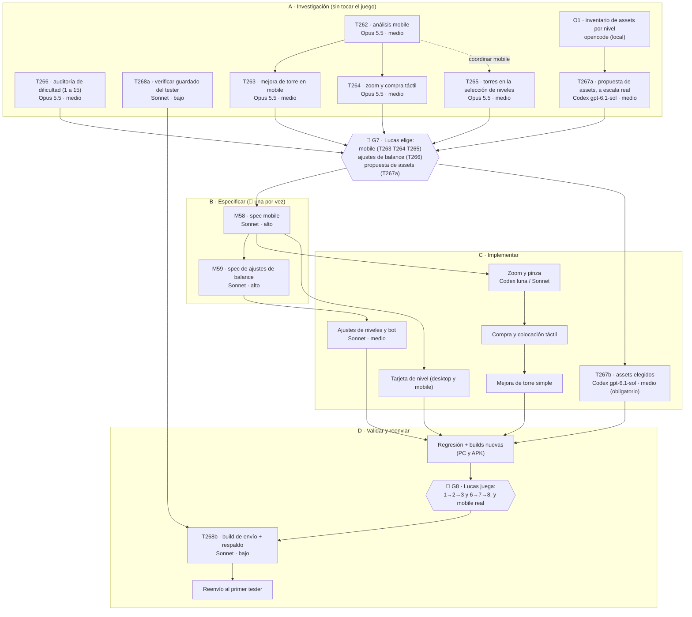

# 12 — Plan de ejecución de T262 a T268 (mobile, presentación, balance y assets)

Fecha: 2026-10-16. Lo escribe Claude a pedido de Lucas, a partir del backlog B-33 a B-39 y las tareas T262 a T268 (`03-tareas.md`, «Prioridad máxima»). Este documento **no cambia ningún requisito**: dice **en qué orden y con quién** se hace cada cosa. Las decisiones de diseño las toma Lucas en las compuertas 🚦.

## 1. La idea en una página

Primero **se investiga y se propone** (sin tocar el juego), después **Lucas elige**, después **se especifica** (📜, una por vez), después **se implementa** y por último **se valida con partidas de verdad** antes de reenviar al tester.

## 2. Las tareas, una por una

| Tarea | Qué entrega | Quién | Depende de | Toca el juego |
|---|---|---|---|---|
| **T262** | Informe mobile: problemas reproducibles, mediciones de rendimiento, propuestas ordenadas por impacto y costo, y tareas chicas. | **Opus 5.5 · medio** | nada | no |
| **T263** | Flujo de mejorar torre con menos pasos: muestras a tamaño de celular, comparación de pasos actual y propuesto, errores posibles. | Opus 5.5 · medio | T262 (para cerrar) | no (prototipos en `tools/`) |
| **T264** | Flujos de zoom, tienda y colocación: tilde/cancelar frente a colocación protegida, casos 1×1 y 2×2, casos de error. | Opus 5.5 · medio | T262 (para cerrar) | no (prototipos en `tools/`) |
| **T265** | Variantes de la presentación de torres disponibles en las tarjetas, en PC y mobile, con pocas y muchas torres. | Opus 5.5 · medio | nada; coordinar con T262 | no (prototipos en `tools/`) |
| **T266** | Auditoría de los 15 niveles: causas, estrategias, excepciones pedagógicas, y ajustes propuestos con antes y después. | **Opus 5.5 · medio** | nada | no (hasta G7) |
| **T267** | **a)** inventario y propuesta a escala real; **b)** producción e integración de lo elegido. | **Codex `gpt-6.1-sol` · medio, obligatorio** (pedido de Lucas) | a) inventario O1; b) G7 | b) sí |
| **T268** | **a)** verificar el guardado del tester con una copia; **b)** build de envío identificada y respaldo conservado. | Sonnet · bajo | b) T266, T267 y G8 | no |

## 3. Cómo se reparte el trabajo (y dónde entra opencode)

**Opus 5.5 en esfuerzo medio** hace todo lo que requiere criterio de diseño y análisis: T262, T263, T264, T265 y T266 (pedido de Lucas para la investigación). Cada informe vive en `specs/tareas/informes/`.

**opencode (modelo local Qwen) se usa poco y solo para trabajo mecánico y acotado**, porque con 16 K de contexto ya falló en una tarea más grande (T222). La regla es: **una pregunta, un archivo de salida, nada de decidir**.

| Microtarea | Qué hace | Por qué sirve |
|---|---|---|
| **O1** (T267a) | Recorre los datos de los niveles 1 a 5 y 11 a 15 y arma una tabla: qué suelo, decoración, enemigos y torres usa cada uno, con la ruta del archivo. | Es lectura y tabulado; le ahorra al modelo caro leer 10 JSON y el árbol de sprites. |
| **O2** (T266, opcional) | Corre las baterías del bot ya definidas y junta los resultados en un CSV. | Son comandos fijos; el análisis lo hace Opus. |
| **O3** (T262, opcional) | Cuenta en el código los pasos y diálogos del flujo actual de mejora y compra (qué escena y cuántos toques). | Es un conteo con referencias a archivo y línea; Opus lo verifica. |

Si opencode se atrasa, se pierde contexto o devuelve algo dudoso, **se corta** y la microtarea la hace el agente grande: no se insiste.

**Codex** hace el arte (T267, `gpt-6.1-sol` medio, fijo) y, ya con spec aprobada, el código acotado (`gpt-6-luna` o `gpt-6.1-sol` en low o medio). **Sonnet** especifica (📜) y hace código con criterio.

## 4. Reglas para no pisarnos

- **Como máximo 2 agentes de código a la vez** y **una sola tarea 📜** (la que escribe RF o D). T262 a T266 **no escriben RF ni D**: solo informes y prototipos en `tools/`.
- **Mediciones de rendimiento (T262) y baterías del bot (T266) compiten por la CPU.** Las baterías corren con `nice -n 19` y, a lo sumo, 4 procesos; cada medición de FPS anota la carga de la máquina (`uptime`) al medir. Si el resultado no es confiable, se repite sola.
- **Lo que no se puede hacer en esta máquina:** probar en un celular real, ver el archivo de guardado del tester y jugar. Eso es de Lucas (G8). T262 deja un **kit de medición** para correr en el celular y T268a prepara la comprobación del guardado con una copia.
- Las propuestas de interfaz se presentan como **imágenes comparables** (mismo nivel, mismo tamaño de pantalla, antes y después), no como descripciones.
- No se reenvía nada al tester hasta que **T266 y T267 estén resueltas y validadas** y Lucas apruebe G8.

## 5. Compuertas de Lucas

| Compuerta | Qué decide | Cuándo |
|---|---|---|
| **G7** | Qué variante de cada cosa mobile (T263, T264, T265), qué ajustes de balance aprueba (T266) y la propuesta de assets (T267a). | Cuando termine la tanda A. |
| **G8** | Si la progresión 1→2→3 y 6→7→8 se siente bien y si el mobile real alcanza. | Después de implementar y reexportar. |
| **Reenvío** | Si se pide campaña nueva o se conserva el progreso, y qué build se manda. | Después de G8. |

## 6. Riesgos

- **No hay celular acá.** La medición mobile real la hace Lucas con el kit de T262; hasta entonces todo lo mobile queda «analizado en escritorio con la proporción del celular».
- **El bot no es una persona.** T266 contrasta el bot con partidas humanas; si Lucas no juega, solo habrá evidencia del bot y se dice.
- **Los niveles 13 a 15 están al borde** (3 y 2 vidas): cualquier ajuste de balance se remide con las 5 semillas y la regla de oro (RF-432).
- **El arte cuesta uso.** T267 se hace en lotes chicos, con la comparación a escala real **antes** de producir; T260/T261 ya se revirtieron una vez.
