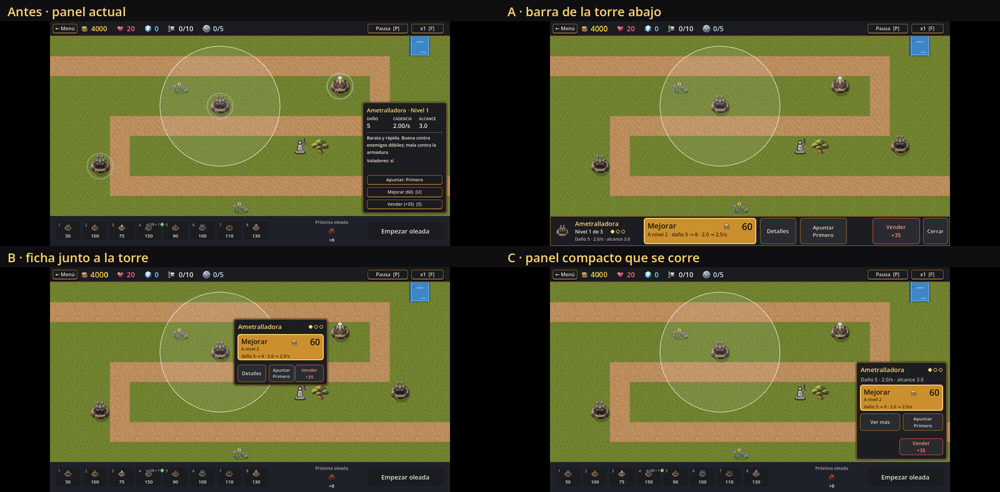
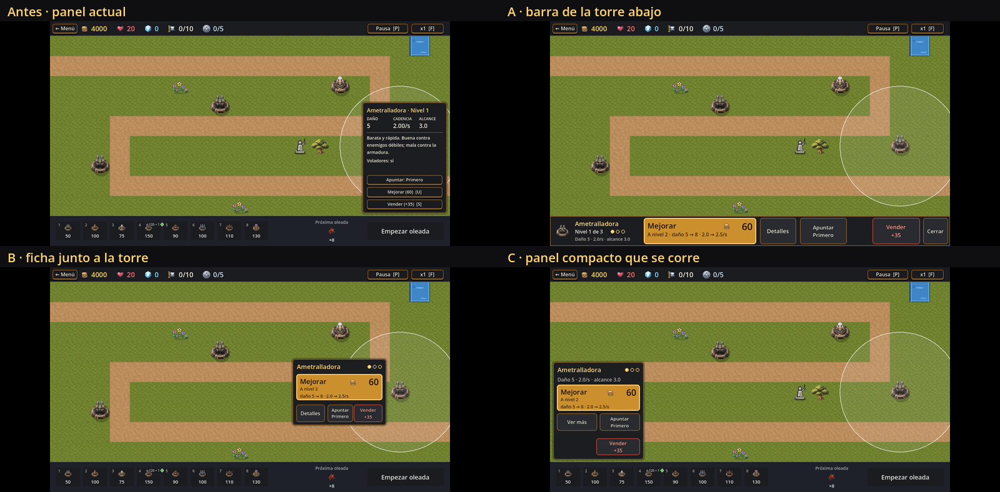
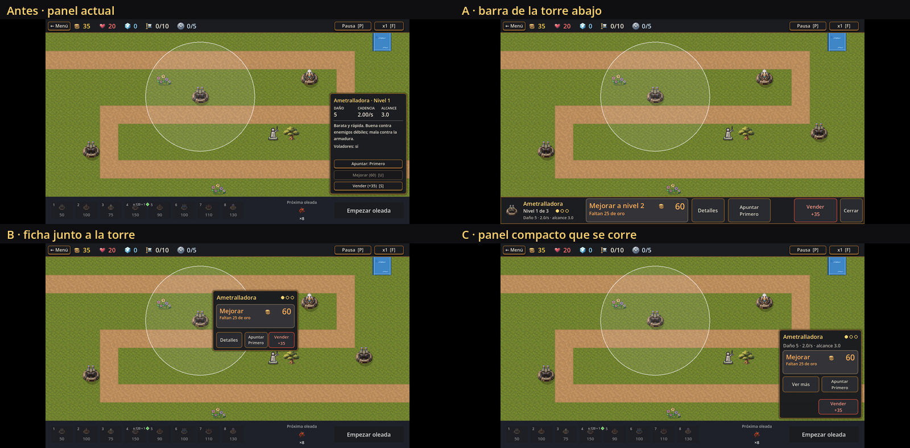
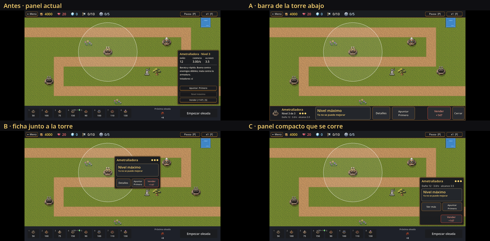
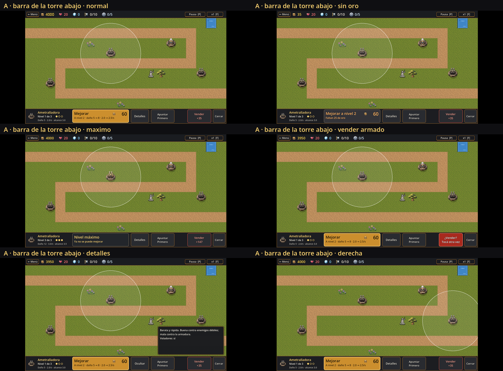
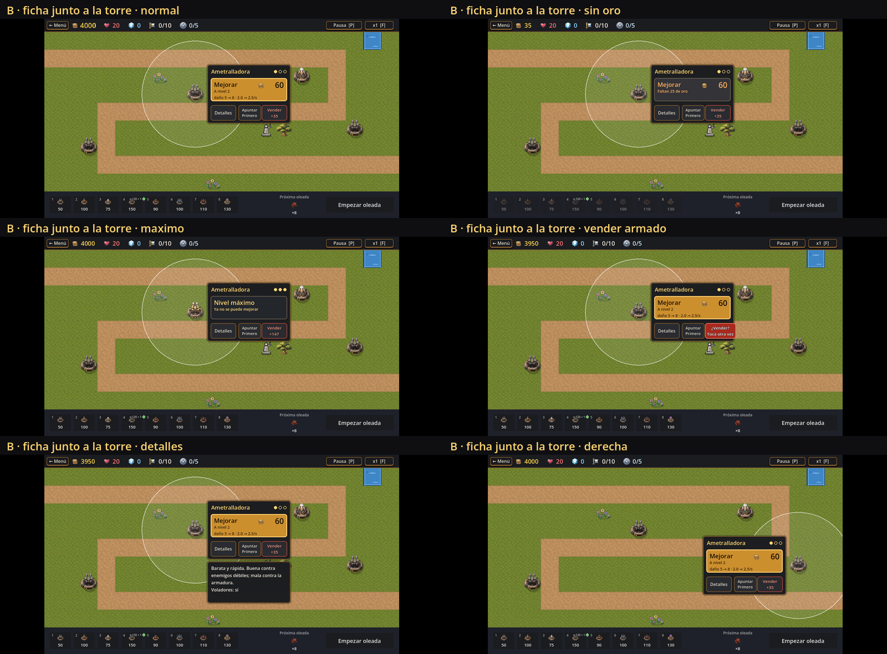
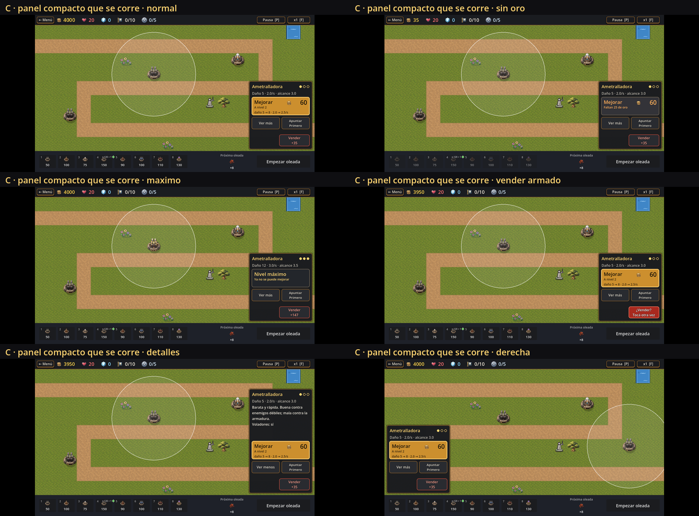

# T263 · Mejora de torre con menos fricción en el celular

> **Estado: PROPUESTA PARA DECIDIR (G7). Ninguna alternativa está aprobada.** Escrito el 2026-10-16 por Claude (Opus 5.5, esfuerzo medio), tarea **T263** (B-34; B-28 como antecedente). **No se tocó código, escenas, datos ni assets del juego.** Lo nuevo es una herramienta de muestras (`tools/t263_upgrade_mock.gd` y su `.tscn`) y las imágenes de [`art/t263-mejora-torre/`](../../../art/t263-mejora-torre/).
>
> **Punto de partida:** el informe [T262](T262-analisis-mobile.md) (§1.4, P-01, P-04, P-05, P-10, P-11) y sus capturas de `art/t262-mobile/`. No se repite su relevamiento: acá se usa como línea de base y se mide solo lo que T263 necesitaba (toques corridos, doble toque, cuánto mapa tapa cada panel).
>
> **Límite principal:** no hay celular en esta máquina. Todo se midió **en escritorio con la proporción de un celular** (20:9 = 1080 × 2400 a 405 ppi, y 16:9 chico = 720 × 1280 a 294 ppi, los mismos supuestos de T262) y con toques simulados que aciertan al píxel. El §9 junta lo que no se pudo probar.

## 0. Resumen (para quien lea solo esto)

1. **El problema no son los diálogos (no hay ninguno), es el panel.** Hoy mejorar cuesta 2 toques y 0 diálogos, pero el panel de 270 × 356 tapa el **13 % del mapa** (y la torre elegida si está en las columnas de la derecha), Mejorar mide **3,2 mm** de alto y Vender está a **0,6 mm** debajo (T262).
2. **Medido en T263 con el panel de hoy:** de **49 toques que apuntan a Mejorar y caen corridos** de 1 a 9 mm, **11 venden la torre al instante** (todos los que caen hacia abajo o en diagonal hacia abajo entre 2,3 y 6,8 mm). Un **doble toque rápido en Mejorar sube dos niveles** (1 → 3) y gasta el oro de las dos mejoras.
3. **Tres alternativas, dibujadas sobre la partida real** del nivel 1 y comparables (mismo nivel, misma torre, mismo tamaño de pantalla, antes y después): **A · barra de la torre abajo** (la barra de abajo cambia de «tienda» a «torre elegida»), **B · ficha junto a la torre** y **C · panel compacto que se corre** (el de hoy, más corto, que se pasa al otro lado si taparía la torre). Las tres tienen Mejorar de **84 px virtuales (7,9 mm)** con el costo y el ícono del oro, lo que se gana al mejorar, «Faltan N de oro» en vez de un gris mudo, detalles bajo demanda y Vender con **segundo toque**.
4. **Con las protecciones propuestas, ningún toque corrido vendió** en A, B ni C (B y C, a lo sumo, «arman» Vender, que vuelve solo a los 3 s), **un toque suelto o un doble toque sobre Vender no vende**, y el doble toque en Mejorar sube **un** nivel.
5. **Pasos:** mejorar sigue costando **2 toques** (3 para dos niveles), igual que hoy. **Vender pasa de 2 a 3 toques** (a propósito). Ver los detalles pasa de 1 (hoy siempre están, ocupando lugar) a 2.
6. **Recomendación (no decisión): A para el celular.** Es la única que **no tapa nada del mapa** (0 % contra 13 % hoy, 9 % B y 12 % C), deja los cinco botones a ≥ 7,5 mm de alto y aleja Vender **35 mm** de Mejorar. Su costo: mientras hay una torre elegida no se ven la tienda ni «Empezar oleada» (1 toque más para comprar o empezar la oleada). Si Lucas prefiere **un mismo panel para PC y celular**, C es el cambio más chico.
7. **Lo que tiene que decidir Lucas** está en el §8 (alternativa, solo celular o también PC, forma de proteger Vender, qué hacer con la tienda y «Empezar oleada» en A, el bloqueo de 0,35 s, y qué se muestra en el panel).

## 1. Línea de base (de T262, más lo que midió T263)

| Qué | Hoy | Fuente |
|---|---|---|
| Pasos para mejorar | 2 toques (torre → Mejorar), 0 diálogos | T262 §1.4 |
| Pasos para vender | 2 toques, 0 diálogos, **sin confirmar ni deshacer** | T262 §1.4 |
| Mejorar / Vender / Apuntar | 242 × 34 / 32 / 32 px virtuales = **22,8 × 3,2 / 3,0 / 3,0 mm** | T262 §1.6; `medidas_20x9.csv` |
| Separación Mejorar–Vender | **6 px = 0,6 mm** (0,5 mm en 16:9) | `tower_panel.tscn:125-141` |
| Mapa tapado por el panel | **13 %**; la torre de la columna 17 queda debajo | T263 (`tapa antes`), T262 prueba F |
| Letra del panel | 12 a 19 px virtuales = 7 a 11 sp | T262 §1.6 |
| Atajos `[U]` y `[S]` en los botones | Visibles en el celular, donde no sirven | T262 P-11 |
| Mejorar sin oro | Botón gris; el motivo («Faltan N de oro») solo está en el tooltip, que en el celular no aparece | `tower_panel.gd:121`, T262 §1.7 |
| **Toques corridos alrededor de Mejorar (49)** | **23 mejoran, 11 venden, 3 cambian el apuntado**, 12 no hacen nada o cierran el panel | T263 §4.2 |
| **Doble toque rápido en Mejorar** | **Sube dos niveles** (1 → 3) | T263 §4.3 |

Capturas de la línea de base: `antes_normal_20x9.png`, `antes_derecha_20x9.png` (la torre queda debajo del panel), `antes_sin_oro_20x9.png`, `antes_maximo_20x9.png`, y las de T262 (`art/t262-mobile/partida_n01_panel_*`).

## 2. Qué tiene que lograr el diseño (B-34)

- **Una acción principal clara:** Mejorar, grande, con **a qué nivel pasa**, **cuánto cuesta** (con el ícono del oro) y **qué gana** (daño, cadencia, alcance).
- **Estado legible sin tooltips:** nivel con puntos (●○○), «Faltan 25 de oro» escrito, «Nivel máximo» como estado y no como botón gris.
- **Detalles bajo demanda:** descripción, «Voladores», efectos, combinaciones e invertido detrás de un botón «Detalles», no siempre abiertos.
- **Protección:** Vender lejos de Mejorar **y** con segundo toque; Mejorar que no sume dos niveles por un doble toque.
- **No tapar la torre elegida ni, si se puede, el mapa.**
- **Sin atajos de teclado** en los botones del celular (P-11).

## 3. Las alternativas, en imágenes

Todas son **capturas reales de la partida del nivel 1** (Godot 4.7.2), con la torre «Ametralladora» elegida y el resto del HUD tal como está hoy. Las alternativas A, B y C son **controles de Godot dibujados encima del HUD por la herramienta** (el panel real se oculta); sus botones funcionan de verdad (mejoran, cambian el apuntado y venden). **No son arte final**: colores y bordes copian el estilo del panel actual (`game_panel_style.tres`) para que la comparación sea de forma y tamaño, no de estética.

### 3.1 Láminas comparables (las cuatro en la misma situación)

| Situación | 20:9 (1080 × 2400) | 16:9 chico (720 × 1280) |
|---|---|---|
| Torre en el centro, oro de sobra |  | `lamina_normal_16x9.png` |
| Torre en la columna 17 (donde hoy el panel la tapa) |  | `lamina_derecha_16x9.png` |
| No alcanza el oro (35 de 60) |  | `lamina_sin_oro_16x9.png` |
| Nivel máximo |  | `lamina_maximo_16x9.png` |

Cada lámina pone, en el mismo orden, **Antes** (arriba a la izquierda), **A** (arriba a la derecha), **B** (abajo a la izquierda) y **C** (abajo a la derecha). Las capturas sueltas a tamaño completo están al lado: `<alternativa>_<situación>_<20x9|16x9>.png`.

### 3.2 A · Barra de la torre abajo



- **Qué es:** al tocar una torre, la barra de abajo (96 px virtuales, donde hoy están las torres para comprar, «Próxima oleada» y «Empezar oleada») **pasa a mostrar la torre elegida**: ícono, nombre, «Nivel 1 de 3» con puntos y los números de hoy; **Mejorar** grande (360 × 84) con el costo; **Detalles**; **Apuntar** con el modo actual; **Vender** en la otra punta (152 × 84); **Cerrar**. Al cerrar o tocar el mapa vuelve la tienda.
- **Detalles:** un panel de 420 × 180 encima del mapa, **del lado opuesto a la torre**, solo mientras se pide.
- **A favor:** **0 % del mapa tapado**; la torre y su alcance siempre se ven; los botones quedan donde llegan los pulgares con el celular acostado; Vender a **35 mm** de Mejorar; la barra ya existe (es cambiar su contenido, no sumar una ventana). Encaja con la idea de T264 de una tienda que se abre y se cierra (la barra sería «tienda» o «torre», nunca las dos, como ya pide RF-73).
- **En contra:** mientras hay una torre elegida **no se ve la tienda ni «Empezar oleada»**: comprar otra torre o empezar la oleada cuesta 1 toque más (Cerrar o tocar el mapa). El ojo va de la torre (arriba) a la barra (abajo). «Cerrar» mide 7,5 mm de ancho (justo debajo de la marca). Una devolución con recursos («+210 y 2 recursos») puede no entrar en Vender a esa letra: **no se probó**.

### 3.3 B · Ficha junto a la torre



- **Qué es:** una ficha de 300 × 212 **al costado de la torre**, del lado con más lugar, a 44 px de su centro, que nunca la tapa. Arriba el nombre y los puntos de nivel; Mejorar (276 × 84) con costo y ganancia; abajo Detalles, Apuntar y Vender (56 de alto).
- **A favor:** todo está **cerca del dedo y de la torre** (menos recorrido); no cambia la barra de abajo (la tienda y «Empezar oleada» siguen a mano); tapa menos que hoy (**9 %**).
- **En contra:** **tapa el mapa justo alrededor de la torre** (otras torres, el camino que se quiere mirar); Vender queda a **1,3 mm** de Mejorar (la protección depende solo del segundo toque); los botones de abajo miden **5,3 mm** de alto. Con el zoom y el desplazamiento de T264 la ficha tendría que seguir a la torre (o cerrarse al mover el mapa): **más caro** y con más casos de error.

### 3.4 C · Panel compacto que se corre



- **Qué es:** el panel de hoy, en el mismo lugar, **más corto** (290 × 312, contra 270 × 356), con Mejorar grande (266 × 84), «Ver más» para la descripción y los efectos, Apuntar al lado y **Vender abajo a la derecha, separado 24 px** y con segundo toque. **Si la torre está en el tercio derecho del mapa, el panel se pasa a la izquierda.**
- **A favor:** es el **cambio más chico** (una escena que ya existe); sirve igual para PC y celular; la torre elegida ya no queda debajo; Vender a **8,3 mm** de Mejorar.
- **En contra:** sigue tapando el **12 %** del mapa (y al abrir «Ver más», más); puede tapar **otra** torre que se quiera tocar después; los botones secundarios miden 5,3 mm de alto.

## 4. Comparación medida

### 4.1 Tamaños, distancia y mapa tapado

Medidas de la herramienta (`medidas_20x9.csv`, `medidas_16x9.csv`, líneas «T263 medidas» y «T263 tapa» de `salida_*.txt`).

| | Antes | A | B | C |
|---|---|---|---|---|
| Mejorar (20:9, 405 ppi) | 22,8 × **3,2** mm | 33,9 × **7,9** mm | 26,0 × **7,9** mm | 25,0 × **7,9** mm |
| Mejorar (16:9 chico, 294 ppi) | 20,9 × 2,9 mm | 31,1 × 7,3 mm | 23,8 × 7,3 mm | 23,0 × 7,3 mm |
| Vender (20:9) | 22,8 × 3,0 mm | 14,3 × 7,9 mm | 8,7 × 5,3 mm | 13,2 × 5,1 mm |
| Apuntar / Detalles (20:9) | 22,8 × 3,0 / — (siempre abiertos) | 14,1 / 10,9 × 7,9 mm | 7,7 / 8,7 × 5,3 mm | 12,1 / 12,1 × 5,3 mm |
| **Distancia Mejorar–Vender** | **0,6 mm** (6 px) | **35,0 mm** (372 px) | **1,3 mm** (14 px) | **8,3 mm** (88 px) |
| **Mapa tapado** (torre al centro / a la derecha) | **13 % / 13 %** | **0 % / 0 %** | 9 % / 9 % | 12 % / 12 % |
| ¿La torre elegida queda debajo? | **Sí, en la columna 17** | No | No | No |
| Controles por debajo de 7,6 mm de lado | 3 de 3 | 1 de 5 («Cerrar», 7,5 mm de ancho) | 3 de 4 | 3 de 4 |
| Letra más chica | 12 px (7 sp) | 14 px (8 sp) | 14 px (8 sp) | 14 px (8 sp) |

La marca de 7,6 mm (48 dp) es la guía de Android que usó T262, no una regla del proyecto. Llegar a 84 px virtuales de alto obliga a usar toda la barra de abajo (A) o paneles más altos (B, C); en la barra de 96 px no cabe más.

### 4.2 Toques corridos: un dedo que apunta a Mejorar y cae al lado

La herramienta toca el centro de Mejorar corrido **12 a 96 px virtuales** (1,1 a 9,0 mm en el celular supuesto) hacia **abajo, arriba, izquierda, derecha y las dos diagonales de abajo**: 49 toques por alternativa. Se anota qué hizo cada uno **sin mejorar ni vender de verdad** (en «antes» se desconectan los botones reales del juego mientras dura la prueba).

| Resultado de los 49 toques | Antes | A | B | C |
|---|---|---|---|---|
| Mejora (lo que se quería) | 23 | 30 | 29 | 31 |
| **Vende al instante** | **11** | **0** | **0** | **0** |
| Arma Vender (pide el segundo toque, vuelve solo a los 3 s) | — | 0 | 2 | 0 |
| Cambia el apuntado | 3 | 0 | 4 | 3 |
| Abre los detalles | — | 0 | 1 | 3 |
| Cierra el panel (toca el mapa) | 1 | 4 | 1 | 0 |
| Nada (fondo del panel o entre botones) | 11 | 15 | 12 | 12 |

Corrida final de 20:9. En 16:9 los toques son los mismos en píxeles virtuales y el resultado es igual, salvo B (31 mejoran, 9 nada, 2 detalles): en B, dos o tres toques que caen justo en el borde de un botón cambian de una corrida a otra (29 a 31 mejoras en cuatro corridas); en las demás columnas no hubo cambios. Detalle por toque en `salida_20x9.txt` («toques corridos … detalle»). **Hoy, un dedo que cae entre 2,3 y 6,8 mm debajo del centro de Mejorar (o en diagonal hacia abajo) vende.** En A, lo que falla hacia arriba cae en el mapa y solo cierra el panel; en B, la diagonal hacia abajo a la derecha llega a Vender, que se arma pero no vende.

### 4.3 Doble toque y toque suelto en Vender

| Prueba | Antes | A | B | C |
|---|---|---|---|---|
| Dos toques en Mejorar a 3 cuadros (dedo que rebota) | **sube 2 niveles** (1 → 3) | sube 1 (el segundo cae en el bloqueo de 0,35 s) | sube 1 | sube 1 |
| Un toque suelto en Vender | **vende** | arma, no vende | arma, no vende | arma, no vende |
| Dos toques seguidos en Vender (a 3 cuadros) | vende (el segundo ya no encuentra torre) | **no vende** (segundo toque antes de 0,4 s) | no vende | no vende |
| Vender a propósito (toque, esperar 0,6 s, toque) | — | vende | vende | vende |

### 4.4 Pasos y toques por flujo

Desde «nada elegido». **M** = medido con toques simulados por la herramienta (líneas «T263 flujo»); **C** = contado sobre el diseño, sin simular.

| Flujo | Antes | A | B | C | |
|---|---|---|---|---|---|
| Mejorar un nivel | 2 | 2 | 2 | 2 | M |
| Mejorar dos niveles seguidos | 3 | 3 | 3 | 3 | M (con 0,5 s entre toques) |
| Vender | **2** | **3** | **3** | **3** | M |
| Ver descripción y efectos | 1 (siempre visibles, a veces hay que desplazar) | 2 | 2 | 2 | C |
| Cambiar el apuntado | 2 | 2 | 2 | 2 | C |
| Cerrar | 1 (tocar el mapa) | 1 (Cerrar o el mapa) | 1 | 1 | C |
| Saber por qué no se puede mejorar | no se puede (tooltip) | 1 («Faltan N de oro» a la vista) | 1 | 1 | C |
| Con una torre elegida, comprar otra | 2 | **3** (Cerrar + torre + casilla) | 2 | 2 | C |
| Con una torre elegida, empezar la oleada | 1 | **2** | 1 | 1 | C |
| Con una torre elegida, elegir otra que está debajo del panel | **2** (cerrar y tocar) | 1 | 1 o 2 (si la ficha la tapa) | 1 o 2 (si el panel la tapa) | C |
| Diálogos en cualquier flujo | 0 | 0 | 0 | 0 | — |

El segundo toque de Vender **no es un diálogo**: el mismo botón cambia a «¿Vender? Tocá otra vez» en rojo (`*_vender_armado_*.png`).

## 5. Protecciones propuestas (y sus alternativas)

| Riesgo | Propuesta en las muestras | Alternativas que Lucas puede preferir |
|---|---|---|
| Vender por error | **Segundo toque en el mismo botón**, que cuenta solo entre **0,4 y 3 s** después del primero; el botón cambia de texto y color; a los 3 s vuelve solo. Más **distancia** (A: 35 mm, C: 8,3 mm). | **Mantener apretado** 0,6 s con una barra que se llena (1 gesto, pero hay que descubrirlo y no se ve en la captura). **Deshacer** durante 4 s (vender al toque y ofrecer «Deshacer»): es lo más rápido, pero toca reglas (¿qué pasa si en esos 4 s la torre debía disparar o si el oro ya se gastó?) y necesita RF propio. |
| Mejorar dos veces por un doble toque | **Bloqueo de 0,35 s** después de mejorar, con «¡Nivel N!» en el botón mientras dura. | Sin bloqueo (como hoy). O confirmar cada mejora (más lento: **no** se recomienda, B-34 pide menos fricción). |
| Mejorar sin querer al tocar la torre | La interfaz aparece **lejos del dedo** (A abajo, C al costado) o **al costado de la torre** (B). Los botones de Godot actúan al **soltar** y solo si se apretó sobre ellos, así que el mismo toque que abre el panel no puede apretar Mejorar. | — |
| No entender por qué no mejora | «Faltan 25 de oro» escrito en el botón, en naranja. | Además, que el botón se habilite solo cuando alcanza (ya pasa hoy, RF-76). |
| Tapar la torre o su alcance | A no tapa; B y C se ponen del lado opuesto. | — |

**Casos de error que la implementación tiene que cubrir** (sacados de las pruebas y del diseño; ninguno está resuelto todavía):

1. **La torre se vende sola o se destruye mientras Vender está armado** (si existiera algo que destruye torres; hoy no) → el estado armado se borra al cambiar la selección (las muestras ya lo hacen).
2. **Se arma Vender y se toca otra torre** → la nueva aparece sin Vender armado (las muestras lo hacen al cambiar la selección).
3. **Se arma Vender y la partida se pausa** → con la pausa de hoy (RF-104) la torre se deselecciona: se pierde el armado, bien. Si T264 permite planear en pausa, definir si se puede vender en pausa.
4. **Se gana o se pierde el nivel con Vender armado** → hoy `sell()` no hace nada con la partida terminada (`build_controller.gd:214`); el panel debería cerrarse.
5. **Llega oro justo después de tocar Mejorar sin oro** → el botón «Faltan N» no hace nada al tocarlo; el siguiente toque ya mejora. Definir si el toque en «Faltan N» debería mejorar apenas alcance (no se recomienda: sería una mejora que la persona no vio).
6. **Se cambia el apuntado sin querer** (3 o 4 de 49 toques corridos en B y C, 3 hoy) → es reversible, pero hoy cicla por cuatro modos: tocar de más obliga a dar la vuelta. Se podría mostrar la lista al tocar (2 toques) en vez de ciclar.
7. **En A, se quiere comprar con una torre elegida** → la tienda no se ve: hay que cerrar primero. Medir en el celular si molesta (K7 del kit de T262).
8. **Torre de apoyo o de pulso** → Apuntar deshabilitado (las muestras lo hacen con la regla de `tower_panel.gd:117`), pero el lugar queda vacío o gris.
9. **Torre aturdida o con desgaste** (RF-280, RF-360) → el estado tiene que verse sin abrir los detalles (en A, en el renglón del nombre). **No se dibujó.**
10. **Torres de 2 × 2** → B y C miden la distancia desde el centro de la torre; con 2 × 2 el corrimiento de 44 px es menor que media torre: hay que sumar medio tamaño. **No se probó.**

## 6. Recomendación

**Para el celular, A · barra de la torre abajo**, con Vender de segundo toque (0,4 a 3 s) y el bloqueo de 0,35 s en Mejorar. Motivos, en orden:

1. Es la única que **no tapa nada del mapa** y nunca la torre ni su alcance (P-05).
2. Es la que más **separa la acción destructiva** de la principal (35 mm) y la única con todos los botones grandes de alto ≥ 7,5 mm (P-01, P-04).
3. **No suma ventanas:** reusa la barra que ya está y sigue la regla de RF-73 (torre para construir **o** torre elegida, nunca las dos).
4. Es la que mejor **convive con el zoom y el desplazamiento de T264**: no depende de dónde está la torre en la pantalla. B, en cambio, tendría que seguir a la torre al mover el mapa.

**Lo que se resigna:** con una torre elegida, comprar o empezar la oleada cuesta 1 toque más. Si eso molesta en el celular real, la variante es **A con «Empezar oleada» a la vista** (achicando Detalles y Apuntar) o cerrar la barra sola al empezar una oleada: **no se dibujó** y queda para decidir.

**Para PC**, la recomendación es **no cambiar el panel** salvo la **protección de Vender** (que también falla con el mouse, aunque mucho menos: con un monitor de 24", 6 px son 2,5 mm) y el bloqueo del doble clic. Si Lucas quiere **un solo panel para las dos plataformas**, **C** es el cambio más chico y ya resuelve que tape la torre, pero en el celular sigue tapando el 12 % del mapa.

**B** no se recomienda como primera opción: es cómoda para el dedo, pero tapa justo lo que se quiere mirar alrededor de la torre y es la más cara de hacer bien con zoom.

## 7. Cómo seguiría (después de G7, no ahora)

1. Lucas elige alternativa y protecciones (§8).
2. **M58** (spec mobile) escribe el RF de la mejora de torre en el celular y su decisión, con los casos de error del §5 como criterios «Dado / Cuando / Entonces».
3. Implementación con tests de lógica (estado armado y plazos en `scripts/logic/`, P10) y una pasada de la herramienta para regenerar las capturas con la escena real.
4. Prueba en el celular de Lucas con K7 y K8 del kit de T262 (mejorar 3 veces, ventas accidentales de 5) **antes y después**.

## 8. Lo que tiene que decidir Lucas

1. **¿Qué alternativa para el celular?** A (recomendada), B, C u otra.
2. **¿Solo en el celular o también en PC?** (recomendado: en PC solo la protección de Vender y el bloqueo del doble clic).
3. **¿Cómo se protege Vender?** Segundo toque (recomendado), mantener apretado o deshacer.
4. **¿Bloqueo de 0,35 s después de mejorar?** (recomendado sí; el número se ajustaría en el celular).
5. **En A: ¿qué pasa con la tienda y «Empezar oleada» mientras hay una torre elegida?** Ocultarlos (como en la muestra), dejar «Empezar oleada» a la vista, o cerrar la barra al empezar la oleada.
6. **¿Qué va siempre a la vista y qué en «Detalles»?** Propuesta: nombre, nivel con puntos, daño · cadencia · alcance, y lo que gana la mejora a la vista; descripción, «Voladores», efectos, combinaciones e invertido en Detalles.
7. **¿Apuntar cicla (como hoy) o abre una lista?**

## 9. Qué no se pudo probar

- **Nada corrió en un celular** (no hay dispositivo). En particular, **no se probó**:
  - el **dedo real**: su tamaño, el temblor, la oclusión (el dedo tapa lo que toca) y qué tan lejos cae de verdad; los corrimientos de 1 a 9 mm son una grilla fija, no una medición de personas;
  - si los **84 px virtuales** alcanzan en la mano, ni si los pulgares llegan cómodos a la barra de A con el celular acostado;
  - si **0,4 s y 3 s** para el segundo toque de Vender y **0,35 s** de bloqueo son buenos números: son estimaciones;
  - la **lectura** de la letra de 14 a 24 px virtuales (8 a 14 sp, una cuenta);
  - el **gesto del sistema** desde el borde de abajo (la barra de gestos de Android) cerca de la barra de A;
  - el «atrás» de Android con Vender armado o con los detalles abiertos.
- **Las muestras son prototipos dibujados encima del HUD**, no la escena del juego cambiada: no se probó cómo convive A con las **pestañas** de la barra (niveles 7 en adelante, RF-455), con el **panel de un removible** (RF-404), ni con el **cartel de la próxima oleada**.
- **Solo se dibujó la Ametralladora** del nivel 1: no se vieron nombres largos, devoluciones con recursos («+210 y 2 recursos»), torres de apoyo o de pulso, torres de 2 × 2, ni los estados «Aturdida» y «Desgaste».
- **La herramienta tuvo una falla intermitente:** en una corrida de 16:9, el flujo «vender a propósito» de C no vendió con 3 toques; al repetirla, sí (y en todas las de 20:9). No se encontró la causa; parece de tiempos de la prueba (el segundo toque depende de un temporizador de 0,6 s), no del diseño. Los números de este informe son de las corridas finales (`salida_*.txt`).
- **No se midió el tiempo** que tarda una persona en cada flujo, solo la cantidad de toques.
- **No se implementó nada en el juego** ni se escribió RF o D (T263 no lo hace, plan `12-plan-t262-t268.md` §4).

## 10. Cómo repetirlo

```bash
godot --headless --import   # si la herramienta es nueva para el editor
XDG_DATA_HOME=/tmp/xdg godot --path . --resolution 1600x720 res://tools/t263_upgrade_mock.tscn -- res=1600x720 tag=20x9
XDG_DATA_HOME=/tmp/xdg godot --path . --resolution 1280x720 res://tools/t263_upgrade_mock.tscn -- res=1280x720 tag=16x9 target=1280x720 ppi=294
```

Cada corrida tarda unos dos minutos, abre una ventana, usa un guardado temporal (`user://t263_upgrade_mock.json`, se borra al final), y deja en `art/t263-mejora-torre/` las capturas, las láminas, `medidas_<tag>.csv` y lo que imprime (redirigido a `salida_<tag>.txt` en esta entrega). Para otro celular: `target=WxH ppi=N`.
