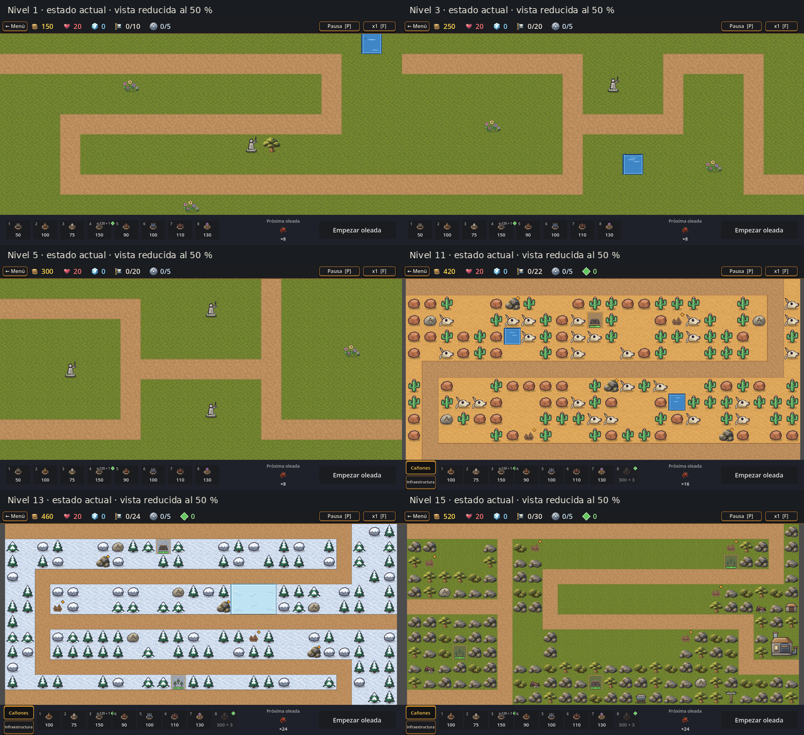
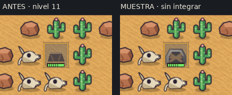
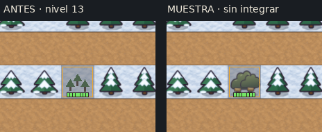
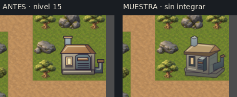
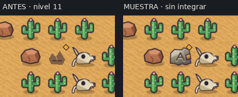
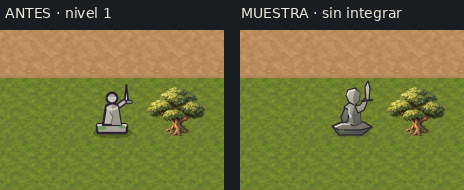
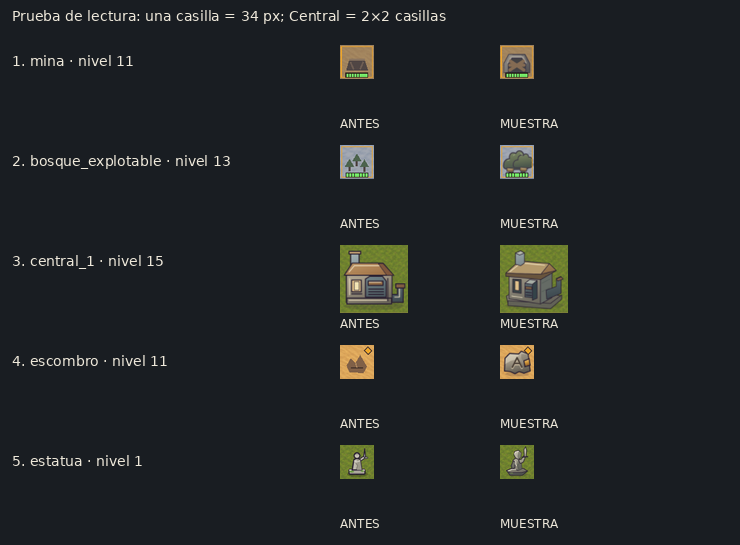
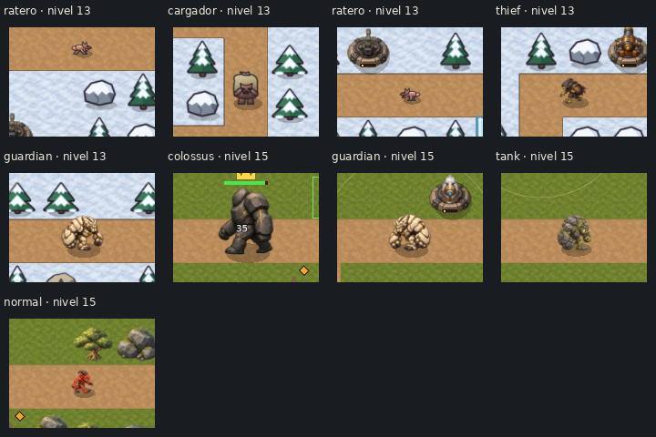
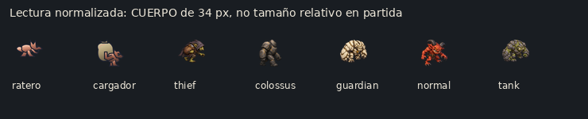

# T267a · Propuesta de mejora de assets con muestras

**2026-10-16 · Propuesta para revisión de Lucas. No hay assets nuevos integrados ni producción final autorizada. T267 sigue abierta.** Referencia: B-38, [inventario](T267a-inventario-assets.md), guía de arte y antecedentes T233/T260/T261. Versión de referencia: `6c38619`, en `feature/t267a-propuesta-assets`, antes del commit T267a.

**Recomiendo empezar por mina, bosque explotable, Central, escombros y estatua.** En mina, bosque explotable y escombros hay un problema previo al acabado: el juego no consume los SVG entregados y muestra dibujos provisionales por código. En la Central y la estatua se nota especialmente la convivencia de geometría frontal simple con árboles, rocas y cañones renderizados. Después revisaría la Cuadrilla y la decoración repetida de desierto/nieve; no empezaría por reemplazar los suelos que Lucas ya prefirió.

Para elegir: [comparador antes/después a escala nativa](../../../art/t267a/comparison.html). Permite alternar el mapa completo sin mover las piezas. Las cinco comparaciones de abajo son recortes a tamaño real, sin ampliación. Se puede elegir cada pieza por separado, conservar el antes o pedir otra dirección; ninguna muestra se declara aprobada.

## 1. Estado actual en imágenes

**El resumen está reducido.** Cada enlace de la tabla abre una captura original de **1280×720**, renderizada por Godot 4.7.2/OpenGL en esta máquina. No son mapas reconstruidos ni composiciones de assets. Se usó la escena real `game.tscn`, sus datos, cámara, HUD y capas de decoración. Un `SubViewport` fijo evita que el gestor de ventanas agrande la salida a 1777×999; no se achicó luego la captura para simular esa resolución.

| Nivel | Mapa actual, sin ayuda | Combate real preparado | Qué se ve |
|---|---|---|---|
| 1 · Pradera | [Original](../../../art/t267a/captures/level_01_current.png) | [Primera oleada](../../../art/t267a/captures/level_01_combat.png) | Estatua frontal plana junto a árbol renderizado; agua rectangular con borde duro. Suelo y camino se separan bien. |
| 3 · Encrucijada | [Original](../../../art/t267a/captures/level_03_current.png) | [Primera oleada](../../../art/t267a/captures/level_03_combat.png) | Estatua, flores y agua quedan expuestas sobre grandes superficies de pradera texturada; no hay árboles/rocas vecinos aquí. La estatua contrasta con el acabado de los cañones al combatir. |
| 5 · Fortaleza | [Original](../../../art/t267a/captures/level_05_current.png) | [Primera oleada](../../../art/t267a/captures/level_05_combat.png) | Las estatuas hacen visible la repetición del mismo dibujo pequeño; falta volumen, no más líneas de detalle. |
| 11 · Puesto seco | [Original](../../../art/t267a/captures/level_11_current.png) | [Primera oleada](../../../art/t267a/captures/level_11_combat.png) | Cactus, huesos y piedras rojizas muy repetidos y delineados. Mina casi reducida a un trapecio, escombros a triángulos; roca removible sí renderizada. |
| 13 · Paso alto | [Original](../../../art/t267a/captures/level_13_current.png) | [Primera oleada](../../../art/t267a/captures/level_13_combat.png) | Pinos, abetos y roca nevada vectoriales sobre nieve texturada; bosque explotable como tres triángulos. El hielo es una placa azul plana. |
| 15 · La Central | [Original](../../../art/t267a/captures/level_15_current.png) | [Primera oleada](../../../art/t267a/captures/level_15_combat.png) | Regresa la pradera renderizada, pero la Central, abastecimiento y campamentos son vectoriales. Extracción y escombros conservan las figuras provisionales. |

Las tomas `combat` juegan **tres segundos de la primera oleada**, con hasta tres torres compradas y **2000 de oro de ayuda**. No representan progreso humano ni prueban balance. Las tomas `current` no reciben esa ayuda. Los pares `current`/`proposal` se toman con el mismo mapa detenido, antes de construir: cambian únicamente las cinco piezas seleccionadas.

También capturé los vecinos **2, 4, 12 y 14** para revisar continuidad: [hoja reducida](../../../art/t267a/review/neighbors_overview.png), originales [2](../../../art/t267a/captures/level_02_current.png), [4](../../../art/t267a/captures/level_04_current.png), [12](../../../art/t267a/captures/level_12_current.png) y [14](../../../art/t267a/captures/level_14_current.png). El 2 suma la columna plana; el 4, el tronco. El 11→12 mantiene el mismo desierto saturado de objetos iguales; el 12→13 cambia de bioma pero conserva la geometría muy delineada; el 14 vuelve a columnas/señales vectoriales; el 14→15 hace más visible el cambio a roca y vegetación renderizadas. No hace falta igualar los biomas: sí su perspectiva, grosor aparente de borde y jerarquía de detalle.

## 2. Qué se revisó y qué desentona

El tamaño lógico de casilla es 64 px, pero la cámara lo reduce: **1–5: 64 px; 11: 52,36 px; 12: 49,23 px; 13–15: 48 px** en esta resolución. Un SVG de 64×64 no ocupa necesariamente 64 píxeles de pantalla ni su cuerpo llena el lienzo. [Metadatos de captura](../../../art/t267a/map_metadata.json).

| Orden | Pieza concreta y ruta actual | Motivo visual y alcance propuesto |
|---|---|---|
| **1** | Mina · `assets/sprites/map/mina.svg`, `mina_activa.svg`, `mina_agotada.svg` | **El SVG no está conectado en partida:** `MapDrawings.TEXTURES` no registra `mina`; `LevelDecor._draw_new_object()` dibuja el sustituto geométrico. El velo gris y la reserva dejan una boca casi ilegible a 34 px. Primero probar la boca/puntales existentes, luego ajustar material y estados. No confundir con retocar un archivo que hoy no se ve. |
| **2** | Bosque explotable · `assets/sprites/map/bosque_explotable.svg` y variantes `_activo`, `_agotado` | Tampoco está conectado: se ven tres arbolitos triangulares por código, casi una miniatura de la decoración de nieve. Compite con los pinos en 13 y desaparece sobre verde en 15. Probar una masa de extracción reconocible, troncos/cintas visibles y estados claros. |
| **3** | Central · `assets/sprites/map/central_1.svg` a `central_4.svg` | Se reconoce como edificio, pero su fachada frontal, contorno pesado y techo plano parecen una pieza de interfaz entre rocas y torres con volumen. Mantener 2×2 casillas y salida libre; probar techo visible, lateral oscuro y basamento coherente. No agregar efectos ni aumentar su tamaño. |
| **4** | Escombros · `assets/sprites/map/escombro.svg`, `escombro_trabajo.svg` | No está conectado el SVG: hoy son polígonos marrones simples, pequeños frente a las rocas removibles renderizadas. En desierto pierden contraste y en pradera parecen montículos de tierra. El SVG existente recupera piedra y signo, pero **se parece demasiado a `roca_marcada`**; no recomiendo conectarlo sin resolver esa diferencia. |
| **5** | Estatua · `assets/sprites/map/estatua.svg` | Primer extremo de la campaña: cuerpo frontal, cabeza circular y espada fina, con menos material que el árbol vecino. A 34 px domina el contorno. Probar silueta pétrea facetada y pedestal con profundidad, sin agrandar ni recargar. Afecta 1, 3 y 5, y otros consumidores de la misma ruta. |
| **6** | Cuadrilla · `assets/sprites/enemies/rendered/ratero.png`, `ratero_walk.png`, `cargador.png`, `cargador_walk.png` | En 13/14 convive un dibujo vectorial rasterizado muy simple con criaturas renderizadas. El Cargador se entiende por la bolsa, pero es casi una bolsa con patas; el Ratero ocupa muy poco cuerpo visible y a tamaño real parece una rayita con orejas. El problema combina acabado y superficie útil del cuadro. Preservar radios, anclaje, escalas, familia cobre/terracota y diferencia de siluetas; estudiar el encuadre antes de tocar parámetros. Sin muestra nueva en esta etapa. |
| **7** | Desierto: `cactus.svg`, `roca_roja.svg`, `huesos.svg`; nieve: `pino.svg`, `abeto.svg`, `roca_nieve.svg` | Mucha repetición del mismo perfil y borde oscuro en áreas densas. El 11 es especialmente cargado de cactus/cráneos; el 13 parece una trama de triángulos sobre la nieve. Trabajar familias pequeñas con volumen/material común, revisando la densidad existente; no sumar variantes ni cambiar el mapa ahora. |
| **8** | Señales: `roca_marcada.svg`, `simbolo_ruina.svg`, `campamento_vacio.svg`; abastecimiento: `supply_depot.svg`, `supply_line_pole.svg`, `supply_cart.svg` | La A se lee; conviene conservar su trazo. El soporte, campamento y abastecimiento son más planos que su entorno en 15. El poste es muy fino, aunque su silueta se reconoce; el depósito se parece a una casita pequeña. Revisarlos después de elegir el tratamiento de la Central, sin inventar símbolos ni cambiar significados. |
| **9** | Agua/hielo · `scenes/levels/level_decor.gd` | **No existen `agua.svg` ni `hielo.svg` consumidos.** Agua con ribete cuadrado y reflejos, hielo como placa plana: el corte con suelo texturado es visible. Cualquier mejora requerirá una tarea de dibujo por código o nuevos terrenos autorizados; no reemplazar `ground_*` para intentar corregirlos. |
| **10** | Íconos de recursos/infraestructura · `scenes/game/hud.gd`, `scenes/ui/infrastructure_tab.gd`; entregados en `assets/sprites/ui/` | El rombo verde del contador y los precios es una textura generada por código, aunque existe `stat_resources.svg`. La pestaña de infraestructura usa texto y figuras funcionales, no la demoledora entregada. El HUD es legible, pero son otros puntos de conexión pendientes; no rediseñar todo el HUD para resolverlos. |
| **Conservar por ahora** | `ground_pradera.png`, `ground_desierto.png`, `ground_nieve.png`, `ground_ruinas.png`, `path.png`; `flores.svg`; roca removible y torres renderizadas | El camino se separa del suelo y las criaturas de la primera oleada se leen. Las texturas son las restauradas que Lucas prefirió; las flores conservadas de T260 cumplen su papel bajo y pequeño. La roca removible tiene volumen y el rombo ámbar la distingue. No propongo volver a aplanar estos materiales. |
| **Revisar después, sin redibujar ahora** | Coloso · `colossus.png`, `colossus_walk.png`, Pedazo · `colossus_shard.png`, `colossus_shard_walk.png` | En el 15 el cuerpo oscuro, grande y facetado se separa del camino y del Guardián claro; está más cerca de las torres que la Cuadrilla. No es una razón para declararlo aprobado: falta revisar continuidad de facetas en las 16 poses, superposición en escolta y los Pedazos al dividirse. No se observó aquí una pérdida de contraste que justifique cambiar el suelo. |

**Corrección al inventario:** para dibujos como roca/árbol, el nombre de leyenda no garantiza que el juego use `map/<id>.svg`: `MapDrawings`/`MapThemes` apuntan a PNG renderizados. Para mina/bosque/escombros ocurre lo inverso: el SVG existe pero no se consume. El diagnóstico sigue la ruta efectiva, no solo el listado de archivos.

## 3. Cinco muestras antes/después en las casillas reales

**Izquierda: actual. Derecha: después propuesto, aislado.** No se alteran mapa, escala, suelo, cámara, marcas ni reservas. Los recortes incluyen vecinos para comparar materiales. [Pares completos de cada nivel](../../../art/t267a/comparison.html). Todas las muestras respetan el lienzo y nombre de destino existentes; los archivos nuevos están exclusivamente en `art/t267a`.

### 1 · Mina, nivel 11, casilla (11, 2)

Prueba el **SVG ya existente**, copiado sin modificarlo: una boca de piedra con puntales y tablones aporta una señal más concreta que el trapecio. El velo/reserva del juego sigue encima, por lo que no se presenta una mejora de contraste artificial retirándolo. A 34 px el marco se reconoce mejor, pero los tablones siguen apretados. **Elegir si esta forma de boca sirve; no aprobarla todavía para los tres estados.** La variante activa debería verse abierta y la agotada mantener el lugar reconocible. Hoy ninguna se conecta automáticamente: haría falta integrar el estado además de la textura.

### 2 · Bosque explotable, nivel 13, casilla (11, 10)

Prueba el **SVG existente**, sin modificarlo, frente a los tres triángulos actuales. La copa agrupada se diferencia de los pinos de alrededor y deja de parecer un miniárbol repetido. **Límite visible:** bajo el velo y a 34 px se vuelve una masa compacta; las cintas no alcanzan para explicarlo por sí solas. Elegir la masa agrupada como dirección y pedir más separación de troncos/cintas antes de producir. No es una recomendación de conexión inmediata.

### 3 · Central, nivel 15, cuatro casillas desde (24, 7)

Boceto vectorial nativo nuevo: cara superior y lateral, basamento y ventilación simplificada, luz arriba/izquierda. Mantiene exactamente **cuatro SVG 64×64**, orden NO/NE/SO/SE y huella 2×2. En esta cámara la huella es **96×96 px**; no se agrandó para que parezca más importante. La perspectiva conversa mejor con las rocas, pero el edificio sigue siendo más liso que ellas. Elegir si vale seguir esta dirección geométrica/material antes de producir un acabado final; no afirmar que ya iguala las torres renderizadas.

### 4 · Escombros, nivel 11, casilla (16, 2)

Prueba el **SVG existente**, sin modificarlo. Mejora el contraste de piedra sobre arena y hace visible lo que hoy son dos pequeños picos marrones. **Pero falla una comparación importante:** junto a las rocas con A parece otra señal permanente con una marca de demolición. Conviene conservar la marca ámbar del juego y diseñar una silueta de mampostería quebrada claramente diferente, preservando el signo canónico. Esta muestra permite rechazar la simple conexión del archivo como solución final.

### 5 · Estatua, nivel 1, casilla (12, 5)

Boceto vectorial nativo nuevo: piedra facetada, cabeza menos circular, pedestal con cara superior/lateral y espada todavía en alto. Conserva **64×64**, apoyo y posición; se muestra también en los pares de 3 y 5. La silueta deja de depender tanto de un borde grueso. A 34 px todavía se reconoce como figura con espada, aunque el brazo se junta con el torso. Elegir entre conservar la sencillez actual o seguir con este volumen, sin agregar microtextura que desaparezca.

Los dos bocetos nuevos también tienen [hoja de fuentes a 220 px](../../../art/t267a/review/source_contact_220.png) y [a 112 px para Wiki](../../../art/t267a/review/source_contact_112.png). Esas hojas comparan los SVG como fuentes, sobre el suelo de referencia; las cinco imágenes de arriba son las pruebas efectivas en mapa.

### Lectura a 34 px

Esta hoja **normaliza cada casilla a 34 px**; la Central ocupa 68×68, para conservar su relación 2×2. No es una captura de partida a otra resolución. Revela sobre todo los límites del bosque velado y la semejanza entre escombro y señal: no todos los «después» son soluciones terminadas.

## 4. Cuadrilla, Coloso, señales e íconos en contexto real

Se insertaron instancias reales de `Enemy`, con los datos y atlas integrados, sobre el recorrido de sus niveles: [Cuadrilla y comparadores en 13](../../../art/t267a/captures/level_13_diagnostic.png), [Coloso y comparadores en 15](../../../art/t267a/captures/level_15_diagnostic.png). Se conserva la escala del juego; el Coloso se dañó para mostrar su barra y corona. Las posiciones están elegidas para que se vean: **no son sus oleadas naturales ni una escolta jugada**. El acabado plano y el cuerpo pequeño del Ratero son visibles sin ampliarlo; la bolsa del Cargador sí ayuda a distinguirlo. El Coloso tiene masa propia y buen contraste en esta toma.

Esta segunda hoja iguala el cuerpo visible a 34 px, desde la imagen estática de cada `.tres`, para comparar silueta/material. **No demuestra sus tamaños relativos en combate**, que están en la imagen anterior. No se redibujaron enemigos ni se tocaron sus parámetros; las especies aprobadas de M43 son referencia, no candidatas a reemplazo en esta tarea.

Se revisaron extracción y demolición en curso con las capas reales: [11 actual](../../../art/t267a/captures/level_11_working_current.png)/[muestra](../../../art/t267a/captures/level_11_working_proposal.png), [13 actual](../../../art/t267a/captures/level_13_working_current.png)/[muestra](../../../art/t267a/captures/level_13_working_proposal.png), [15 actual](../../../art/t267a/captures/level_15_working_current.png)/[muestra](../../../art/t267a/captures/level_15_working_proposal.png). Se habilitan puntos y se adelanta un trabajo al 40 % con las APIs de infraestructura; no es tiempo de partida humana. Las muestras todavía no cambian al SVG activo/agotado: ese contrato queda pendiente de la integración futura.

La [pestaña de infraestructura con selección real](../../../art/t267a/captures/level_11_infrastructure.png) permite ver rombo de recursos, reserva, controles y tiempos. Las señales con A y los campamentos se inspeccionan en los mapas 11–15; no se las evaluó solo en una galería. `sendero`, `herramienta` y `poste_cintas` no aparecen en estos diez mapas: no atribuyo un defecto en partida a piezas que no se ven aquí. `hito` de T233 tampoco está en el catálogo de leyenda efectivo; las rocas marcadas cumplen ese papel visual en los mapas revisados.

## 5. Selección pendiente y límites de la entrega

Propuesta de orden para la próxima etapa: **elegir primero la silueta de extracción y el volumen de Central/estatua**, decidir qué hacer con la semejanza escombro/señal y luego producir únicamente las piezas elegidas. Para la Cuadrilla hace falta una propuesta propia de acabado/encuadre con las cuatro direcciones, manteniendo su identidad y números. No doy por aprobadas las muestras ni cierro T267 o habilito el reenvío al tester.

Se conservaron las rutas y tamaños de todos los archivos del juego: **cero cambios en `assets/`, `data/`, `scripts/`, `scenes/` y `tools/`**. [Manifiesto](../../../art/t267a/manifest.json), [originales y bocetos](../../../art/t267a/sources/), [reproducción y método](../../../art/t267a/README.md). Las únicas conexiones nuevas viven en la escena de revisión `art/t267a`, no en la campaña. El comparador permite revisar las cinco prioridades y también los vecinos.

**Verificación:** importación con salida 0; **1635/1635 tests GUT**, 19704 asserts, 117 scripts, **0 `SCRIPT ERROR`/`Parse Error`/`Failed to load script`**; **16/16 herramientas `tools/*.gd`** con `--check-only`, salida 0 y sin esos errores. La suite conserva el error esperado del fixture `no_existe`, avisos de guardados corruptos provocados por tests y huérfanos informados por GUT. La captura final termina con salida 0, sin errores ni avisos del motor. El import avisa que no hay daemon ADB en `tcp:5037`, sin impedir que termine correctamente. [Salidas completas](../../../art/t267a/validation/).

El [control de comparación](../../../art/t267a/validation/comparison_check.json) comprueba que los diez pares antes/después **no tienen diferencias fuera de las casillas seleccionadas**. Las capturas y los recortes se revisaron visualmente; los PNG originales miden 1280×720. Se conserva el registro de intentos fallidos de preparación: arranque prematuro antes de terminar el import, corrección de un array tipado y de una sangría en la herramienta local; no se los cuenta como validaciones verdes.

**No probado:** partida humana completa, todas las oleadas y especies, ciclo completo de extracción agotada, división del Coloso, coherencia de las 16 poses de Cuadrilla/Coloso, Windows/Android, exportaciones o FPS. La legibilidad observada corresponde a escritorio 1280×720 y a la hoja normalizada de 34 px; no equivale a validación móvil ni a aprobación artística de Lucas. No se hizo push ni publicación externa.
