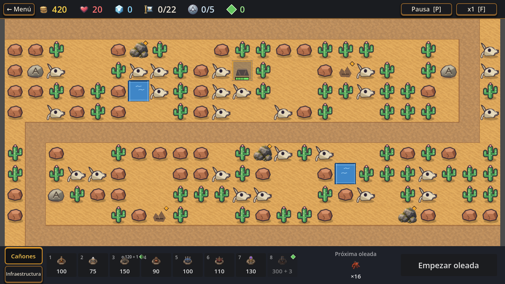
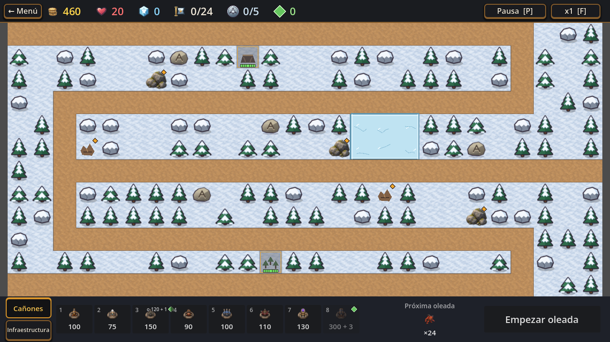
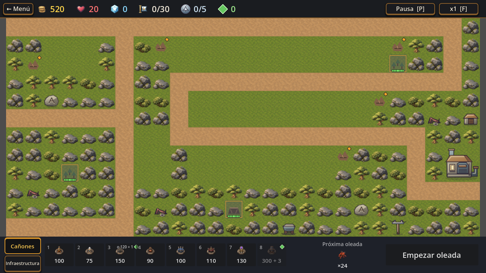

# T267a · Guía visual para revisar las muestras

Esta página reúne las imágenes más útiles para evaluar las propuestas sin empezar por las hojas reducidas. Cada captura de mapa es la imagen original de Godot a **1280×720**. Las comparaciones de piezas aparecen a lo ancho de la página para que se distingan mejor; abrir cada imagen permite verla en su resolución original. Esa ampliación de lectura **no cambia el tamaño de la pieza dentro del juego**.

Las muestras son propuestas, no aprobación final. El informe completo conserva el diagnóstico, las limitaciones y las decisiones pendientes: [T267a · Propuesta de mejora de assets](T267a-propuesta-assets.md). También está disponible el [comparador interactivo antes/después](../../../art/t267a/comparison.html).

## Contexto en el mapa real

### Nivel 11 · Puesto seco

Captura original, antes de construir. La cámara reduce las casillas a unos 52 px a 1280×720.

### Nivel 13 · Paso alto

Captura original, antes de construir. La cámara reduce las casillas a 48 px a 1280×720.

### Nivel 15 · La Central

Captura original, antes de construir. La comparación de la Central mantiene su huella de 2×2 casillas.

## Comparaciones de piezas

En cada imagen, **izquierda es el estado actual y derecha es la muestra**. Son recortes de revisión; no implican cambiar cámara, mapa, casillas, materiales ni reglas. Para cada par, el comparador permite ver los mapas completos y alternar entre estados.

### Mina · nivel 11

La muestra reutiliza el SVG existente. El velo y la reserva siguen presentes; la lectura de tablones a escala real todavía es limitada.

### Bosque explotable · nivel 13

La copa agrupada se separa de los pinos, aunque bajo el velo se vuelve una masa compacta.

### Central · nivel 15

Boceto con techo, lateral y basamento; conserva cuatro partes de 64×64 y la huella existente.

### Escombros · nivel 11

El SVG existente mejora el contraste de piedra, pero se parece demasiado a la roca marcada.

### Estatua · niveles 1, 3 y 5

El boceto explora una silueta pétrea con pedestal; falta validar que se distinga del resto a escala real.

## Qué queda por decidir

Las imágenes permiten juzgar dirección y escala, pero no autorizan producción ni integración. La mina necesita estados activo/agotado; al bosque le falta separar troncos y cintas; el escombro debe distinguirse de la roca marcada; Central y estatua siguen siendo bocetos. Elegí piezas por separado, pedí otra dirección o conservá el estado actual. No hay que aprobar el paquete entero como bloque.
