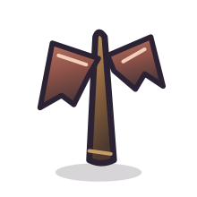
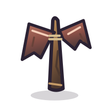
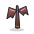
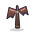
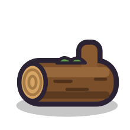
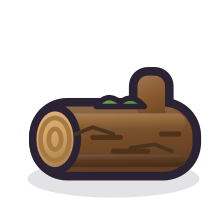
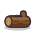
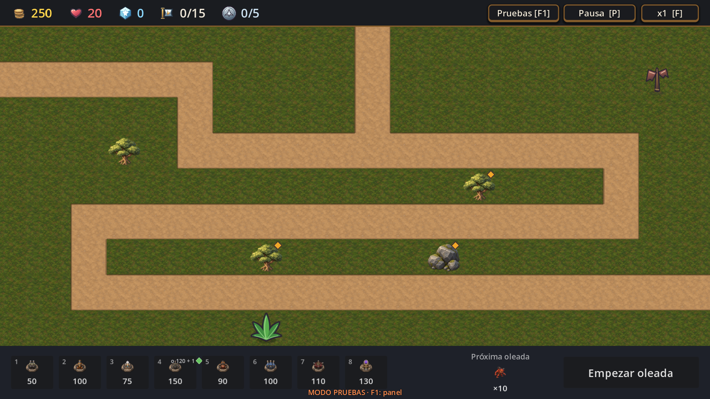
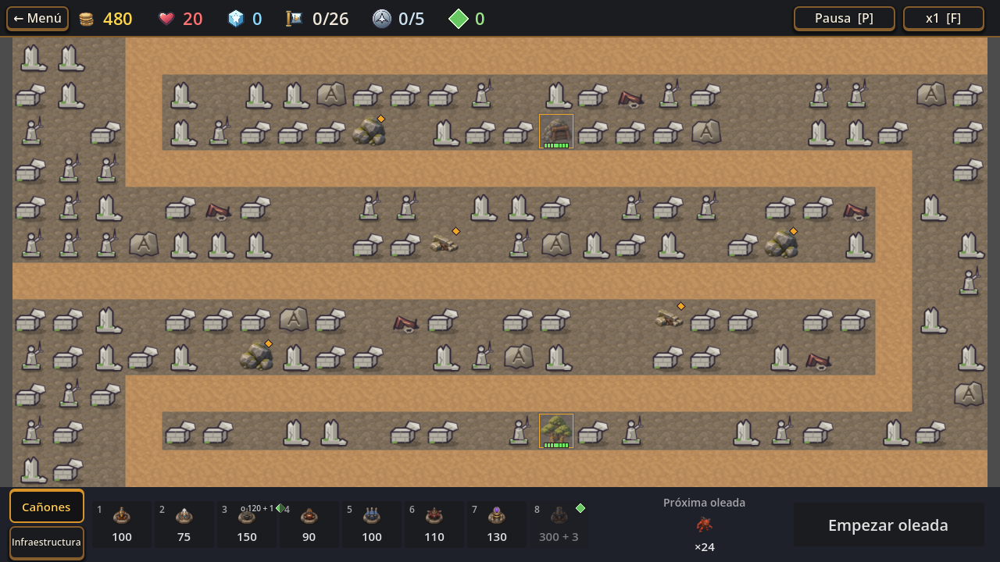
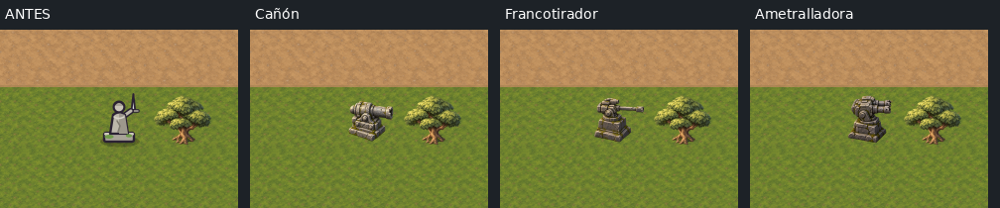

# T436 · Muestras visuales para revisar T434

Esta página reúne recursos que ya existen en el repositorio. **Las columnas “después” son propuestas previas, no arte integrado ni aprobado.** Ningún sprite de producción se cambió para preparar esta revisión.

## Nivel 6 · bosque

Las variantes “después” vienen de T260, que había pulido la decoración vectorial y luego se revirtió. Las mismas imágenes se abren a tamaño original desde los enlaces.

### Helecho

| Antes · 220 px | Propuesta T260 · 220 px |
|---|---|
|  |  |

| Antes · 34 px | Propuesta T260 · 34 px |
|---|---|
|  |  |

### Poste con cintas

| Antes · 220 px | Propuesta T260 · 220 px |
|---|---|
|  |  |

| Antes · 34 px | Propuesta T260 · 34 px |
|---|---|
|  |  |

### Tronco

| Antes · 220 px | Propuesta T260 · 220 px |
|---|---|
|  |  |

| Antes · 34 px | Propuesta T260 · 34 px |
|---|---|
|  |  |

### En contexto

La siguiente captura es la partida de nivel 6 con los recursos que se usan actualmente. La página T260 tiene además galerías rotuladas y el mapa con muestras superpuestas para facilitar la comparación.

Abrir la [galería completa de T260](../../../art/t260-decoration/comparison.html) o el [informe de esa propuesta](../../../art/t260-decoration/README.md).

## Nivel 14 · estatuas en ruinas

La captura muestra el recurso guerrero que la auditoría señala como inconsistente con D-098 y la guía de arte, que reservan las estatuas para torres.

T267b contiene una muestra anterior de estatuas basadas en torres. Sigue **pendiente de aprobación**, y la muestra visible tiene materiales/piezas mecánicas que no respetan plenamente la dirección vigente de piedra erosionada sin metal ni mecanismos. Por eso sirve como referencia de historial, pero no como solución aprobada para las ruinas.

La próxima propuesta debería mostrar una torre reconocible tallada en piedra gris, con musgo, sobre el suelo de ruinas, junto al Estandarte para comprobar que se distinguen. No se generó esa variante todavía.

## Caminata hacia la izquierda

Los atlas actuales ya incluyen una fila de caminata hacia la izquierda y el selector de dirección del juego la usa. No se espejan esos personajes. El comparador de los 18 atlas está en el [PR #36](https://github.com/pasaporteN25/MonstersAndCanons/pull/36), junto con el diagnóstico que recomienda no rehacer todos los ciclos y elegir un caso prioritario antes de producir más arte.

## Decime para la siguiente iteración

- Para helecho, poste y tronco: ¿la propuesta T260 se conserva como dirección o querés corregir alguna antes de integrarla?
- Para la estatua: ¿priorizamos producir una muestra nueva que cumpla D-098, con una torre tallada en piedra y musgo sobre el suelo de ruinas?
- Para los atlas izquierdos: ¿querés elegir uno de los candidatos de T431 para una mejora puntual, o por ahora los dejamos como están?

La revisión visual de estos casos no reemplaza una auditoría de referencias dinámicas ni resuelve el atraso general de decoración de niveles 10–14; son seguimientos separados señalados por T434.
