# T545 · Revisión de textos e imágenes del lore

*Preparado el 2026-10-28 por Claude (Sonnet 5.5) para que Lucas lea y decida. **No se cambió ningún texto del juego, ni `data/`, ni código.** Todo lo que sigue sale de leer el repositorio real; las capturas son de PC a 1280×720 tomadas con el motor (`art/t545-revision/capture_t545.gd`). La versión para leer cómodo, con las imágenes y un recuadro de decisión por pieza, es `art/t545-revision/revision.html`.*

## Cómo leerlo

- Cada pieza trae el texto actual **tal cual**, su fuente, los límites (RF-464) y observaciones objetivas contra `specs/10-universo.md`. Los hallazgos van marcados `H1`…`H16` con prioridad **Alta / Media / Baja** y, donde hay un problema real, 1 o 2 alternativas cortas. **No se reescribió nada que no tuviera un problema.**
- Vocabulario vetado de la biblia («enemigo», «peligro», «bestia», «salvaje», «invasor», «nativo», «indio», «alien», «monstruo», «malvado», «héroe»): **no aparece en ningún texto de lore** (niveles, epílogo, intro, créditos ni Wiki Lore). Sí en la Wiki mecánica («enemigo»), donde la biblia lo permite.
- Todos los límites de caracteres se cumplen: lugares de 7 a 31 de 32; entradas de 125 a 201 de 240; victorias de 59 a 134 de 160; ninguna línea pasa de 90 (la más larga, 86, está en la entrada del 13).

## Resumen de hallazgos

| # | Prioridad | Hallazgo |
|---|---|---|
| H1 | Alta | El agua del oasis y el nivel 2 se contradicen |
| H2 | Alta | Victoria del 15 («luz propia», «línea de abastecimiento completa») frente al epílogo nuevo |
| H3 | Alta | El epílogo: «la máquina» no tiene referente en el canon y la partida en 3 líneas |
| H4 | Media | La imagen del final todavía es la de T233 (luminosa) |
| H5 | Media | Nivel 13: el texto habla de «hitos de piedra» pero el mapa dibuja rocas marcadas |
| H6 | Media | Dos nombres por nivel y de estilo mezclado |
| H7 | Media | Nivel 14: lo «vacío» se anuncia tres veces |
| H8 | Media | Jefe en el juego, Soberano en el lore |
| H9 | Media | Dónde queda la Central |
| H10 | Baja | Voz: «informe» y «nosotros» mezclados |
| H11 | Baja | Nivel 11: «paso asegurado» frente al lugar «El punto de agua» |
| H12 | Baja | Repeticiones entre campos del mismo nivel |
| H13 | Baja | Entradas con frases de relleno o referencias sueltas |
| H14 | Baja | Wiki: «Los poblados vacíos» repite la victoria del 14 |
| H15 | Baja | Créditos: solo lo comprobable |
| H16 | Baja | Intro: tiempos verbales y un dato que choca con H1 |

## Tabla de los 15 niveles (lo que el jugador lee)

| # | Nombre | Lugar (car.) | Entrada (car.) | Victoria (car.) | Hallazgos |
|---|---|---|---|---|---|
| 1 | Pradera | Campamento de aterrizaje (24) | 138 | 98 | H1 |
| 2 | Desfiladero | El paso del agua (16) | 149 | 91 | H1, H12 |
| 3 | Encrucijada | Las huertas (11) | 144 | 96 | H13 |
| 4 | Espiral | El pozo (7) | 150 | 89 | H13, H1 |
| 5 | Fortaleza | La empalizada (13) | 125 | 92 | H10, H6 |
| 6 | Nido | El lindero (10) | 154 | 77 | H6, H10 |
| 7 | Cruce | El aserradero (13) | 151 | 106 | H2, H6 |
| 8 | Bastión | El bastión sobre ruinas (23) | 150 | 110 | H6, H10 |
| 9 | Taller asediado | El taller (9) | 171 | 119 | H6, H13 |
| 10 | La mina vieja | Primer puesto de abastecimiento (31) | 157 | 134 | H12, H6 |
| 11 | Puesto seco | El punto de agua (16) | 153 | 81 | H11 |
| 12 | El cañadón | El paso hacia el norte (22) | 194 | 113 | H13, H12 |
| 13 | Paso alto | El camino al resto de la región (31) | 198 | 101 | H5, H9 |
| 14 | Los poblados vacíos | Asentamientos de los Moradores (30) | 144 | 59 | H7, H14 |
| 15 | La Central | Energía y abastecimiento (24) | 201 | 89 | H2, H9 |

## 1. Niveles: nombre, lugar, entrada y victoria

### Selector de campaña (vista de mapa)

- **Fuente:** scenes/ui/level_select.gd, campaign_map_view.gd; los nombres salen de `nombre` de cada data/levels/level_NN.json
- **Límites:** nombre: una línea, se recorta con «…» si no entra

| Campo | Texto actual |
|---|---|
| Qué se lee | Título «Elegir nivel»; en el mapa, «15 · La Central» bajo la insignia del nivel elegido y, en la franja de abajo, «Disponible · sin victorias todavía». El lugar de cada nivel no se ve en el mapa: aparece en la vista de tarjetas (bajo el nombre) y en el cartel de entrada. |

- **Observaciones:** Solo lleva el nombre del nivel (H6). La captura es con 14 niveles completados para ver el mapa entero.
- **Hallazgos:** H6

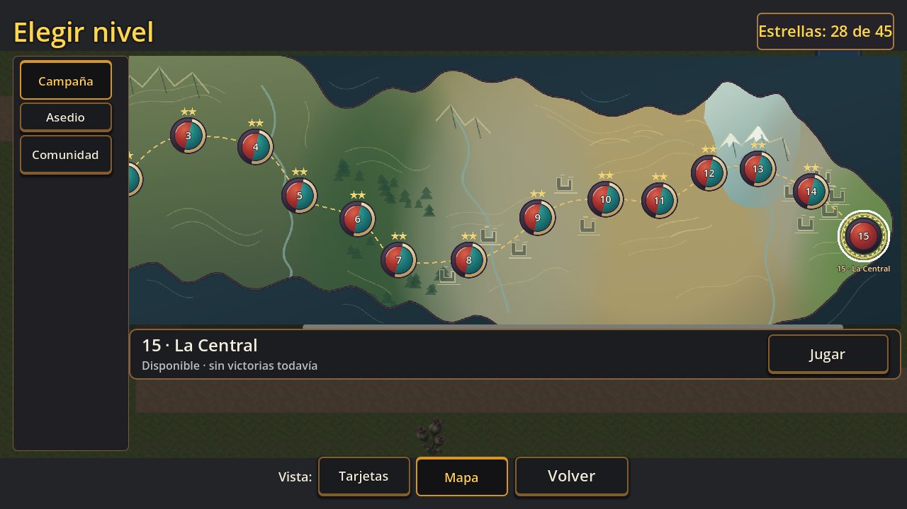

### Nivel 1 · Pradera

- **Fuente:** data/levels/level_01.json (campo `textos`; texto fuente: specs/11-textos-lore.md §1)
- **Límites:** lugar 24/32 · entrada 138/240 (3 líneas, máx. línea 61/90) · victoria 98/160 (2 líneas, máx. línea 58/90)

| Campo | Texto actual |
|---|---|
| Nombre (tarjeta y mapa) | Pradera |
| Lugar | Campamento de aterrizaje |
| Entrada | La nave quedó en el borde del oasis. Hay agua, pasto y un terreno firme donde armar el campamento. Antes de descargar, hay que defenderlo. |
| Victoria | Campamento asegurado. Las primeras torres quedaron en pie. La carga de la nave se baja esta noche. |

- **Observaciones:** Sin problemas de tono. «La carga de la nave se baja esta noche» es coherente con la intro (la nave no vuelve a despegar). Confirma que en el nivel 1 el agua está en el oasis (ver H1).
- **Hallazgos:** H1

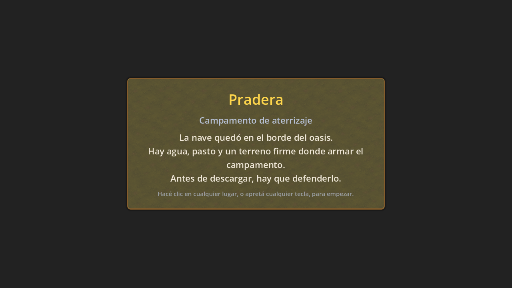

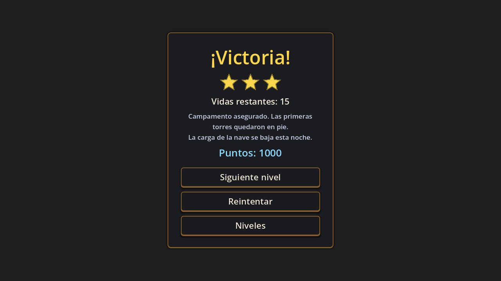

### Nivel 2 · Desfiladero

- **Fuente:** data/levels/level_02.json (campo `textos`; texto fuente: specs/11-textos-lore.md §1)
- **Límites:** lugar 16/32 · entrada 149/240 (3 líneas, máx. línea 60/90) · victoria 91/160 (2 líneas, máx. línea 60/90)

| Campo | Texto actual |
|---|---|
| Nombre (tarjeta y mapa) | Desfiladero |
| Lugar | El paso del agua |
| Entrada | El agua dulce más cercana está al otro lado del desfiladero. Sin ese paso, el campamento no aguanta. Hay que sostenerlo antes de tender las cañerías. |
| Victoria | Paso asegurado. El agua llega al campamento por primera vez. Faltan tres tramos de cañería. |

- **Observaciones:** Contradice la intro, el nivel 1 y el artículo «El oasis» (H1). «Faltan tres tramos de cañería» es un dato de juego que no se vuelve a nombrar. El lugar «El paso del agua» y «Paso asegurado» repiten «paso» (H12).
- **Hallazgos:** H1, H12

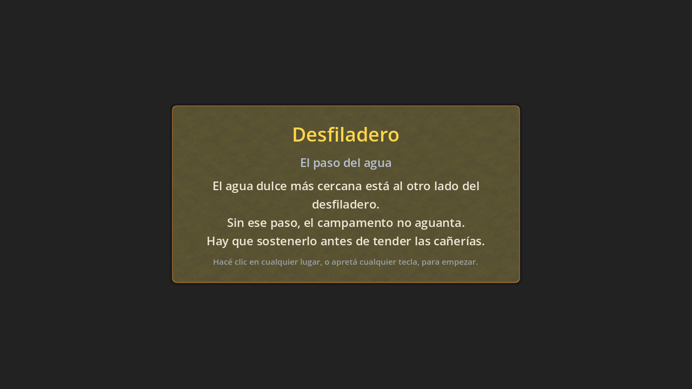

### Nivel 3 · Encrucijada

- **Fuente:** data/levels/level_03.json (campo `textos`; texto fuente: specs/11-textos-lore.md §1)
- **Límites:** lugar 11/32 · entrada 144/240 (3 líneas, máx. línea 62/90) · victoria 96/160 (2 líneas, máx. línea 49/90)

| Campo | Texto actual |
|---|---|
| Nombre (tarjeta y mapa) | Encrucijada |
| Lugar | Las huertas |
| Entrada | Al norte del campamento hay tierra buena para sembrar. Dos caminos se cruzan justo ahí, y por los dos llegan manadas. Sin huerta no hay cosecha. |
| Victoria | Huertas aseguradas. Se sembró el primer surco. Lo que crezca depende de que las torres aguanten. |

- **Observaciones:** La línea 3 es casi tautológica (H13). «Manadas» se usa por primera vez: es el vocabulario de la biblia.
- **Hallazgos:** H13

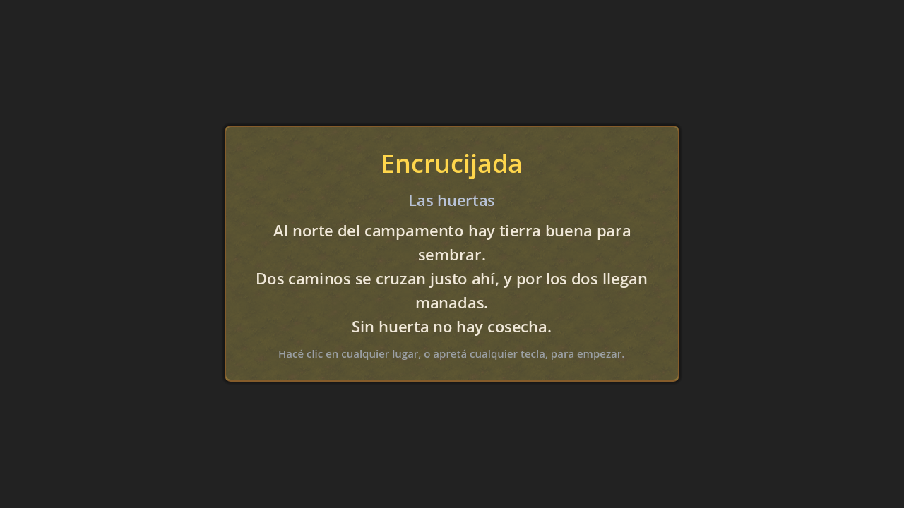

### Nivel 4 · Espiral

- **Fuente:** data/levels/level_04.json (campo `textos`; texto fuente: specs/11-textos-lore.md §1)
- **Límites:** lugar 7/32 · entrada 150/240 (3 líneas, máx. línea 61/90) · victoria 89/160 (2 líneas, máx. línea 46/90)

| Campo | Texto actual |
|---|---|
| Nombre (tarjeta y mapa) | Espiral |
| Lugar | El pozo |
| Entrada | El arroyo no alcanza para toda la colonia. Hay que cavar un pozo en el centro del valle. El camino hasta ahí da muchas vueltas: que les cueste llegar. |
| Victoria | Pozo terminado. Hay agua para toda la colonia. Se armó un turno de guardia para cuidarlo. |

- **Observaciones:** «que les cueste llegar»: sin referente (H13). El «arroyo» es el mismo que podría haber traído el nivel 2 (H1). Victoria: buena, concreta.
- **Hallazgos:** H13, H1

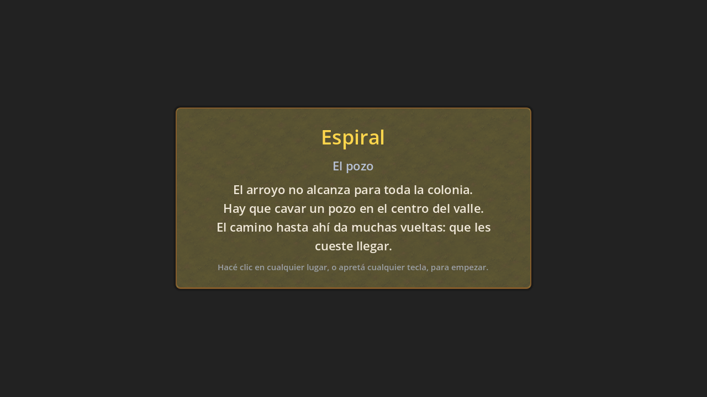

### Nivel 5 · Fortaleza

- **Fuente:** data/levels/level_05.json (campo `textos`; texto fuente: specs/11-textos-lore.md §1)
- **Límites:** lugar 13/32 · entrada 125/240 (3 líneas, máx. línea 55/90) · victoria 92/160 (2 líneas, máx. línea 57/90)

| Campo | Texto actual |
|---|---|
| Nombre (tarjeta y mapa) | Fortaleza |
| Lugar | La empalizada |
| Entrada | El campamento ya es un pueblo y todavía no tiene cerco. Hoy se cierra el primer perímetro. Lo que quede afuera, queda afuera. |
| Victoria | Empalizada cerrada. Es el primer perímetro de la colonia. Por primera vez, dormimos adentro. |

- **Observaciones:** Fuerte y coherente con la biblia (consecuencia, sin sentencia). «Lo que quede afuera, queda afuera» puede leerse como indiferencia, que es lo que se busca. Primera persona en «dormimos» (H10). El nombre «Fortaleza» no se parece al lugar «La empalizada» (H6).
- **Hallazgos:** H10, H6

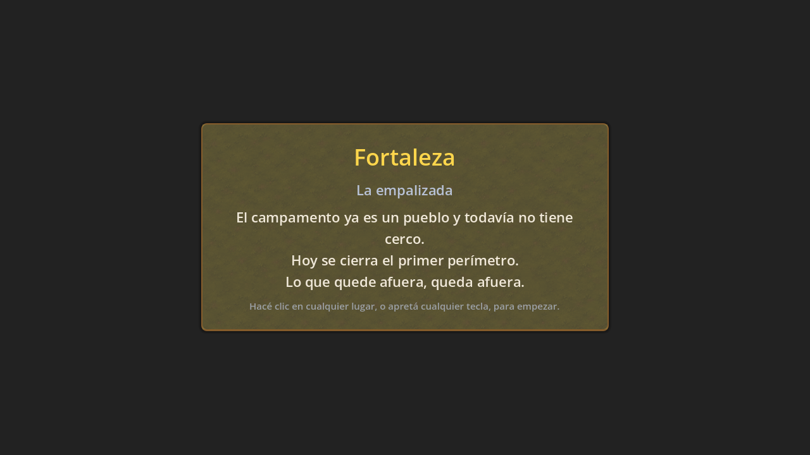

### Nivel 6 · Nido

- **Fuente:** data/levels/level_06.json (campo `textos`; texto fuente: specs/11-textos-lore.md §1)
- **Límites:** lugar 10/32 · entrada 154/240 (3 líneas, máx. línea 71/90) · victoria 77/160 (2 líneas, máx. línea 43/90)

| Campo | Texto actual |
|---|---|
| Nombre (tarjeta y mapa) | Nido |
| Lugar | El lindero |
| Entrada | El bosque empieza donde termina el cerco. Hay madera para varios años, y también criaturas que no habíamos visto. Del campamento empezaron a faltar cosas. |
| Victoria | Lindero asegurado. Se taló el primer tramo. La madera alcanza para dos casas. |

- **Observaciones:** «Nido» no aparece en el texto (H6). «criaturas que no habíamos visto» usa el término del canon («criaturas»). «Del campamento empezaron a faltar cosas» presenta al Ladrón sin nombrarlo: buena.
- **Hallazgos:** H6, H10

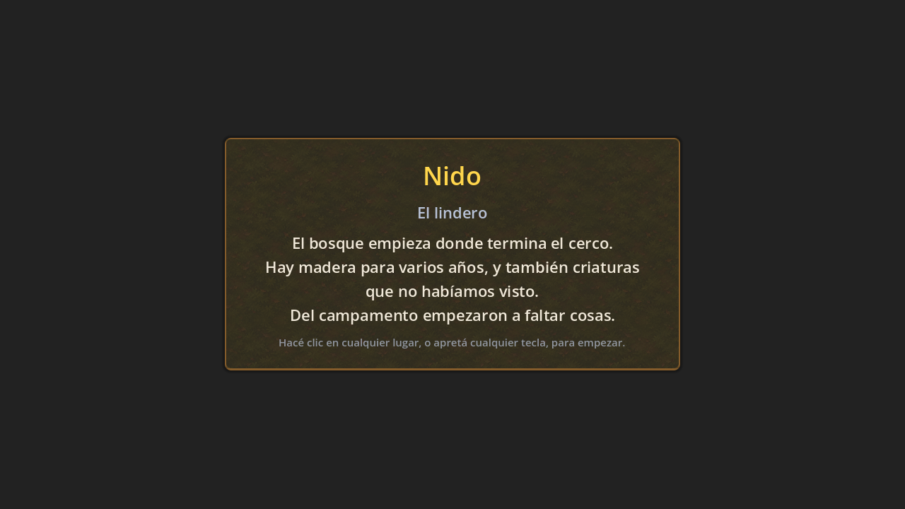

### Nivel 7 · Cruce

- **Fuente:** data/levels/level_07.json (campo `textos`; texto fuente: specs/11-textos-lore.md §1)
- **Límites:** lugar 13/32 · entrada 151/240 (3 líneas, máx. línea 62/90) · victoria 106/160 (2 líneas, máx. línea 56/90)

| Campo | Texto actual |
|---|---|
| Nombre (tarjeta y mapa) | Cruce |
| Lugar | El aserradero |
| Entrada | El mejor sitio para cortar madera es un cruce de caminos. Se arma un aserradero, y para eso hay que despejar el terreno. Todo lo que estorbe se retira. |
| Victoria | Aserradero en marcha. La colonia ya tiene madera propia. La primera carga sale mañana hacia el campamento. |

- **Observaciones:** «Todo lo que estorbe se retira» es neutral para quien solo ve árboles y rocas y puede leerse distinto después de saber lo de los Moradores: parece buscado. «madera propia» abre el hilo de independencia (7, 9, 15; ver H2).
- **Hallazgos:** H2, H6

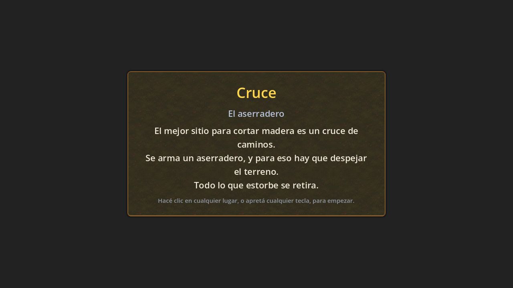

### Nivel 8 · Bastión

- **Fuente:** data/levels/level_08.json (campo `textos`; texto fuente: specs/11-textos-lore.md §1)
- **Límites:** lugar 23/32 · entrada 150/240 (3 líneas, máx. línea 58/90) · victoria 110/160 (2 líneas, máx. línea 68/90)

| Campo | Texto actual |
|---|---|
| Nombre (tarjeta y mapa) | Bastión |
| Lugar | El bastión sobre ruinas |
| Entrada | Sobre la loma hay muros de piedra vieja, a medio enterrar. Las rocas tienen la misma marca que las del campamento. Alguien la puso antes que nosotros. |
| Victoria | Bastión asegurado. La colonia tiene una posición alta sobre la loma. Los muros son de otros; los usamos igual. |

- **Observaciones:** Parte del ejemplo de la biblia. La mejor entrada y la mejor victoria del bloque 2. El lugar «El bastión sobre ruinas» repite el nombre del nivel y adelanta la palabra «ruinas», que la entrada evita (dice «piedra vieja») (H6).
- **Hallazgos:** H6, H10

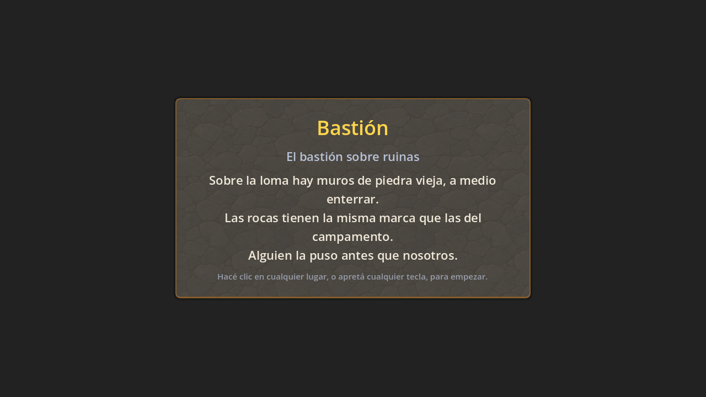

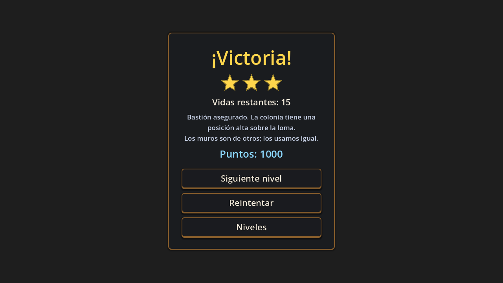

### Nivel 9 · Taller asediado

- **Fuente:** data/levels/level_09.json (campo `textos`; texto fuente: specs/11-textos-lore.md §1)
- **Límites:** lugar 9/32 · entrada 171/240 (3 líneas, máx. línea 65/90) · victoria 119/160 (2 líneas, máx. línea 71/90)

| Campo | Texto actual |
|---|---|
| Nombre (tarjeta y mapa) | Taller asediado |
| Lugar | El taller |
| Entrada | Entre las ruinas hay un galpón que puede servir de taller. Los que lo rodean no parecen animales: algunos curan a los suyos. Hoy se prueba el primer mortero de la colonia. |
| Victoria | Taller asegurado. El horno se encendió por primera vez fuera del oasis. La forja ya no depende de lo que trajo la nave. |

- **Observaciones:** «no parecen animales: algunos curan a los suyos» es buena. «el primer mortero» es mecánica y está marcada A REVISAR TRAS G4 (H13). El nombre «Taller asediado» choca con el modo «Asedio» (H6).
- **Hallazgos:** H6, H13

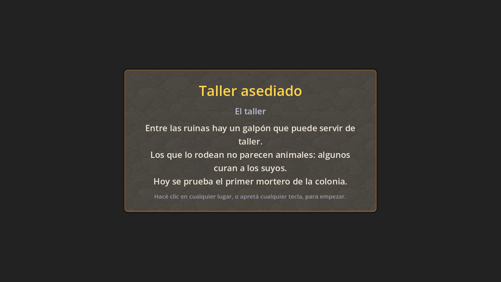

### Nivel 10 · La mina vieja

- **Fuente:** data/levels/level_10.json (campo `textos`; texto fuente: specs/11-textos-lore.md §1)
- **Límites:** lugar 31/32 · entrada 157/240 (3 líneas, máx. línea 71/90) · victoria 134/160 (2 líneas, máx. línea 68/90)

| Campo | Texto actual |
|---|---|
| Nombre (tarjeta y mapa) | La mina vieja |
| Lugar | Primer puesto de abastecimiento |
| Entrada | Las galerías ya estaban cavadas cuando llegamos. Si se las retoma, la colonia tiene mineral a pocos días del campamento. Hay que sostener la boca de la mina. |
| Victoria | Mina asegurada. Es el primer puesto de abastecimiento de la colonia. Las galerías no las cavamos nosotros, y nadie vino a reclamarlas. |

- **Observaciones:** «nadie vino a reclamarlas» es la línea más fina del bloque. El lugar tiene 31 de 32 caracteres y se repite tal cual en la victoria (H12). Nombre provisorio según la biblia («La mina vieja»).
- **Hallazgos:** H12, H6

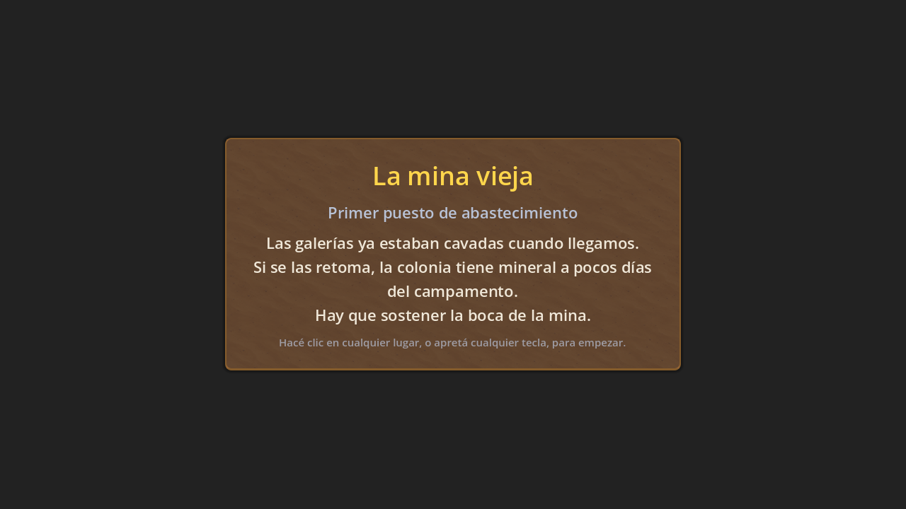

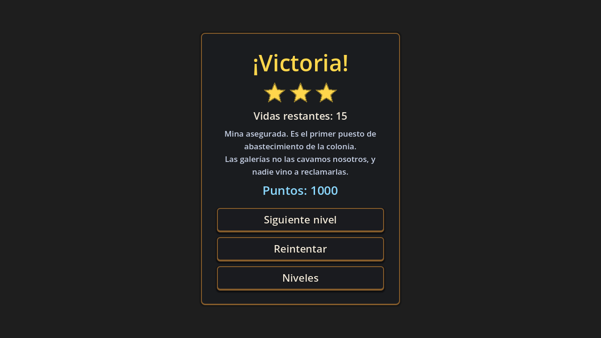

### Nivel 11 · Puesto seco

- **Fuente:** data/levels/level_11.json (campo `textos`; texto fuente: specs/11-textos-lore.md §1)
- **Límites:** lugar 16/32 · entrada 153/240 (3 líneas, máx. línea 60/90) · victoria 81/160 (2 líneas, máx. línea 40/90)

| Campo | Texto actual |
|---|---|
| Nombre (tarjeta y mapa) | Puesto seco |
| Lugar | El punto de agua |
| Entrada | Pasada la mina, el camino se vuelve seco. Los dos pozos que hay ya tenían huellas alrededor. Desde hoy, algunas torres se apagan sin que nadie las toque. |
| Victoria | Informe del puesto seco: paso asegurado. Dos pozos quedaron dentro del perímetro. |

- **Observaciones:** La victoria es el ejemplo de la biblia. Habla de «paso» cuando el lugar es «El punto de agua» (H11). «Desde hoy, algunas torres se apagan…» anuncia la mecánica como un hecho del mundo, y funciona.
- **Hallazgos:** H11

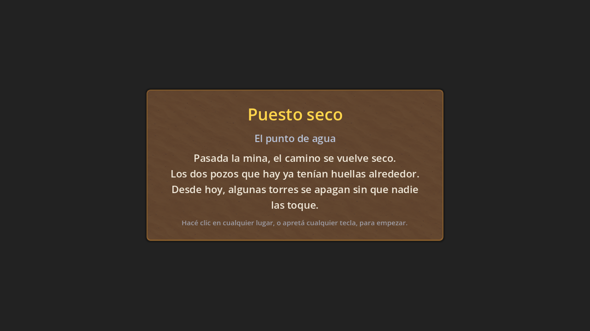

### Nivel 12 · El cañadón

- **Fuente:** data/levels/level_12.json (campo `textos`; texto fuente: specs/11-textos-lore.md §1)
- **Límites:** lugar 22/32 · entrada 194/240 (3 líneas, máx. línea 73/90) · victoria 113/160 (2 líneas, máx. línea 62/90)

| Campo | Texto actual |
|---|---|
| Nombre (tarjeta y mapa) | El cañadón |
| Lugar | El paso hacia el norte |
| Entrada | El único paso hacia el norte es un cañadón de paredes altas. Los tiros vuelven contra las torres, como si las paredes los devolvieran. Cruzarlo es la única forma de llegar al resto de la región. |
| Victoria | Cañadón asegurado. El paso al norte quedó abierto. En las paredes quedaron las marcas de los tiros que volvieron. |

- **Observaciones:** Las líneas 1 y 3 repiten «único» (H13). «Los tiros vuelven contra las torres…» explica la mecánica del Espejo en voz de informe. La victoria es muy buena (la marca queda en el paisaje).
- **Hallazgos:** H13, H12

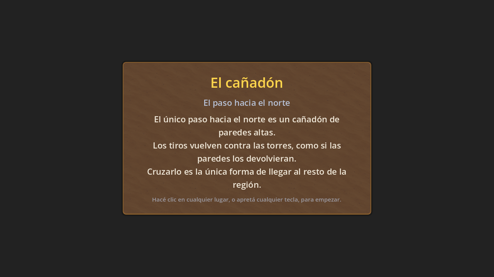

### Nivel 13 · Paso alto

- **Fuente:** data/levels/level_13.json (campo `textos`; texto fuente: specs/11-textos-lore.md §1)
- **Límites:** lugar 31/32 · entrada 198/240 (3 líneas, máx. línea 86/90) · victoria 101/160 (2 líneas, máx. línea 61/90)

| Campo | Texto actual |
|---|---|
| Nombre (tarjeta y mapa) | Paso alto |
| Lugar | El camino al resto de la región |
| Entrada | En el paso alto el camino se parte en dos. Ya no llegan de a uno: cada grupo trae quien protege, quien cura y quien apaga torres. Hay hitos de piedra en el camino. Marcan un límite, y ya lo pasamos. |
| Victoria | Paso alto asegurado. La región queda comunicada con el valle. Los hitos quedaron del lado de adentro. |

- **Observaciones:** «Hitos de piedra» (H5). La línea 2 enumera la mecánica de la escolta («quien protege, quien cura y quien apaga torres»). La línea 3 tiene 86 de 90 caracteres. «La región… con el valle» no precisa cuál (H9).
- **Hallazgos:** H5, H9

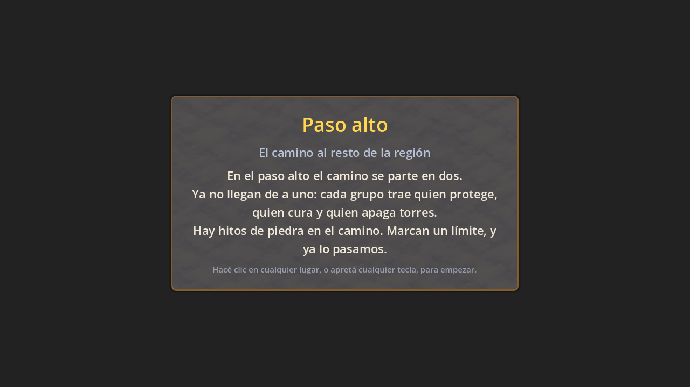

### Nivel 14 · Los poblados vacíos

- **Fuente:** data/levels/level_14.json (campo `textos`; texto fuente: specs/11-textos-lore.md §1)
- **Límites:** lugar 30/32 · entrada 144/240 (3 líneas, máx. línea 60/90) · victoria 59/160 (2 líneas, máx. línea 32/90)

| Campo | Texto actual |
|---|---|
| Nombre (tarjeta y mapa) | Los poblados vacíos |
| Lugar | Asentamientos de los Moradores |
| Entrada | Los poblados están a la vista, pero no sale humo de ninguno. Los Moradores se llevaron lo que pudieron. Aun así, algo todavía defiende el lugar. |
| Victoria | Los poblados están vacíos. Las brasas todavía están tibias. |

- **Observaciones:** El golpe de la victoria ya está gastado en el nombre y la entrada (H7). El lugar usa «Asentamientos», el nombre y el artículo «poblados»: dos palabras para lo mismo. 59 caracteres: la victoria más corta, a propósito.
- **Hallazgos:** H7, H14

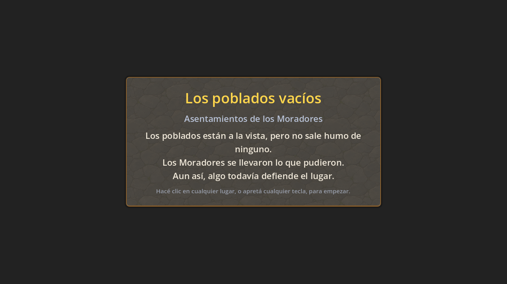

### Nivel 15 · La Central

- **Fuente:** data/levels/level_15.json (campo `textos`; texto fuente: specs/11-textos-lore.md §1)
- **Límites:** lugar 24/32 · entrada 201/240 (3 líneas, máx. línea 79/90) · victoria 89/160 (2 líneas, máx. línea 60/90)

| Campo | Texto actual |
|---|---|
| Nombre (tarjeta y mapa) | La Central |
| Lugar | Energía y abastecimiento |
| Entrada | Falta cerrar el valle: la central de energía y la línea que la une con la mina. Si se sostiene, la colonia queda asentada en esta región. Hoy llega lo más grande que vimos hasta ahora, y no viene solo. |
| Victoria | Central encendida. La línea de abastecimiento está completa. La colonia tiene luz propia. |

- **Observaciones:** La victoria («luz propia») y la entrada («línea que la une con la mina», «asentada en esta región») continuaban el epílogo viejo; con el nuevo se leen como logro puro (H2). «El valle» no es claro (H9). La entrada es la más larga: 201 de 240 caracteres y 5 renglones visibles en pantalla (captura).
- **Hallazgos:** H2, H9

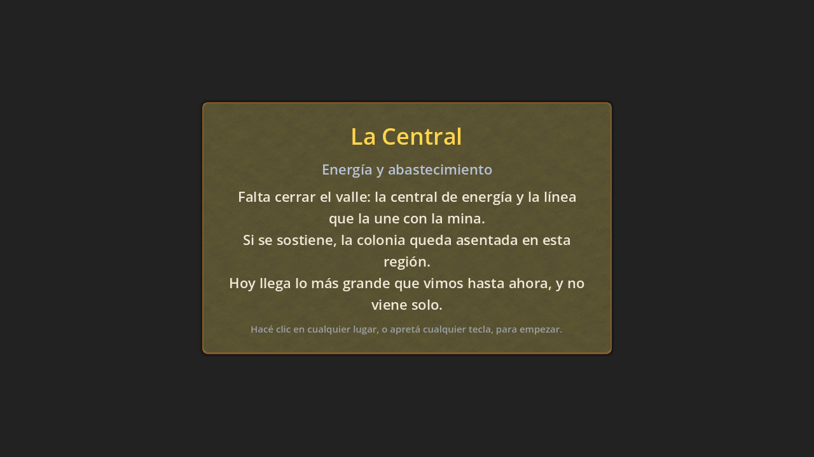

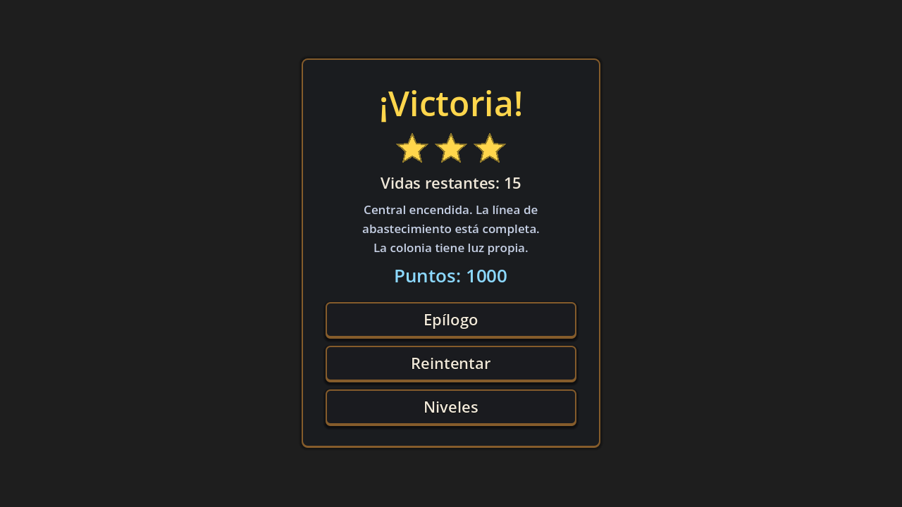

## 2. Epílogo, imagen del final y créditos

### Epílogo (nivel 15)

- **Fuente:** data/levels/level_15.json (`textos.epilogo`); pantalla: scenes/ui/epilogue_screen.gd; spec: specs/11-textos-lore.md §2
- **Límites:** 3 líneas, 70 caracteres (límite 3 a 5 líneas, 400, 90 por línea)

| Campo | Texto actual |
|---|---|
| Texto | La máquina sigue avanzando, pero ¿por cuánto tiempo más? ¿A qué costo? |

- **Observaciones:** Decisión de Lucas del 2026-10-28. La frase es una sola oración partida en 3 renglones y se lee bien sobre la franja oscura. Se mantiene la botonera «Créditos» y «Niveles». Con el epílogo nuevo, la victoria del 15 y el nivel 15 ya no tienen continuidad con él (H2); «la máquina» no tiene referente (H3).
- **Hallazgos:** H2, H3

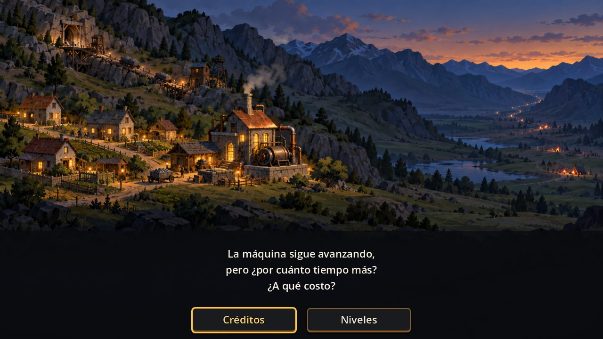

### Imagen del epílogo (assets/sprites/story/epilogue.png)

- **Fuente:** assets/sprites/story/epilogue.png (1920×1080, precargada en scenes/ui/epilogue_screen.gd). Arte de T233, sin OK de arte, a retirar o reemplazar en T546 y T547.
- **Límites:** 1920×1080, recortada a 16:9 de la ventana

| Campo | Texto actual |
|---|---|
| Qué muestra | La colonia iluminada con una central de vapor en primer plano y una mina arriba a la izquierda; al fondo a la derecha un río y varias fogatas pequeñas que se alejan por el valle (los Moradores retirándose, según la biblia §7). Atardecer cálido adelante, horizonte frío atrás. |

- **Observaciones:** Calza con la biblia (logro adelante, retirada atrás), pero con la frase nueva dice «logro» más fuerte que la duda del texto (H4). T546 propone dos variantes según estrellas (una con referencia oscura) y T547 retira esta imagen.
- **Hallazgos:** H4

### Créditos

- **Fuente:** data/creditos.json; pantalla scenes/ui/credits_screen.gd; spec: specs/11-textos-lore.md §3
- **Límites:** 4 líneas

| Campo | Texto actual |
|---|---|
| Líneas | Monsters & Canons Un juego de Lucas Hecho con Godot Engine Software libre bajo la licencia GPL-3.0-or-later (los detalles, en Wiki → Licencias) |

- **Observaciones:** Solo lo que se puede comprobar en el repositorio (copyright y licencia salen de Wiki → Licencias). Sin nombres ni agradecimientos (H15).
- **Hallazgos:** H15

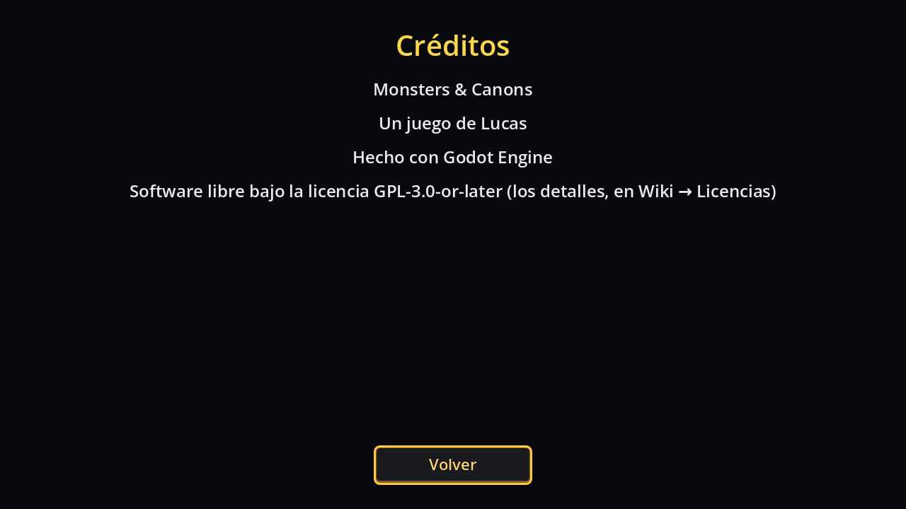

## 3. Intro de láminas

### Lámina 1 · la nave

- **Fuente:** data/intro/intro.json (fuente: specs/intro/guion.md); imagen assets/intro/01_la_nave.webp; pantalla scenes/ui/intro_screen.gd
- **Límites:** 84 caracteres, 2 línea(s), 7 s (límite 2 líneas, 160, 90 por línea)

| Campo | Texto actual |
|---|---|
| Texto | La Compañía Meridiana mandó una sola nave. No lleva soldados: lleva gente de oficio. |

- **Observaciones:** El «no lleva soldados» es una frase de bitácora coherente con la biblia (gente de oficio).

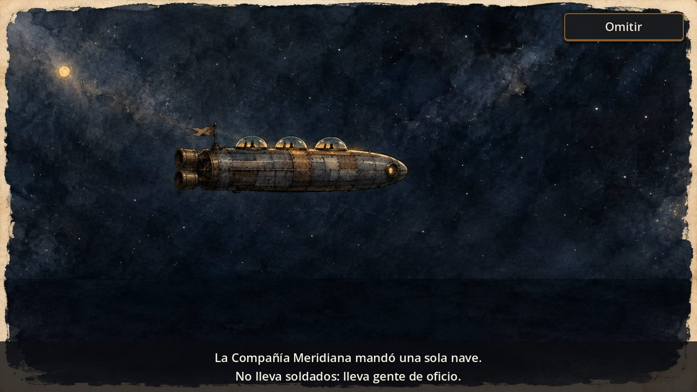

### Lámina 2 · la bodega

- **Fuente:** data/intro/intro.json (fuente: specs/intro/guion.md); imagen assets/intro/02_la_bodega.webp; pantalla scenes/ui/intro_screen.gd
- **Límites:** 126 caracteres, 2 línea(s), 9 s (límite 2 líneas, 160, 90 por línea)

| Campo | Texto actual |
|---|---|
| Texto | Herreros, carpinteros, ingenieros, agricultores: cada uno trajo su oficio. Hay semillas, planos y piezas para empezar de cero. |

- **Observaciones:** Dos líneas de 79 y 52 caracteres; repite la idea de la lámina 1 (oficios) con más detalle.

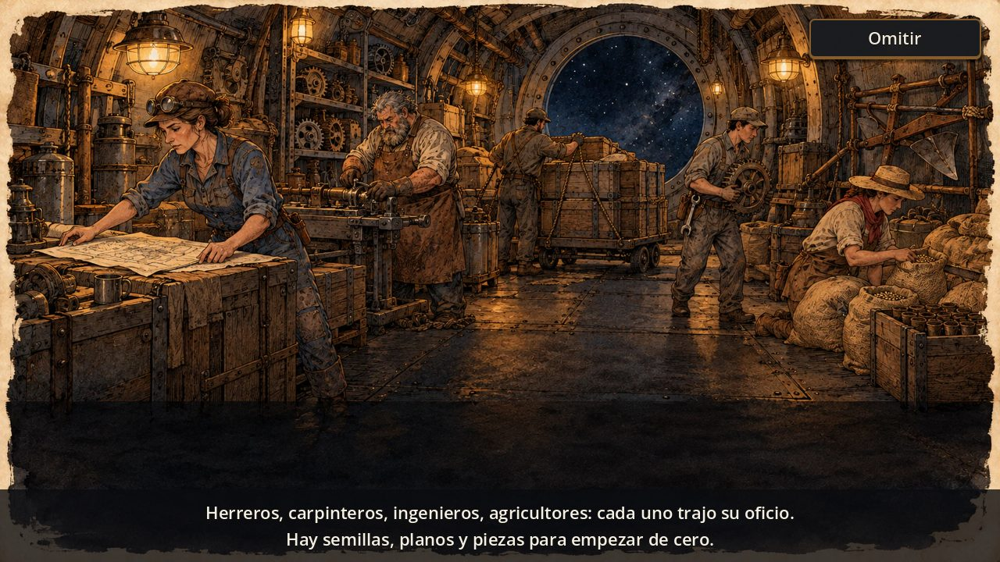

### Lámina 3 · los turnos

- **Fuente:** data/intro/intro.json (fuente: specs/intro/guion.md); imagen assets/intro/03_los_turnos.webp; pantalla scenes/ui/intro_screen.gd
- **Límites:** 104 caracteres, 2 línea(s), 8 s (límite 2 líneas, 160, 90 por línea)

| Campo | Texto actual |
|---|---|
| Texto | Fueron años de viaje. Se durmió por turnos y lo que se rompía se arreglaba a bordo. Era un viaje de ida. |

- **Observaciones:** «Era un viaje de ida» es el dato canónico (no hay rescate ni regreso).

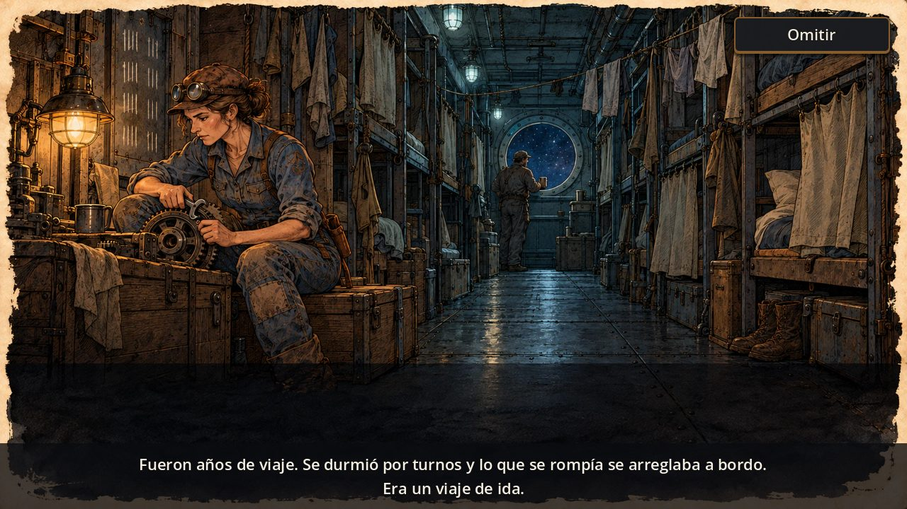

### Lámina 4 · la ventana

- **Fuente:** data/intro/intro.json (fuente: specs/intro/guion.md); imagen assets/intro/04_la_ventana.webp; pantalla scenes/ui/intro_screen.gd
- **Límites:** 89 caracteres, 2 línea(s), 7 s (límite 2 líneas, 160, 90 por línea)

| Campo | Texto actual |
|---|---|
| Texto | El reconocimiento vio agua en un solo lugar de todo el planeta. Hacia ahí apuntó la nave. |

- **Observaciones:** Choca con el nivel 2 (H1): «agua en un solo lugar de todo el planeta». La imagen muestra el punto verde dentro de un círculo, como dice el guion.
- **Hallazgos:** H1, H16

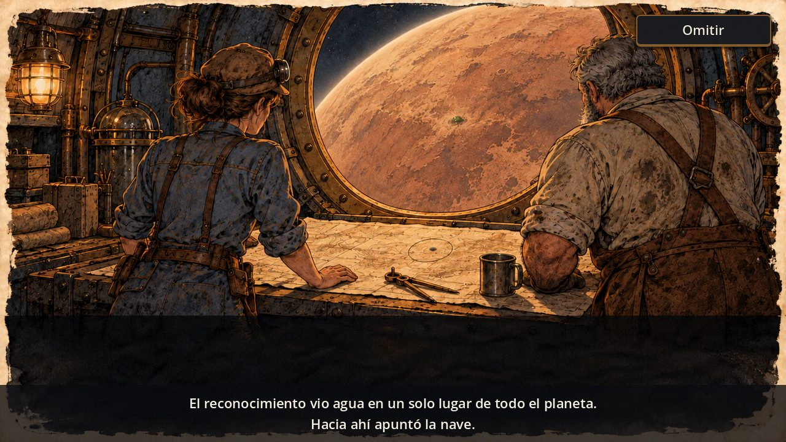

### Lámina 5 · el descenso

- **Fuente:** data/intro/intro.json (fuente: specs/intro/guion.md); imagen assets/intro/05_el_descenso.webp; pantalla scenes/ui/intro_screen.gd
- **Límites:** 59 caracteres, 1 línea(s), 5 s (límite 2 líneas, 160, 90 por línea)

| Campo | Texto actual |
|---|---|
| Texto | La bajada fue brusca. El casco crujió entero, pero aguantó. |

- **Observaciones:** Una sola línea.

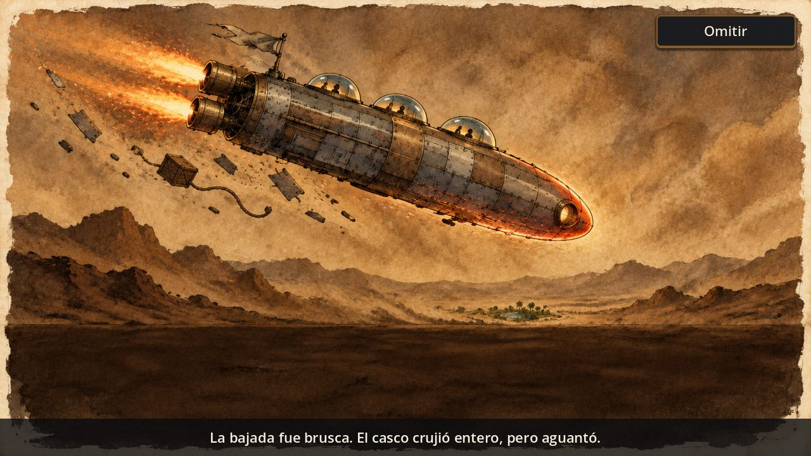

### Lámina 6 · los motores apagados

- **Fuente:** data/intro/intro.json (fuente: specs/intro/guion.md); imagen assets/intro/06_los_motores_apagados.webp; pantalla scenes/ui/intro_screen.gd
- **Límites:** 69 caracteres, 2 línea(s), 6 s (límite 2 líneas, 160, 90 por línea)

| Campo | Texto actual |
|---|---|
| Texto | Los motores se apagaron al tocar tierra. La nave ya no va a despegar. |

- **Observaciones:** «La nave ya no va a despegar» es el segundo dato canónico; cambia a presente (H16).
- **Hallazgos:** H16

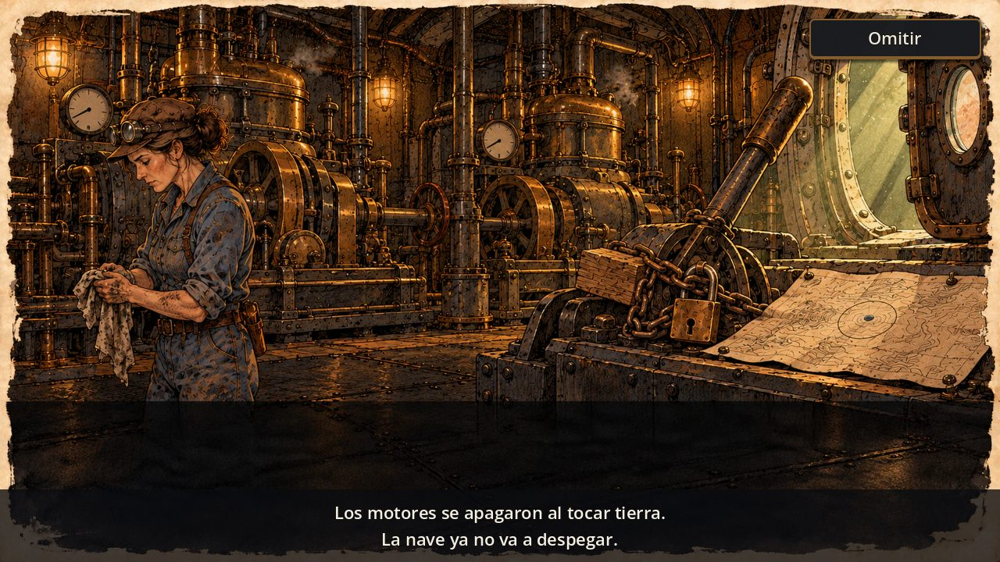

### Lámina 7 · el oasis

- **Fuente:** data/intro/intro.json (fuente: specs/intro/guion.md); imagen assets/intro/07_el_oasis.webp; pantalla scenes/ui/intro_screen.gd
- **Límites:** 72 caracteres, 2 línea(s), 9 s (límite 2 líneas, 160, 90 por línea)

| Campo | Texto actual |
|---|---|
| Texto | Un valle chico, con agua y pasto, en medio de la nada. Acá nos quedamos. |

- **Observaciones:** «en medio de la nada» es la mirada de los colonos y el juego después la desmiente (adrede). «Acá nos quedamos»: primera persona del plural (H10). El horizonte de la imagen está vacío; en el epílogo hay fogatas.
- **Hallazgos:** H10, H16

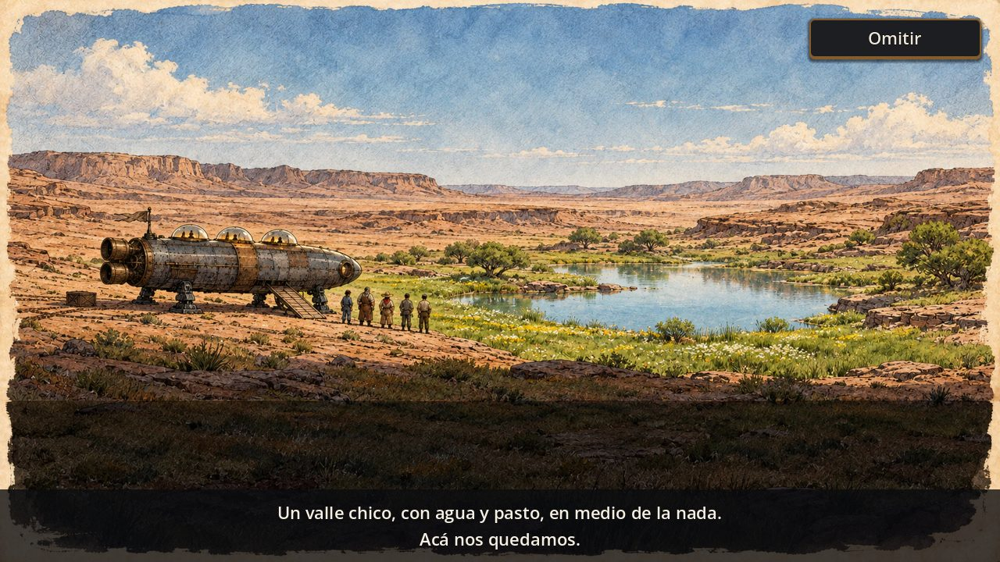

## 4. Artículos de Lore de la Wiki

### Wiki · El oasis

- **Fuente:** data/wiki/lore/el_oasis.json (spec: specs/11-textos-lore.md §4; se abre al ganar `level_01`)
- **Límites:** 3 párrafos, 445 caracteres; orden 1

| Campo | Texto actual |
|---|---|
| Subtítulo | Donde aterrizó la nave |
| Párrafo 1 | El oasis es un valle chico de agua dulce, pasto y flores, rodeado de tierra seca. Es el único sitio con agua a la vista que encontró el reconocimiento, y por eso la nave bajó acá. |
| Párrafo 2 | Los primeros días se armó el campamento junto al agua. Desde entonces, todo lo que la colonia necesita (madera, mineral, un lugar donde sembrar) hay que ir a buscarlo más lejos. |
| Párrafo 3 | Los registros de la Compañía lo llaman «el único lugar seguro». No aclaran seguro de qué. |

- **Observaciones:** «No aclaran seguro de qué» es una buena última línea. Dice «agua dulce»: choca con el nivel 2 (H1).
- **Hallazgos:** H1

### Wiki · Cántaro

- **Fuente:** data/wiki/lore/planeta_cantaro.json (spec: specs/11-textos-lore.md §4; se abre al ganar `level_02`)
- **Límites:** 3 párrafos, 292 caracteres; orden 2

| Campo | Texto actual |
|---|---|
| Subtítulo | El planeta, o lo que se conoce de él |
| Párrafo 1 | Los colonos le pusieron Cántaro al planeta, por el oasis: un poco de agua guardada en una tierra seca. |
| Párrafo 2 | Lo que se conoce es un solo rincón: el oasis y lo que lo rodea. Más allá, todavía no se llegó. |
| Párrafo 3 | Cada tramo que se asegura se agrega al mapa de la Compañía. El mapa tiene más blanco que dibujo. |

- **Observaciones:** Buen cierre («más blanco que dibujo»). Su nombre aparece primero acá (la intro lo evita a propósito).

### Wiki · La Compañía Meridiana

- **Fuente:** data/wiki/lore/la_compania.json (spec: specs/11-textos-lore.md §4; se abre al ganar `level_03`)
- **Límites:** 3 párrafos, 513 caracteres; orden 3

| Campo | Texto actual |
|---|---|
| Subtítulo | Quiénes somos |
| Párrafo 1 | La Compañía Meridiana armó la expedición. No es un ejército: es gente de oficio (ingenieros, herreros, carpinteros, agricultores) con herramientas, semillas y planos. |
| Párrafo 2 | La nave no puede volver a despegar. Se la va desarmando de a poco para hacer casas, cañerías y torres, y lo que se rompe se arregla con lo que hay. |
| Párrafo 3 | Por eso las torres son de hierro, bronce y cristal: se pueden reparar en el lugar. Entre la carga venían también planos y piezas de repuesto, que se van recuperando de entre los restos del aterrizaje. |

- **Observaciones:** El más largo (513 caracteres). «La nave no puede volver a despegar» coincide con la intro lámina 6.

### Wiki · El Soberano

- **Fuente:** data/wiki/lore/el_soberano.json (spec: specs/11-textos-lore.md §4; se abre al ganar `level_04`)
- **Límites:** 2 párrafos, 277 caracteres; orden 4

| Campo | Texto actual |
|---|---|
| Subtítulo | Quien va al frente de las manadas |
| Párrafo 1 | Al final de una oleada aparece a veces un animal enorme, carmesí y cornudo. Las manadas parecen seguirlo, o dejarle paso. Los colonos le dicen Soberano. |
| Párrafo 2 | No es uno solo: hay uno por cada paraje, y ninguno se parece del todo al anterior. Nadie sabe si manda o si solo va adelante. |

- **Observaciones:** «Soberano» no se ve en ninguna otra pantalla: el juego dice «Jefe» (H8).
- **Hallazgos:** H8

### Wiki · Las criaturas que van solas

- **Fuente:** data/wiki/lore/criaturas_solas.json (spec: specs/11-textos-lore.md §4; se abre al ganar `level_06`)
- **Límites:** 2 párrafos, 310 caracteres; orden 5

| Campo | Texto actual |
|---|---|
| Subtítulo | Lo que no pertenece a ninguna manada |
| Párrafo 1 | En el bosque hay seres que no andan con ninguna manada. El Ladrón, por ejemplo, va solo, con una capa gris y una bolsa, y se lleva lo que brilla del campamento: monedas, herramientas, un botón. |
| Párrafo 2 | Los informes las llaman criaturas, para distinguirlas de los animales. No obedecen a nadie, y nadie sabe cuántas hay. |

- **Observaciones:** Se abre al ganar el 6 y el Ladrón se ve desde el 6: coherente. «Los informes las llaman criaturas» confirma el término.

### Wiki · La Cuadrilla

- **Fuente:** data/wiki/lore/la_cuadrilla.json (spec: specs/11-textos-lore.md §4; se abre al ganar `level_07`)
- **Límites:** 3 párrafos, 482 caracteres; orden 6

| Campo | Texto actual |
|---|---|
| Subtítulo | Los que andan juntos |
| Párrafo 1 | Cerca del aserradero se vieron criaturas chicas y rápidas que se llevan lo que brilla, igual que el Ladrón. A diferencia de él, no andan solas: llegan juntas, y los colonos las llaman Rateros. |
| Párrafo 2 | Con ellas viene siempre una más grande y lenta, con una bolsa más grande que ella misma donde parece juntarse lo de todas. La llaman el Cargador, y a todas juntas, la cuadrilla, por cómo llegan. |
| Párrafo 3 | Nadie vio que alguna mande ni que alguna obedezca. Parece que van juntas porque buscan lo mismo. |

- **Observaciones:** Se abre al ganar el 7 y su `orden` va entre el 5 y el 6. «No andan solas» contrasta con el artículo 5 («va solo»): intencional.

### Wiki · Las ruinas

- **Fuente:** data/wiki/lore/las_ruinas.json (spec: specs/11-textos-lore.md §4; se abre al ganar `level_08`)
- **Límites:** 3 párrafos, 418 caracteres; orden 7

| Campo | Texto actual |
|---|---|
| Subtítulo | Lo que había antes |
| Párrafo 1 | Sobre la loma del bastión hay muros de piedra y metal, a medio enterrar. Los colonos los llaman «las ruinas» y los tratan como un yacimiento: se despeja, se anota y se recupera lo que sirve. |
| Párrafo 2 | Todas llevan la misma marca que las rocas del oasis. Nadie sabe qué quiere decir: puede ser «esto es nuestro», «hasta acá» o un recuerdo. |
| Párrafo 3 | El informe de la Compañía dice que las dejó una gente que ya no está. No dice cómo lo sabe. |

- **Observaciones:** Repite la «misma marca que las rocas» de la entrada del 8; después de la victoria funciona como confirmación. «No dice cómo lo sabe» es muy buena.

### Wiki · Los Moradores

- **Fuente:** data/wiki/lore/los_moradores.json (spec: specs/11-textos-lore.md §4; se abre al ganar `level_09`)
- **Límites:** 3 párrafos, 431 caracteres; orden 8

| Campo | Texto actual |
|---|---|
| Subtítulo | Los que ya estaban |
| Párrafo 1 | Así llama la Compañía a las comunidades que viven en Cántaro. Es un nombre de informe: cómo se llaman ellos a sí mismos no figura en ningún registro. |
| Párrafo 2 | Hasta ahora se vieron dos oficios: los que protegen, de piedra y escudo dorado, y los que curan, con una semilla en el pecho. No está claro si son un solo pueblo o varios que se juntaron. |
| Párrafo 3 | Tampoco está claro si guían a los animales de las manadas o si solo cuidan sus propios caminos. |

- **Observaciones:** Habla de dos oficios porque el Chamán debuta en el 11. Sin juicio.

### Wiki · Los pozos

- **Fuente:** data/wiki/lore/los_pozos.json (spec: specs/11-textos-lore.md §4; se abre al ganar `level_11`)
- **Límites:** 3 párrafos, 377 caracteres; orden 9

| Campo | Texto actual |
|---|---|
| Subtítulo | Informe del puesto seco |
| Párrafo 1 | En el camino seco hay pocos pozos, y todos tienen huellas alrededor. Dos quedaron dentro del perímetro del puesto. |
| Párrafo 2 | El mismo día en que se aseguró el paso empezaron los fallos: torres que se apagan sin motivo. Las observaciones coinciden en un encapuchado con un bastón que chispea, que se acerca a las torres y no a los colonos. |
| Párrafo 3 | No ataca a las personas. Ataca lo que construimos. |

- **Observaciones:** Repite «dos pozos quedaron dentro del perímetro» de la victoria del 11, a propósito. Cierra con «Ataca lo que construimos»: primera persona, y dice «ataca» de una criatura (permitido: es un hecho).
- **Hallazgos:** H10

### Wiki · Los poblados vacíos

- **Fuente:** data/wiki/lore/poblados_vacios.json (spec: specs/11-textos-lore.md §4; se abre al ganar `level_14`)
- **Límites:** 3 párrafos, 270 caracteres; orden 10

| Campo | Texto actual |
|---|---|
| Subtítulo | Lo que quedó en pie |
| Párrafo 1 | Los poblados del valle bajo son de piedra y paja. Tienen fogones, cuerdas y pieles todavía en su sitio. |
| Párrafo 2 | No hay nadie. Las brasas están tibias, así que se fueron hace poco, y se llevaron lo que podían cargar. |
| Párrafo 3 | La Compañía registra los poblados como «posiciones desocupadas». |

- **Observaciones:** Repite la victoria del 14 y la entrada (H14). «posiciones desocupadas» ya marcado en la spec como la línea que podría sobrar.
- **Hallazgos:** H14

### Wiki · La Central

- **Fuente:** data/wiki/lore/la_central.json (spec: specs/11-textos-lore.md §4; se abre al ganar `level_15`)
- **Límites:** 4 párrafos, 451 caracteres; orden 11

| Campo | Texto actual |
|---|---|
| Subtítulo | Energía y abastecimiento |
| Párrafo 1 | La central quedó en el valle donde aterrizó la nave. Produce la energía que necesita la colonia y alimenta la línea que la une con la mina. |
| Párrafo 2 | Con ella, la región queda asegurada: agua, luz y camino. No es todo el planeta, y nadie en la Compañía dice que lo sea. |
| Párrafo 3 | Los colonos lo llaman el Coloso. Es de la misma piedra que los Guardianes. Cuando cae, se parte en tres y los pedazos siguen camino. |
| Párrafo 4 | El informe termina ahí. No dice qué se hará con lo que falta. |

- **Observaciones:** Último párrafo anticipa la pregunta del epílogo (H14). «El valle donde aterrizó la nave» (H9). Nombra al Coloso una sola vez en todo el lore.
- **Hallazgos:** H9, H14

## Hallazgos con alternativas

### H1 · El agua del oasis y el nivel 2 se contradicen (prioridad Alta)

La intro (lámina 4) dice que el reconocimiento vio agua «en un solo lugar de todo el planeta»; el artículo «El oasis» lo llama «valle chico de agua dulce» y el nivel 1 dice «Hay agua, pasto…». Pero la entrada del nivel 2 afirma «El agua dulce más cercana está al otro lado del desfiladero» y su victoria, «El agua llega al campamento por primera vez». Leído en orden, el jugador ve agua en el campamento y después se le dice que no hay.

- **Opción A (cambia solo el nivel 2):**
  > Entrada:
  > El agua del oasis no alcanza para toda una colonia.
  > El arroyo más cercano está al otro lado del desfiladero.
  > Hay que sostener el paso antes de tender las cañerías.
  >
  > Victoria:
  > Paso asegurado. El agua del arroyo llega al campamento por primera vez.
  > Faltan tres tramos de cañería.
  >
  > (El «arroyo» ya aparece en el nivel 4: «El arroyo no alcanza para toda la colonia», que así queda como continuación.)

- **Opción B (cambia la intro y la Wiki):**
  > Dejar el nivel 2 y suavizar las dos piezas que dicen que el oasis es el único lugar con agua: la lámina 4 («…vio agua en un solo lugar de todo el planeta…») y el artículo «El oasis». Toca piezas ya aprobadas y no arregla del todo que el nivel 1 diga «Hay agua»; no se recomienda.

### H2 · Victoria del 15 («luz propia», «línea de abastecimiento completa») frente al epílogo nuevo (prioridad Alta)

El epílogo viejo continuaba esas dos ideas; el nuevo («La máquina sigue avanzando, pero ¿por cuánto tiempo más? ¿A qué costo?») ya no. Ahora la victoria suena triunfal y el epílogo la pone en duda. Eso encaja con la biblia («logro y costo») si es a propósito: la victoria es el logro y el epílogo es el costo. Pero hoy la victoria no tiene ni una pizca de costo, y «luz propia» repite el hilo de independencia de «madera propia» (7) y «ya no depende de lo que trajo la nave» (9), que sí cierra bien. Decisión de Lucas.

- **Opción A (no cambiar):**
  > La victoria es el logro y el epílogo es el costo, como pide la biblia. El contraste hace trabajar la frase.

- **Opción B (un cierre menos triunfal):**
  > Central encendida. La línea de abastecimiento está completa.
  > La luz se ve desde los poblados vacíos.

- **Opción C (sin «propia»):**
  > Central encendida. La línea de abastecimiento está completa.
  > La colonia ya no depende de la nave.

### H3 · El epílogo: «la máquina» no tiene referente en el canon y la partida en 3 líneas (prioridad Alta)

«Máquina» no aparece en la biblia ni en los textos como nombre de nada (las torres son «máquinas robustas» en la biblia §3, y «demoledora» es una mecánica). Es ambiguo a propósito, pero puede leerse como la colonia, la central, las torres o el jugador. Sobre el choque del mínimo de líneas (T545): `LevelFile` exige 3 a 5 líneas y la frase se parte en 3 respetando sus palabras exactas, que se ve bien en pantalla (captura). Opción 1: dejar la partida en 3 (sin RF ni D nuevos; es solo cómo se renglonea). Opción 2: permitir 1 línea: exige RF y D nuevos y cambiar `EPILOGUE_MIN_LINES`, el validador y `tests/test_epilogue.gd`. Recomendación: opción 1.

- **Opción 1 (recomendada):**
  > Mantener las 3 líneas tal cual (La máquina sigue avanzando, / pero ¿por cuánto tiempo más? / ¿A qué costo?). Sin RF ni D nuevos: T545 se cierra con la decisión de Lucas anotada en la spec.

- **Opción 2:**
  > Una sola línea de 75 caracteres: RF y D nuevos (mínimo de líneas del epílogo de 3 a 1), cambiar `LevelTexts` y `tests/test_epilogue.gd`.

- **Sobre «la máquina»:**
  > Si Lucas quiere acotar sin explicar, el artículo «La Central» podría llamar «la máquina» a la central (hoy dice «La central… produce la energía»), dejando el resto abierto. No es necesario si prefiere la ambigüedad total.

### H4 · La imagen del final todavía es la de T233 (luminosa) (prioridad Media)

La captura muestra la colonia iluminada y fuegos de los Moradores alejándose, con la frase nueva encima. T546 prevé dos variantes (según estrellas) y T547 retira esta imagen: no se revisa su arte acá, solo que con la frase nueva el cuadro dice «logro» más fuerte que la duda del texto.

### H5 · Nivel 13: el texto habla de «hitos de piedra» pero el mapa dibuja rocas marcadas (prioridad Media)

`11-textos-lore.md` ya avisaba que el 13 depende de dibujar la señal `hito`. `data/levels/level_13.json` usa `roca_marcada` en su leyenda; `assets/sprites/map/hito.svg` existe pero ningún nivel ni script lo usa (búsqueda en el repositorio). El jugador lee «hitos» y ve rocas marcadas.

- **Opción A (texto):**
  > Entrada, línea 3: «Hay rocas marcadas en el camino. Marcan un límite, y ya lo pasamos.»
  > Victoria, línea 2: «Las rocas marcadas quedaron del lado de adentro.»

- **Opción B (arte):**
  > Dibujar de verdad el `hito` (ya existe `hito.svg`, sin usar) en el nivel 13 y dejar el texto. Requiere OK de arte; T233 lo traía.

### H6 · Dos nombres por nivel y de estilo mezclado (prioridad Media)

La tarjeta del selector muestra el nombre (campo `nombre`) y debajo el lugar. Los nombres 1 a 10 son de mapa y vienen de antes del lore (Pradera, Desfiladero, Encrucijada, Espiral, Fortaleza, Nido, Cruce, Bastión, Taller asediado, La mina vieja); del 11 al 15 llevan artículo y cuentan algo (El cañadón, Los poblados vacíos, La Central). Casos concretos: «Nido» no aparece en ningún texto del 6 (la entrada habla del lindero y del bosque); «Encrucijada» (3) y «Cruce» (7) son casi sinónimos; «Fortaleza» (5) y «Bastión» (8) también compiten; «Taller asediado» usa «asedio», que es además el nombre de un modo del selector; «Puesto seco» (11) tiene lugar «El punto de agua». Los lugares también cambian de forma: sustantivos cortos (7 a 16 caracteres) en 1 a 9 y 11, y frases descriptivas de 22 a 31 caracteres en 8, 10, 12, 13, 14 y 15.

- **Opción A (mínima):**
  > Renombrar solo «Nido» y «Taller asediado»; el resto queda. Por ejemplo «Nido» → «Bosque» y «Taller asediado» → «Taller en ruinas». Hay que actualizar los lugares en el selector, los tests que mencionan nombres y los documentos.

- **Opción B (estilo único):**
  > Dejar el nombre de mapa como etiqueta corta y fija (sustantivo sin artículo) y que lo narrativo viva solo en el lugar. Es decir: no tocar 1 a 10 y pasar 11 a 15 a «Puesto seco», «Cañadón», «Paso alto», «Poblados», «Central». Menos nombres que revelan.

- **Opción C (no cambiar):**
  > Mantener la mezcla: el nombre es del mapa, el lugar es del relato.

### H7 · Nivel 14: lo «vacío» se anuncia tres veces (prioridad Media)

El nombre del nivel es «Los poblados vacíos», la entrada dice «Los Moradores se llevaron lo que pudieron» y la victoria recién «descubre» «Los poblados están vacíos». El golpe de la victoria (la mejor del juego según la biblia) ya está gastado antes de jugar. Además la entrada cierra con «algo todavía defiende el lugar», que es mecánica (hay enemigos) y choca un poco con «vacíos».

- **Opción A (entrada):**
  > Línea 2: «Los fogones están armados y no se ve a nadie.» (el descubrimiento queda en la victoria)

- **Opción B (nombre):**
  > Mantener la entrada y renombrar el nivel a «Los poblados».

### H8 · Jefe en el juego, Soberano en el lore (prioridad Media)

El artículo «El Soberano» (se abre al ganar el 4) dice que los colonos le llaman Soberano, pero el juego lo llama «Jefe» en la presentación («¡Llega el Jefe!»), en el bestiario y en los consejos; «Soberano» no aparece en ningún texto de juego fuera de ese artículo (búsqueda en `data/`, `scenes/` y `scripts/`). La biblia dejó que gane el nombre que ve el jugador (Q-2 de T202); acá no se ve la relación entre uno y otro.

- **Opción A:**
  > Dejar el nombre del juego y sumar al artículo una frase como «En los partes del campamento se lo anota como el Jefe de la oleada.»

- **Opción B:**
  > Cambiar el nombre visible «Jefe» a «Soberano» en presentación, bestiario y consejos (toca `boss.tres`, la presentación y tests). Lo contradice la decisión Q-2 de T202.

### H9 · Dónde queda la Central (prioridad Media)

El artículo «La Central» dice «quedó en el valle donde aterrizó la nave» y la entrada del 15 «Falta cerrar el valle». En el mapa de la campaña (captura del selector) el 15 está en el extremo opuesto al 1. Tampoco queda claro cuál es «el valle» de la victoria del 13 («comunicada con el valle»).

- **Opción A:**
  > Cambiar el artículo: «La central quedó en el valle de más al este…» / «en el último valle» (la que mejor calza con la captura del mapa).

- **Opción B:**
  > Dejar el texto y mover el 15 en el mapa de campaña (arte de selector), lo que es más caro.

### H10 · Voz: «informe» y «nosotros» mezclados (prioridad Baja)

La biblia pide voz de informe de trabajo. Los niveles pasan a primera persona del plural en: entrada 6 («no habíamos visto»), 8 («antes que nosotros»), 10 («cuando llegamos»), 13 («ya lo pasamos»), 15 («vimos»); victoria 5 («dormimos»), 8 («los usamos»), 10 («no las cavamos nosotros») y la lámina 7 de la intro («Acá nos quedamos»). El resto, y toda la Wiki, es impersonal o tercera persona («los colonos»). Funciona (da calidez al jugador-colono), pero no es uniforme y la Wiki habla de «los colonos» como otros.

### H11 · Nivel 11: «paso asegurado» frente al lugar «El punto de agua» (prioridad Baja)

La victoria viene de la biblia (ejemplo de tono) y funciona como informe, pero habla de un paso mientras el lugar y el nombre hablan de un puesto y un punto de agua. «Paso» ya se usa en 2 («El paso del agua»), 12 y 13 y es la palabra que más se repite del lore de niveles.

- **Opción:**
  > «Informe del puesto seco: punto de agua asegurado.» (cambia la frase de la biblia; hay que anotarlo)

### H12 · Repeticiones entre campos del mismo nivel (prioridad Baja)

El lugar y la entrada o la victoria se repiten: 2 (lugar «El paso del agua» y victoria «Paso asegurado»), 10 (el lugar «Primer puesto de abastecimiento» aparece tal cual en la victoria), 12 («El paso hacia el norte» dos veces: lugar y primera línea), 15 («Energía y abastecimiento» y «abastecimiento» en la victoria). Además, nueve de las quince victorias abren con «X asegurado/a» (1, 2, 3, 6, 8, 9, 10, 12, 13): es la fórmula del canon, no un error, pero la secuencia es muy pareja.

### H13 · Entradas con frases de relleno o referencias sueltas (prioridad Baja)

Nivel 3: «Sin huerta no hay cosecha» es casi tautológica. Nivel 4: «que les cueste llegar»: el «les» no tiene referente en el texto. Nivel 12: «único paso» y «única forma» en la misma entrada. Nivel 9: «Hoy se prueba el primer mortero de la colonia» nombra una torre (mecánica) y la spec lo marcó «A REVISAR TRAS G4».

- **Nivel 3:**
  > Quitar la línea 3 (el límite es «hasta» 3 líneas) o: «Sin huerta no hay con qué alimentar a la colonia.»

- **Nivel 4:**
  > «El camino hasta ahí da muchas vueltas: conviene que a las manadas les cueste llegar.»

- **Nivel 12:**
  > Línea 3: «Cruzarlo es llegar al resto de la región.»

### H14 · Wiki: «Los poblados vacíos» repite la victoria del 14 (prioridad Baja)

El artículo se abre justo al ganar el 14 y su segundo párrafo («Las brasas están tibias… se llevaron lo que podían cargar») repite la victoria y la entrada. Su última línea («posiciones desocupadas») ya figura en `11-textos-lore.md` §5 como la que podría sobrar. El último párrafo de «La Central» («No dice qué se hará con lo que falta») anticipa la pregunta del epílogo («¿por cuánto tiempo más?») y puede sobrar.

- **Opción:**
  > Párrafo 2: «No hay nadie. Se fueron hace poco y se llevaron lo que podían cargar.» (sin las brasas) y sacar el párrafo 3 si Lucas prefiere. En «La Central», quitar el párrafo 4.

### H15 · Créditos: solo lo comprobable (prioridad Baja)

Cuatro líneas, sin nombres ni agradecimientos, sin decir quién hizo los dibujos, los sonidos ni qué herramientas se usaron además de Godot. Es lo que se acordó (RF-472, P7 de M52); queda como pregunta abierta por si Lucas quiere sumar algo.

### H16 · Intro: tiempos verbales y un dato que choca con H1 (prioridad Baja)

Las láminas pasan del presente (1: «lleva», 6: «ya no va a despegar») al pasado (3, 4, 5) y de nuevo al presente (7). No es un error (es el relato de una bitácora) pero es irregular. El dato de la lámina 4 es el que choca con el nivel 2 (H1). La lámina 7 («en medio de la nada») es lo que ven los colonos, y el juego después muestra que no era cierto (adrede, ver `specs/intro/guion.md` §1).

## Imágenes narrativas: dónde se usan

| Imagen | Archivo | Dónde se usa | Estado |
|---|---|---|---|
| Láminas de la intro (7) | assets/intro/01_la_nave.webp … 07_el_oasis.webp | scenes/ui/intro_screen.gd, datos en data/intro/intro.json | Aprobadas (guion G6, 2026-10-11). Se ven en la sección Intro. |
| Imagen del epílogo | assets/sprites/story/epilogue.png | scenes/ui/epilogue_screen.gd | Arte T233 sin OK; T546 la reemplaza por dos variantes, T547 la retira. |
| Ilustración de jefes (Jefe y Coloso) | no existe arte propio: la presentación usa el sprite (`assets/sprites/enemies/boss.svg`, `colossus`) | scenes/ui/boss_presentation.gd | T367 sigue abierta (sin muestras ni OK). Hay un cartel «¡Llega el Jefe!» genérico. |
| Artículos de Lore | sin imágenes | data/wiki/lore/*.json (solo bloques `texto`) | Nada que revisar. |
| Señales del mapa (roca marcada, símbolo de ruina, sendero, herramienta, poste con cintas, campamento vacío) | assets/sprites/map/*.svg y leyendas de data/levels | scripts/logic/map_drawings.gd | Narrativas pero sin texto; no se revisan acá. `hito.svg` sin uso (H5). |
| Mapa de la campaña | assets/ui/campaign_map_background.svg, assets/ui/campaign_badges/ | scenes/ui/level_select.gd, campaign_map_view.gd | Se ve en la captura del selector. Dibuja los biomas 1→15 de oeste a este (H9). |
| Logo del menú | assets/ui/logo.png | scenes/ui/main_menu.tscn | No se revisó. |

## Preguntas para Lucas, por prioridad

1. **[Alta]** Nivel 2 y el agua (H1): ¿opción A (cambia el nivel 2: «El arroyo más cercano…») u opción B (cambiar la intro y el artículo)? Recomiendo A.
2. **[Alta]** Victoria del 15 (H2): ¿la dejamos (logro que luego el epílogo pone en duda), la hacemos menos triunfal (B o C) o la cambiamos por otra?
3. **[Alta]** Epílogo (H3): ¿mantenemos las 3 líneas sin RF ni D nuevos o preferís una sola línea (RF y D nuevos)? ¿Querés que «la máquina» tenga referente (por ejemplo, la central)?
4. **[Media]** Nombres de nivel (H6): ¿mantenemos «nombre de mapa» + «lugar» o unificamos? Y si mantenemos: ¿renombramos «Nido» y «Taller asediado» (choca con el modo Asedio)? ¿Algún otro de los 15 que no te cierre?
5. **[Media]** Nivel 13 (H5): ¿dibujamos el hito (arte) o pasamos el texto a «rocas marcadas»?
6. **[Media]** Nivel 14 (H7): ¿sacamos de la entrada que los Moradores se llevaron lo que pudieron y/o renombramos el nivel, para guardar el golpe de la victoria?
7. **[Media]** Jefe o Soberano (H8): ¿cómo lo ve el jugador? ¿Se aclara en el lore, o se cambia el nombre visible?
8. **[Media]** Dónde queda la Central (H9): ¿«el valle donde aterrizó la nave» o el último valle del este?
9. **[Media]** Imagen del final (H4): confirmar que T546/T547 siguen como están. Si la imagen luminosa se mantiene como variante de 3 estrellas, ¿te sirve ya con la frase nueva?
10. **[Baja]** Voz (H10): ¿dejamos la mezcla de informe impersonal y «nosotros» o la unificamos?
11. **[Baja]** Nivel 11 (H11): ¿«paso asegurado» como está en la biblia o «punto de agua asegurado»?
12. **[Baja]** Frases de relleno (H13): niveles 3, 4 y 12. ¿Aplicamos las alternativas?
13. **[Baja]** Wiki (H14): ¿sacamos «posiciones desocupadas», las brasas del artículo del 14 y el último párrafo de «La Central»?
14. **[Baja]** Créditos (H15): ¿sumás tu nombre completo, agradecimientos, o quién hizo el arte y los sonidos?

## Lo que esta revisión no cubre

- No se leyeron ni se capturaron en celular (interfaz móvil): todas las capturas son de PC a 1280×720; la entrada de 5 renglones del nivel 15 y el 3-líneas del epílogo no se probaron en un teléfono real.
- El selector solo se capturó en vista de mapa; la vista de tarjetas (donde se ve el lugar bajo el nombre) no se capturó.
- No se revisaron los textos mecánicos (Wiki de cómo se juega, tutorial, consejos de derrota, descripciones del bestiario, novedades, opciones): no son de tono lore. Los consejos de derrota usan voseo y «matalos» (mecánico, permitido por la biblia); no se tocan.
- No se probó nada en el juego más allá de las capturas; no hace falta correr GUT porque solo se agregaron documentos y un script de capturas bajo `art/`, y no se tocó `data/`, `scripts/`, `scenes/` ni `tests/`.
- No se evaluó la calidad estética de las láminas ni del epílogo; solo qué muestran y si calzan con la biblia.
- Los textos de `specs/11-textos-lore.md` y `data/` coinciden entre sí (comprobado por script: los 15 niveles, el epílogo y los 11 artículos); no se verificó el resto del repositorio por inconsistencias con la biblia más allá de la búsqueda de las palabras vetadas, que no apareció en ningún texto de lore.

## Estado

Documento de lectura. T545 queda **abierta** hasta que Lucas responda: lo aprobado se copia a `specs/11-textos-lore.md` (y `specs/intro/guion.md` para la intro) y recién después se cambia `data/`. Si cambia el mínimo de líneas del epílogo hace falta RF y D nuevos.
